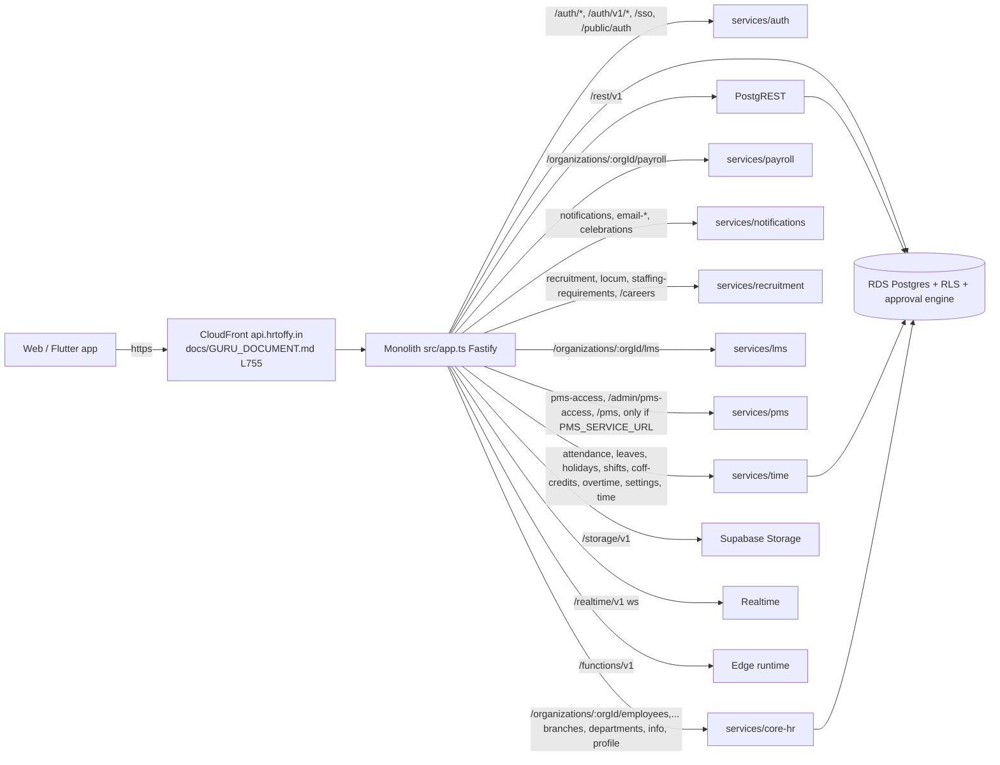
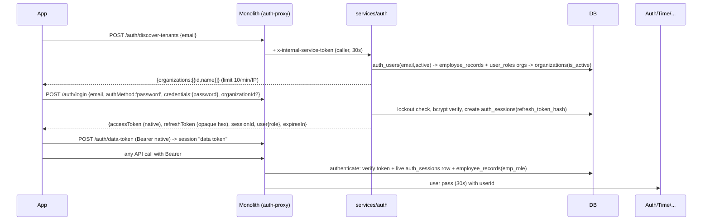
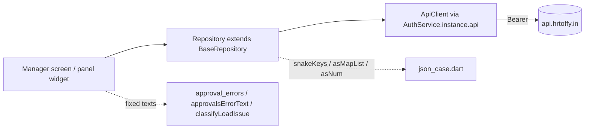

# HR Toffy: the Manager role. Login, workflows, permissions and how they connect to the backend

Prepared 16 Oct 2026. A standalone analysis. It is **not** part of, and not merged into, the Guru Document.

**Sources read (read-only):** the website `hrtoffy` and the backend `hrtoffy-backend` on branch `claude/funny-allen-dt492e` (the integration branch; the website at `origin/claude/funny-allen-dt492e`, the backend at `73d648b`), and the Flutter mobile app `hrtoffy_app_aws_test` (master at the time of writing). Nothing was run, no account was logged into, and no secret values appear in this document. Statements the code does not show are tagged **INFERRED**.

**How to read it.** Part A is the summary and the cross-cutting findings. Part B covers the website. Part C covers the backend. Part D covers the mobile app. Each part was written from its own code and cites file paths.

## Contents
- Part A: Executive summary and cross-cutting findings
- Part B: The website (frontend)
- Part C: The backend
- Part D: The mobile app

---

# Part A: Executive summary

## A.1 What "manager" means (three things that do not always agree)
1. **The role.** `emp_role = 'manager'`, assigned by HR (a database trigger also inserts `manager` or `reviewer` rows in `user_roles` from report counts, insert-only). The role holds about 30 permissions and none of `employees.view`, `compensation.*`, `*.view_all` or `attendance.view_reports`. Setting a `manager_id` on an employee does not by itself grant the role.
2. **The relationship.** The reporting tree from `employee_records.manager_id`, plus secondary managers and reviewer lines in some modules. "Team" is defined differently per module (tree depth 50 in some, 8 in others, direct reports only in PMS).
3. **The approval-engine step owner.** The database approval engine ignores the role label and decides by the chain step the person owns.
Reviewer (rank 3) outranks manager (rank 2), so every "rank at least manager" gate also admits reviewers.

## A.2 The path of one manager request, end to end
Login (`/auth/discover-tenants`, `/auth/login`, `/auth/resolve-user`) gives a token. Every call goes through CloudFront to the Fastify monolith, which re-checks the live session, then either serves the module itself or proxies to a service with a 30-second internal pass. The website additionally talks to the Supabase-compatible data API (`/rest/v1`, `/functions/v1`, `/storage/v1`, `/realtime/v1`, `/auth/v1`), where Postgres row-level security is the real enforcement. Approvals are decided in the database engine, never by writing a status.

## A.3 Most important findings (read these first)
1. **The integration branch lacks the manager routes that staging runs.** The team leave list, manager expense and benefit decisions, team attendance geo access and the manager approval counts were deployed to staging from `feat/manager-scoped-routes` and temporary deploy branches. A search of `claude/funny-allen-dt492e` finds none of them. Until they are merged, a deploy from the integration branch would take them away. (They are also why parts of the backend analysis below call some endpoints HR-only: that is true of the integration branch, not of staging.)
2. **Website and backend count differently.** The website's `get_pending_approval_counts` returns organisation-wide counts for a plain manager; the backend's own dashboard route is team-scoped on purpose. The mobile app deliberately uses the team-scoped numbers (owner decision, 16 Oct 2026), so its tile counts will not equal the website's.
3. **Requisitions, F&F and similar surfaces are decided from the browser** through a decision gateway plus a direct update, so only row-level security stops a bypass. Every other approval module decides in the database engine, which refuses direct status writes.
4. **The 9th Box and ConWisely sign-in functions never check the caller's role on the server;** the role lists exist only in the UI. A scoped-query function runs on the service key with hand-written scope fences.
5. **Approval lists can silently truncate.** `approval_row_meta` handles only the first 500 ids and the in-progress list caps at 1000, so older pending items can vanish from the inbox.
6. **Login has no second factor.** `login()` never checks MFA and the organisation-switch step-up is a stub. A revoked data token stays valid on `/rest/v1` for up to 15 minutes (INFERRED).
7. **Row-level security for the monolith is on only by configuration** (`RLS_ENFORCE_ROUTES`, `*` on staging; the production value was not verifiable). The extracted services connect with roles that bypass row-level security, so their isolation is Node code.
8. **A website bug:** a manager who is also a reviewer never sees the reviewer leave queue because `TimeModulePage` reads a field the employee object does not have. `TimeLeaveHub.tsx` (a file that looked like the Time page) is dead code; the live pages are under `src/pages/time/`.
9. **Event gap:** `leave.approved.v1` is emitted on one decision path only.

## A.4 What a manager can do, at a glance (website vs mobile)
| Area | Website | Mobile app |
|---|---|---|
| Dashboard, team (12 direct reports) | Yes | Yes |
| Approvals: leave, regularization, overtime, loans, travel, benefits (incl. ESI), expenses | Yes, counts org-wide | Yes, Pending and History lists, team-scoped counts |
| Time: attendance, leave, regularization, overtime, holidays | Yes | Yes (Time hub) |
| C-Off approvals | Yes | Tab built; needs the new backend routes deployed |
| Engage: updates, directory, tasks, tickets, letters, internal opportunities | Yes | Yes |
| Disciplinary Cases | Yes (module on) | Yes, read-only |
| Requisitions (raise, submit, cancel) | Yes (browser-side writes) | Screen built; needs the new backend routes and a database grant |
| 9th Box and ConWisely sign-in | Yes | Not built |
| How-To Guide | Yes | Not built |
| Payroll dashboard, Settings, Compliance registers | HR only | Absent (correct) |
| Ask Toffy | Yes | Hidden (owner decision) |

## A.5 Recommended next steps
1. Merge the manager-scoped routes and the new C-Off and requisition routes into the integration branch, so a deploy cannot remove what staging runs.
2. Apply the `job_requisitions` grant migration (`20261395`) on staging after a dry run, then deploy the C-Off and requisition routes through an isolated workflow.
3. Decide the server-side role check for the 9th Box and ConWisely sign-in functions and the browser-side requisition decision path.
4. Fix the 500-id and 1000-row truncation in the approval inbox.
5. Decide on MFA at login and the revocation window.

---

# Part B: The website (frontend)

## HR Toffy website: the MANAGER role, login to workflows to backend

Source: git branch `origin/claude/funny-allen-dt492e` of `hrtoffy-web` (React / Vite / TypeScript), read only via `git show`, `git grep`, `git ls-tree`. Nothing was checked out, edited or run, and no login was performed.

Conventions used in this document:
- **[READ]** means I read that code.
- **[INFERRED]** means I deduced it from code that is not itself in this branch (for example the backend `/auth/v1` shim, the approval-engine RPC bodies). Those pieces live in the separate `hrtoffy-backend` repo. `src/utils/approvalsApi.ts` header and `src/hooks/useFeaturePermission.ts` lines 908-914 refer to "backend migration 20261050 / 20261140 / 20261141 / 20261390". Those SQL files are NOT in this branch.
- Paths are relative to the repo root. Line numbers are from `git show ... | cat -n` of that branch and are approximate where marked "~".
- Secrets: the repo contains a hard-coded Supabase project URL and publishable (anon) key in `src/integrations/supabase/client.ts`, and a Google Maps browser key in `.env.production`. Values are deliberately not reproduced here.

---

## 0. Big picture (read this first)

1. There is **no role called "manager" decided by one table or one function**. "Manager" is the product of four things:
   - a row in `user_roles` (role `manager`), created by a DB trigger from `employee_records.reports_count`;
   - the `emp_role` text on `employee_records` (only as a fallback, only for `employee/manager/reviewer`);
   - the live check "does anyone have `manager_id = my employee id`" (`useReporteesAndReviewees`), which decides whether the **role switcher offers "My Team"**;
   - the client-side `userRole` string in React state and `localStorage.userRole`, which is what almost all page code branches on.
2. Almost all data access is `supabase.from()` / `supabase.rpc()` / `supabase.functions.invoke()` calls. With the `VITE_*_API=backend` flags these are redirected at startup to the HR Toffy backend (PostgREST at `/rest/v1`, GoTrue-compatible `/auth/v1`, Edge Runtime at `/functions/v1`, Storage at `/storage/v1`, Realtime at `/realtime/v1`). Row Level Security (RLS) in Postgres is the real enforcement. Only a minority of features (payroll, gratuity, letters, offers, trials, reports, biometric) use the Fastify REST API through `apiClient`. **No manager workflow uses `apiClient` for its decision**; all manager decisions go through database RPCs (`approval_decide` etc.) or direct table writes guarded by RLS.
3. Approvals mostly ride a **server-side approval engine** (RPCs `approval_initialize`, `approval_decide`, `approval_can_decide`, `approval_row_meta`) called via `src/utils/approvalsApi.ts`. A smaller set of surfaces (job requisition, F&F, increment cycle and others) use a **browser-side gateway** (`src/lib/approvals/decisionGateway.ts`, `approvalSurfaces.ts`) that checks authority in the browser and then does a direct table update guarded only by RLS.
4. `TimeLeaveHub.tsx` (named in the brief) is **dead code**. It is exported in `src/pages/unified/index.ts` but no route renders it; `App.tsx` ~line 58 says "consolidated into TimeLeaveHub" yet `/time-leave` redirects to `/time/attendance` (`App.tsx` ~823) and the live pages are `src/pages/time/AttendancePage.tsx`, `LeavePage.tsx`, `RegularizationPage.tsx`, `COffPage.tsx`, all wrapped in `TimeModulePage`.

---

## 1. Login, session and organisation switching

### 1.1 Pages and paths

| Item | File / symbol | Notes |
|---|---|---|
| Landing role picker | `src/components/auth/RoleSelectionPage.tsx` (route `/role-selection`) | Navigates to `/auth?role=<id>`; role ids include `employee`, `manager`, `reviewer`, `hr`, `hr_manager`, `hr_head`. [READ] |
| Login/sign-up page | `src/components/auth/AuthPage.tsx` (route `/auth`, `App.tsx` 403-406) | Reads `?role=`; if role is `manager` the copy says "Enter your work email to sign in to your manager account" (~630). |
| Password sign-in | `AuthPage.handleSignIn` (~150) calls `AuthContext.signIn(email, password, selectedRole\|null)` | After sign-in it navigates to `/dashboard` (`DashboardRedirector` picks the dashboard), `/toffy` if "Toffy only", `/admin/blogs` for blog admins. |
| First-time account set-up for employee/manager/reviewer | `AuthPage` email check (~320-383) -> `AuthContext.validateEmployeeEmail` (RPC `validate_employee_email`, 867-931) -> `handlePasswordSetup` (~385) -> `AuthContext.setupEmployeeAccount` (933-978) | Requires the person to already exist in `employee_records` (HR pre-registered them). Consent checkboxes (privacy/terms) and a `strongPassword` zod rule are enforced in the browser. |
| Reviewer set-up | `validateReviewerEmail` (1159) and `setupReviewerAccount` (1232) | Same RPC `validate_employee_email`. |
| Mobile OTP | `src/components/auth/PhoneOtpForm.tsx` -> edge functions `send-phone-otp`, `verify-phone-otp`; on success `supabase.auth.setSession({access_token, refresh_token})` (~96) then `navigate('/dashboard')` | Purpose `login` or `signup`. |
| Forgot password (link) | `AuthPage` (~925) `supabase.auth.resetPasswordForEmail(email, {redirectTo: <origin>/auth?role=...})` ; `src/pages/ResetPassword.tsx` (route `/reset-password`) uses `supabase.auth.updateUser` | |
| Forgot password (OTP) | `src/components/auth/ForgotPasswordOTPDialog.tsx` -> edge functions `send-password-reset-otp`, `verify-password-reset-otp` | |
| Inbound SSO from other products | `src/pages/SSOAuth.tsx` (route `/auth/sso`) -> edge function `validate-hrms-session-token`, then `supabase.auth.verifyOtp({token_hash, type:'magiclink'})`, then `localStorage.selectedOrganization = data.organization_id` | Then `window.dispatchEvent(new CustomEvent('organizationChanged'))` (see risk R12). |
| Individual (non-org) sign-up | `AuthPage` (~704) `supabase.functions.invoke('check-email-status')` | Tells the user "already registered with <org>". |
| Demo mode | `src/main.tsx` 29-37 sets `sessionStorage.demoMode`, `localStorage.userRole = 'hr_head'`, `localStorage.selectedOrganization = 'demo-org-acme'` when path starts `/live-demo`; `AuthContext.initAuth` 306-334 injects a fake HR Head session for `isDemoModeActive()` | Not a manager path; noted because it writes `userRole` / `selectedOrganization` before React mounts. |

There is **no tenant discovery by domain or subdomain** and no tenant picker before login. The "organisation" is discovered **after** authentication from the user's data (section 1.4). Sign-up for staff is email-based: the email must already exist in `employee_records` (RPC `validate_employee_email`).

### 1.2 How the browser talks to the backend (flags)

All flags are read via `import.meta.env` (build-time). The repo contains no committed values for the `*_API` flags (`.env.example` lists only Supabase vars), so the production values are [INFERRED] to be set in the Amplify build environment (`amplify.yml` just runs `npm run build`).

| Flag | Read in | Effect |
|---|---|---|
| `VITE_BACKEND_API_URL` | `src/lib/api/client.ts` (default `http://localhost:3000`), `dataApi.ts`, `authMode.ts`, `backendAuth.ts` | Base URL of the Fastify/Edge/PostgREST gateway. |
| `VITE_AUTH_API=backend` | `src/lib/auth/authMode.ts` -> `backendSessionAuth` | `supabase.auth` is **replaced** by a second GoTrue client pointed at `${BACKEND}/auth/v1` (`dataApi.installBackendAuth`, 146-173). |
| `VITE_DATA_API=backend` | `dataApi.ts` 17 | `supabase.rest` replaced with a PostgREST client at `${BACKEND}/rest/v1` using a custom `fetch` (`dataFetch`) that injects the backend bearer token and drops the `apikey` header. |
| `VITE_STORAGE_API=backend` | `dataApi.ts` 18 | `supabase.storage` -> `/storage/v1`. |
| `VITE_FUNCTIONS_API=backend` | `dataApi.ts` 19 | `installFunctionsRedirect()` (111-140) monkey-patches `globalThis.fetch`: any URL starting with the Supabase functions URL is rewritten to `${BACKEND}/functions/v1/...` with the data token. |
| `VITE_REALTIME_API=backend` + `VITE_BACKEND_ANON_KEY` | `dataApi.ts` 24-25, `installBackendRealtime` (178-197) | `supabase.realtime` replaced; channel token = backend session token. Requires `backendSessionAuth`. |

Boot order: `src/main.tsx` line 1 `import './lib/data/installDataApi'` runs `installDataApi()` before any other module, so all later `supabase.*` calls are already redirected. [READ]

`src/integrations/supabase/client.ts`: creates the default client (hard-coded fallback URL, `processLock` as the auth lock). When `VITE_AUTH_API==='backend'` it is created with `persistSession:false, autoRefreshToken:false, detectSessionInUrl:false`; the real session client is installed later by `installBackendAuth`.

### 1.3 Token handling and the `/auth/v1` shim

- Sign-in: `src/lib/auth/backendAuth.ts::signInWithPassword`. In `backendSessionAuth` mode it simply calls `supabase.auth.signInWithPassword` (which now hits `${BACKEND}/auth/v1`). [READ] The server side of `/auth/v1` (GoTrue-compatible endpoints) is [INFERRED] from `dataApi.ts` comments ("the backend's Supabase-compatible /auth/v1").
- In the legacy bridge mode (`VITE_BACKEND_API_URL` set but not `VITE_AUTH_API`): it POSTs `${BACKEND}/auth/login`, stores `{accessToken, refreshToken, sessionId, expiresAt}` in `localStorage['hrtoffy.backendAuth']`, installs the returned Supabase session, and **falls back to Supabase Auth** if the backend is unreachable, returns 5xx, or returns 401 (comment: lets in accounts the backend does not know, e.g. Comwisely/Toffy sign-ups). [READ] `backendAuth.ts` 71-133.
- Storage key for the backend session in auth-API mode: `BACKEND_AUTH_STORAGE_KEY = 'hrtoffy-auth-token'` (`authMode.ts`). The session (access + refresh token) is therefore in **`localStorage`** (via `brokeredPreviewStorage()` which returns `localStorage` except when embedded in a Lovable editor preview, where it brokers over `postMessage` to validated Lovable origins). [READ] `src/integrations/supabase/previewAuthStorage.ts`.
- Refresh: GoTrue `autoRefreshToken: true`; for the legacy path `getBackendAccessToken` refreshes via `POST /auth/refresh` when within 30 s of expiry (single in-flight promise). `apiClient.request` retries once on 401 with `forceRefresh` (`src/lib/api/client.ts` 69-74).
- `apiClient` (`src/lib/api/client.ts`): only the backend access token is sent, "no Supabase-token fallback" (comment dated 7 Oct 2026). Throws `ApiError(status, body)` for non-2xx.
- Data token: in non-session mode, `fetchDataToken` does `apiClient.post('/auth/data-token')` and caches it (60 s skew). In session mode the session token already is the data token (`getDataToken`, 63-77).
- `processLock` and timeouts: both GoTrue clients are created with `lock: processLock` to avoid cross-tab `navigator.locks`; `withAuthTimeout(promise, 4000ms)` races `getSession()/refreshSession()` against a timer because two GoTrue instances ("Multiple GoTrueClient instances" warning) can hang (comment `dataApi.ts` 31-36). On timeout the helper returns `null`, meaning the request goes out **unauthenticated (anon role)** (`dataFetch` removes `Authorization` if no token).
- Identity snapshot: `src/lib/auth/identitySource.ts` calls `GET /auth/identity` (via `apiClient`) once per 30 s and serves `highestRole`, `allRoles`, `roleOrganizations`, `employments`, `userRoles`, `ceoOrganizationIds`, `customRolesConfig`. Each accessor **falls back** to the equivalent Supabase RPC/table query (`get_user_highest_role`, `get_user_all_roles`, `get_user_role_organizations`, `employee_records`, `user_roles`, `organizations`, `organization_settings`) if the snapshot is unavailable.

### 1.4 Role and organisation resolution at login (`src/contexts/AuthContext.tsx`)

Flow (`signIn`, ~1432-1860, and `initAuth`, 301-709):

```mermaid
flowchart TD
  A[User submits email+password] --> B[backendSignInWithPassword]
  B -->|error| X[toast 'Sign-in failed']
  B --> C[clear localStorage userRole, explicitRoleSwitch, selectedOrganization, activeCustomRoleSlug]
  C --> D[get_user_highest_role + get_user_all_roles  OR  /auth/identity]
  D --> E{super_admin or blog_admin?}
  E -->|yes| F[role = that; no org]
  E -->|no| G[pick org with highest-ranked role: get_user_role_organizations]
  G --> H[else CEO org via organizations.ceo_email]
  H --> I[else current employee_records row's organization]
  I --> J[getOrgRoles(user, org): highest role in that org, else 'employee']
  J --> K[resolveCustomRoleElevation -> activeCustomRoleSlug if an active custom role assignment]
  K --> L[localStorage userRole + selectedOrganization; navigate /dashboard]
```

Details that matter for a manager:
- Role ranking `roleRank` (AuthContext 238-248): employee 1, manager 2, reviewer 3, hr_manager 4, hr 5, hr_head 6, admin/blog_admin 7, super_admin 8. "Highest" is simply max rank across `get_user_highest_role` and `get_user_all_roles` (union, 371-375).
- With a `selectedOrganization`, the active role is the highest role **in that org** from `user_roles` (`getOrgRoles`, 511-535).
- If no `user_roles` rows exist for the org, the fallback is `employee_records.emp_role` but only if it is one of `employee/manager/reviewer`; anything else becomes `employee` (537-555). Comments mark `emp_role` as "descriptive HR data, not an authorization grant".
- Stored-role honouring (562-590): a stored lower role (e.g. `employee`) is honoured on reload only for self-scoped roles (`employee`, `manager`, `reviewer`) **and** only if `localStorage.explicitRoleSwitch === '1'`.
- Inactive employment: `checkEmployeeStatus` (116-163) allows statuses `active, pre_boarding_complete, pre_boarding, probation, notice_period`; if **every** employment is inactive it calls `supabase.auth.signOut()` and toasts "Your HRMS access has been disabled"; if only the selected org is inactive it clears `selectedOrganization`/`userRole` and sets `justSwitchedOrg`.
- `ProtectedRoute` (`App.tsx` 244-361) additionally queries `employee_records.status` by **email only** (`.maybeSingle()`, no org filter) and redirects `pre_boarding` users to `/pre-boarding`. Blog admins are fenced to `/admin/blogs`; non-super-admins get `<AccessDenied>` on `/admin/*`.

### 1.5 Organisation switching

- `src/components/dashboard/SidebarOrganizationSwitcher.tsx`: lists orgs from RPC `get_user_role_organizations`. `handleOrganizationSwitch` (117-179) sets `localStorage.selectedOrganization`, `userRole` = highest role in the new org (user may downgrade later), `justSwitchedOrg='1'`, clears the active custom role, dispatches `organization-changed`, calls `switchRole`, then `window.location.href='/dashboard'` (full reload). It renders only when the user has more than one org and is not super admin. Menu visibility: `LeftRail` shows it only when `userRole === 'super_admin' || hasFeature('organization_switcher')` (plan feature).
- `HeaderRoleSwitcher.handleRoleSwitch` (212-278) also changes the org (via `resolveOrgForRole`) and dispatches `organization-changed`, then invalidates org-scoped React Query caches; `App.tsx` mounts `CacheLifecycle` (`installCacheLifecycle`) for org-switch/logout cache safety.
- Org id is read **directly from `localStorage.selectedOrganization` in dozens of hooks** (e.g. `useModuleAccess`, `useNotificationCount`, `Approvals` panels, `ExpenseApprovalPanel`). `useModuleAccess` even polls localStorage every 750 ms because "AuthContext writes `selectedOrganization` in many code paths without dispatching `organization-changed`" (`useModuleAccess.ts` 56-63). So the selected organisation is browser-controlled state; the server must independently verify membership (SSO edge functions do: "Client may PROPOSE an organization; it is never trusted").

### 1.6 Logout

`AuthContext.signOut` (1929-1945): `supabase.auth.signOut()`; **only if no error** it clears user/session/role state and `selectedOrganization`, `userRole`, `explicitRoleSwitch` from localStorage. It does **not** clear `activeCustomRoleSlug` or the `dashboard-widgets-*` / `ai-widgets-*` keys. In the legacy bridge mode a `SIGNED_OUT` listener (`backendAuth.ensureSignOutListener`) also calls `POST /auth/logout` with the bearer token (best effort). Token expiry on its own ends the session (comment "The session expires on its own").

---

## 2. How "manager" is determined

### 2.1 The values

- Built-in role strings seen across the code: `employee`, `manager`, `reviewer`, `hr`, `hr_executive` (in lists only), `hr_manager`, `hr_head`, `admin`, `super_admin`, `blog_admin`, `finance` (in some surface lists). Custom roles are separate (section 2.4).
- `manager` is a first-class role value in `user_roles.role` (enum `app_role`), in `employee_records.emp_role` (text), and as the string in `AuthContext.userRole`.

### 2.2 Server-side derivation (the `user_roles` row)

[READ] `supabase/migrations/20250813052844_baseline_squashed_schema.sql`:
- Trigger `sync_employee_roles_trigger` (~35252): `AFTER INSERT OR UPDATE OF reviews_count, reports_count, status ON employee_records ... WHEN new.status='active'` runs `sync_employee_to_user_roles()` (~27290).
- That function looks up `auth.users` by email, then sets role = `reviewer` if `reviews_count > 0`, else `manager` if `reports_count > 0`, else `employee`, and inserts into `user_roles(user_id, role, organization_id, granted_by=auth.uid())` with `ON CONFLICT ... DO UPDATE`. It never deletes. Consequences: [READ + INFERRED] (a) a person who reviews anyone is a `reviewer` (not `manager`) in `user_roles` even if they also have direct reports; (b) a former manager keeps a stale `manager` row; (c) the match is by email only.
- `reports_count` and `reviews_count` are maintained by `update_manager_reviewer_counts()` (~28857) which counts rows where `manager_id = X` (note: **not** `secondary_manager_id`) and `reviewer_id = X`.
- A legacy one-time migration function (~20575) used the same CASE for backfill.
- `get_user_highest_role` / `get_user_all_roles` RPCs (used by AuthContext) are the readers. (Their bodies are in the baseline; not dissected here.)

### 2.3 Client-side determination

1. **Active role** = `AuthContext.userRole` (state mirrored to `localStorage.userRole`), computed in `initAuth`/`signIn` as in 1.4.
2. **"Can I switch to My Team?"** = `useReporteesAndReviewees(userId, orgId)` (`src/hooks/useReporteesAndReviewees.ts`): find my `employee_records.id` (by `user_id` and org), then count rows with `manager_id = myId` (`hasReportees`) and rows with `reviewer_id = myId` (`hasReviewees`). Both `LeftRail.tsx` (lines 154, 172-192) and `HeaderRoleSwitcher.tsx` (84, 148-166) use it:
   - `super_admin` and the HR roles: `[highestRole, 'employee']` + `'manager'` if hasReportees + `'reviewer'` if hasReviewees.
   - Non-HR (manager/reviewer/employee highest): `LeftRail` offers only `[highestRole, 'employee']`; `HeaderRoleSwitcher` (the switcher that is actually rendered; LeftRail comment says "Role Switcher moved to header") **also** adds manager/reviewer when the live counts are positive. So an employee who gained reports can pick "My Team" even if `user_roles` still says `employee` [READ].
3. `AuthContext.switchRole(newRole)` (1863-1927) permits the switch if `canAccessRole(userHighestRole, newRole)` using a **hierarchy table** `getAllowedRolesForUser` (manager -> [manager, employee]; reviewer -> [reviewer, manager, employee]; hr -> [hr, reviewer, manager, employee]; hr_head/hr_manager include all lower; super_admin all). It does NOT check whether the person actually has reports. It then sets state, `localStorage.userRole`, `explicitRoleSwitch='1'`, fires `role-switched` and re-reads `is_view_only` for that role in `user_roles`. [READ]
4. `HeaderRoleSwitcher.handleRoleSwitch` writes `localStorage.userRole = newRole` **before** calling `switchRole`, so if `switchRole` refuses, localStorage and React state disagree until reload (216-273). [READ]
5. Label: the `manager` role is displayed as **"My Team"** in `LeftRail.getRoleDisplayName` (424) and `HeaderRoleSwitcher.getRoleDisplayName` (48); `SidebarOrganizationSwitcher` shows "Manager". The Time-module page and `ManagerTeamDashboard` do not show "My Team" as a menu item; `/my-team` (route `App.tsx` ~1646, `src/pages/MyTeam.tsx`, wrapped in `FeatureGate feature="my_team"`) is **not linked from any menu** [READ: `git grep "/my-team"` finds only the route].
6. **Reviewer is merged into the manager UI**: `/dashboard/reviewer` redirects to `/dashboard/manager` (`App.tsx` 586-589); `useRoleCapabilities.builtInManager` is true for both `manager` and `reviewer`; `DisciplinaryManagement`, `Overtime`, `Tickets` etc. treat `['manager','reviewer']` together. `get_manager_full_hierarchy` returns direct, secondary, indirect (to depth 10) **and** reviewer-only reportees.
7. **Server-side "is manager"** for badge counts is different again: in `get_pending_approval_counts` `_is_manager` = exists an active `employee_records` row with `manager_id = my employee id` (`supabase/migrations/20260828073802_951d48aa-....sql` 42-47). It ignores `secondary_manager_id` and `reviewer_id`.
8. **Custom roles**: `useEffectiveRoles` (RPC `get_user_custom_role_slugs` plus fallbacks to `list_custom_role_assignments`, `list_custom_roles`, `employee_records`) yields active, non-expired slugs from `organization_settings.custom_roles_config`. `useActiveRole` returns either the built-in role or exactly ONE custom slug (`localStorage.activeCustomRoleSlug`), and "access is never a union of the two". A custom role defaults to being the active context after login if any slug exists (AuthContext 616-618, 1545-1548). `DashboardRedirector` sends custom-role actives to `/dashboard/custom`. `BuiltInDashboardGuard` redirects a custom-role active away from built-in dashboards.
9. **Simulate / persona preview (super admin only)**: there is no separate "simulate" feature in the UI. The only mechanism is the role switcher's "downshift": when `userRole !== userHighestRole` the browser sends `_preview_role` to the permission RPCs (`get_my_navigation_features`, `get_my_feature_permissions`) and `p_preview_role` to the approval RPCs. Comments say the server answers "for another role's view to super admins only; any other account may only narrow to a built-in role it really holds, anything else is ignored" (`useFeaturePermission.ts` 908-914, `approvalsApi.ts` 20) [INFERRED server behaviour; the SQL is not in this branch]. Client-side counterpart: `AccessContext.isPreviewingLowerRole` in `resolveFeatureAccess.ts` closes the "real grants leak back in" hole. Note `p_preview_role` is **whatever is in `localStorage.userRole`** (`approvalsApi.previewRole`), so it is a browser-controlled value that the server is trusted to only use to narrow.

---

## 3. Navigation and gating

### 3.1 Mechanics (ordered from outer to inner)

1. `ProtectedRoute` (`App.tsx` 244): must have a session; blog-admin fence; pre-boarding redirect; `/admin/*` denial. **No role check.**
2. `ModuleAccessGuard module="hrms"` (`src/components/guards/ModuleAccessGuard.tsx`): reads `useModuleAccess` -> `useFeatureAccessMap` -> RPC `get_my_feature_access(_org_id, _include_tiers)`. Server returns `{tier, modules, org_modules, features, required_tiers, trial, trial_blocked, super_admin}`; "module flags = organisation flag AND the employee's own switch" and "a caller who is not a member of the organisation gets no answer: every module off". On error it shows a Retry card instead of "Access Not Enabled".
3. `TrialExpirationGuard` via `ProtectedRouteWithTrialGuard` (`App.tsx` 364-376).
4. Route-specific guards:
   - `RoleGuard allowedRoles featureKeys area` (`src/components/guards/RoleGuard.tsx`): the registry entry for the current path wins; otherwise the props. Decides via `resolveFeatureAccess` and renders `<AccessDenied>` (no silent redirect). Waits for `useFeatureAccess().ready`.
   - `CapabilityDomainGuard domain=attendance|leave|regularization|coff` (time pages): for built-in roles always passes; for custom roles needs grants (`useRoleCapabilities.canAccessDomain`).
   - `BuiltInDashboardGuard` (dashboards).
   - `FeatureGate feature="..."` (plan tier). Modes `blur` (default; renders children dimmed and click-blocked behind an upgrade overlay), `hide`, `dialog`. While loading it **renders children** (optimistic). Tier answers come from the server map (`useSubscriptionTier.hasFeature`: override, plan tier, "no tier = open"; a key the server does not list is open to every plan).
5. Menu: `LeftRail.filterMenuItems` -> `resolveNavAccess(path, item.roles, accessContext)` (`src/lib/access/resolveFeatureAccess.ts`). The registry (`src/lib/access/featureRegistry.ts`, entry per feature with `module`, `allowedRoles`, `grants`, `selfService`, `subscriptionFeature`, `parent`) wins over the item's legacy `roles` array.
6. Resolver rules for a **built-in persona** (resolve(), 94-106): module off -> no; plan feature off -> no; `selfService` or no `allowedRoles` -> `hasEmployeeAccess(role)` (all built-in roles); role in `allowedRoles` -> yes; if "previewing lower role" -> no; else `anyGrant` (any grant in `feature.grants` true). Unregistered paths: open to every built-in role (`resolvePathAccess`: `hasEmployeeAccess(userRole)`). `super_admin` acting as itself -> always yes (after module/plan).
7. `src/config/navigationRegistry.ts` is **not an enforcement layer**: it is a page/task catalogue (`RegistryPage.roles`, `permissions` "informational for Toffy") consumed by `ExperienceContext` and `commandResolver` and mirrored to the Toffy edge function. Do not use it to reason about access.
8. `src/lib/access/moduleDestinations.ts` decides where each rail group (Time, Payroll, Workforce, Engage, Compliance) lands for the user (first permitted path in a fixed priority list). Time: `/time/attendance`, `/time/leave`, `/time/regularization`, `/time/attendance/biometric-mapping`.

### 3.2 What a (built-in) manager sees in the left rail

`LeftRail.tsx` [READ]. Condition column uses `userRole === 'manager'` unless stated. `FEATURE` = a plan feature via `hasFeature`, `MODULE` = module flag from `get_my_feature_access`.

| Rail entry | Condition for a manager | Route | Notes |
|---|---|---|---|
| Ask Toffy | `userRole==='super_admin' \|\| hasFeature('toffy_chat')` (LeftRail 514). On the website it is shown whenever the `toffy_chat` plan flag is on. | `/toffy` | `ToffyRouteWrapper` also wraps in `FeatureGate feature="toffy_chat"`. |
| Dashboard | always (non-super-admin) | `/dashboard` -> `/dashboard/manager` | |
| Analytics | only HR roles or grant `analytics_view_all` | `/analytics` | Manager default `analytics_view_all=false` -> hidden. |
| Approvals (badge) | `canViewApprovals = ['manager','reviewer','hr','hr_manager','hr_head','admin','super_admin'].includes(userRole)`; custom role: `leave_approve OR reimbursement_approve` | `/approvals` | Visible to **every** manager even with zero reports. Badge = sum of 11 count keys. |
| Time | `timeItems`: `/time/attendance` (registry `time.attendance`, `selfService`, `module hrms`); Biometric Mapping hidden (HR_TIER only) | rail entry resolves to `/time/attendance` | Time page content then branches by capability (section 4.4). |
| Payroll group | Items that pass for manager: **Compensation & Benefits** (`/compensation-benefits`, `allowedRoles: MEMBER_PERSONAS`, plan `compensation_benefits`), **Expenses** (`/expenses`, selfService, plan `expenses_travel_desk`), **Travel** (`/travel`, selfService, plan `travel_claims`). Hidden: Payroll Dashboard, Benefits & Loans, Arrears, Reimbursements, Increments, Incentives, Fines (HR tier or grants). | rail entry "Payroll" lands per priority list: `/payroll` not permitted, so first permitted among `/expenses`, `/travel`, `/compensation-benefits` (priority order: expenses, travel, compensation) | The rail label says "Payroll" for what is for a manager only self-service pages. |
| Workforce | hidden unless `employee_view_all` grant (manager default false) | | |
| Engage | Internal Updates (`/engage/updates`), Company Directory (`roles` include manager, `grants employee_view_all`, plan `employee_directory`), Tasks & Checklists, Tickets (grant `ticket_view_all` widens scope), Letters & Documents (plan `letters_documents`), Internal Opportunities (`MODULE recruitment`), "Company Policies" (`allowedRoles ['employee']` only: **not shown to manager**) | landing `/engage/updates` | |
| Compliance (collapsed by default) | Disciplinary Cases only if `useDisciplinaryEnabled` (org flag `org_modules.disciplinary`, default on) and registry roles include manager | `/disciplinary` | |
| Extended Modules (collapsed) | **9th Box (PMS)** if `MODULE pms` and role in `[admin,hr,hr_manager,hr_head,manager,employee]` -> SSO; **ConWisely** if `MODULE comwisely` and role in `[admin,hr,hr_manager,hr_head,manager]` -> SSO; **Recruit > Requisitions** if `MODULE recruitment` and role list includes manager/reviewer | `#sso-pms`, `#sso-conwisely` (click handlers), `/recruitment/requisitions` | Reviewer does NOT get 9th Box or ConWisely. |
| Settings | always | `/settings` | Settings cards are filtered by registry `settings.*` entries (manager only reaches `settings.account`). |
| How-To Guide | always | `/ask-me-how-to` | |
| Footer | Org switcher (plan feature or super admin), Sign Out | | Role switcher is in the header (`HeaderRoleSwitcher`). |

Not in the rail for a manager: Shift Roster (`/time/shift-roster` is HR_TIER in the registry and the page itself blocks non-HR), My Team (`/my-team` has no menu entry), Company Policies, Messages (reachable via `/engage/updates` tab "messages", plan `engagement_chat_module`; `/messages` redirects to `/engage/updates/messages`).

### 3.3 Plan / module / feature gating

- Plan tier: `FeatureGate` / `useSubscriptionTier.hasFeature(key)`; examples used on manager pages: `my_team`, `manager_team_dashboard`, `reviewer_dashboard`, `attendance_team_view`, `manager_leave_dashboard`, `reviewer_leave_requests`, `leave_team_view`, `comp_off_approval_queue`, `attendance_regularization`, `comp_off_management`, `overtime_calculation`, `reviewer_leaves`, `reviewer_payroll`, `reviewer_requests`, `reviewer_approvals`, `loan_approval_panel`, `approvals_inbox`, `approval_workflow_engine`, `recruitment_ats`, `recruitment_convert_to_job`, `toffy_chat`, `organization_switcher`, `org_chart_view`, `engagement_chat_module`.
- Module toggles: `hrms`, `pms`, `recruitment`, `comwisely`, `manpower_planning`, `locum_management` (+ `disciplinary` as an org opt-out flag).
- Org feature config and per-employee switch: `get_my_feature_access` (decided on the server). The browser only renders.
- Permission keys: `FEATURE_KEYS` in `src/hooks/useFeaturePermission.ts` (the entire catalogue; ~hundreds of keys). Evaluated by RPC `get_my_feature_permissions(_org_id, _feature_keys, _active_custom_role, _preview_role, _entity_id, _branch_id)` (`fetchServerPermissions`, ~942) and for nav by `get_my_navigation_features`. Server order of precedence (comment 909-911): super admin > HR head/admin override > org's `role_feature_permissions` rows > coded default of the highest built-in role > deny. Fallback if that RPC fails: nav access falls back to a direct SELECT on `role_feature_permissions` (`useNavigationFeatureAccess` 126-131) using the **browser's** `userRole` + custom slugs.
- Manager coded defaults (seed snapshot `supabase/functions/_shared/defaultRolePermissionsSeed.ts`, rows with `role: "manager"`): **enabled**: `leave_cancel`, `document_upload`, `leave_approve`, `attendance_regularize`, `overtime_approve`, `compoff_approve`, `shift_change_approve`, `reimbursement_approve`, `requisition_create`, `candidate_shortlist`, `probation_confirm`, `separation_initiate`, `resignation_approve`, `travel_claim_approve` (all with `direct_action:false`, fallback chain `hr_manager_then_hr_head`). **Disabled** among others: `loan_approve`, `employee_view_all`, `team_compensation_view`, `payroll_view_all`, `attendance_view_all`, `ticket_view_all`, `disciplinary_initiate`, `disciplinary_view`, `analytics_view_all`, `requisition_approve`, `letter_issue`, `policy_*`. `reviewer` has **no** coded default seed ("intentionally absent"). The seed is a snapshot generated from `getCodedDefaultPermission` in `useFeaturePermission.ts` (parity-tested). `hr_toggles` (e.g. `hr_head_override_approvals` in `organization_settings.hr_toggles`) is read by the gateway (`hrHeadOverride.ts`) for HR head override, not relevant to a manager except that HR head can always override the manager's step.

---

## 4. Manager workflows page by page

Legend for "Data path": **API** = Fastify via `apiClient`; **RPC** = `supabase.rpc` on the data API (RLS/SECURITY DEFINER server functions); **TBL** = `supabase.from()` (RLS); **EDGE** = `supabase.functions.invoke` (Edge Runtime). "Engine" = server approval engine (`approvalsApi.ts`: `approval_initialize / approval_decide / approval_can_decide / approval_row_meta`). "Gateway" = browser-side `decisionGateway`.

### 4.1 Dashboard (manager dashboard)

- Route: `/dashboard/manager` (`App.tsx` 568-584): `ProtectedRoute > DashboardLayout > ModuleAccessGuard hrms > BuiltInDashboardGuard > RoleGuard ['manager','reviewer']`. `/dashboard/reviewer` redirects here.
- Page `src/pages/dashboards/ManagerDashboardPage.tsx`: `MissingProfileBanner`, `WelcomeHeader`, `ManagerTeamDashboard` (plan `manager_team_dashboard`), a `WidgetGrid` (`widget-registry.ts`; default for manager `['engagement-summary']`; widget layout persisted in `localStorage` key `dashboard-widgets-<user>-<org>-<role>`; reviewers' grid behind plan `reviewer_dashboard`), `CelebrationsWidget`, `EmployeeDetailsCard`. Nothing renders unless an `employee_records` row exists for the user (`hasEmployeeRecord`).
- `src/components/dashboard/ManagerTeamDashboard.tsx` [READ]:
  - Finds the manager by `employee_records` `.eq('email', user.email).maybeSingle()` with **no org filter** (~105-110).
  - RPC `get_manager_full_hierarchy(p_manager_id)` -> team with `relation_type` direct / secondary / indirect / reviewer and `hierarchy_level`.
  - TBL `attendance` (last 30 days) and `leave_applications` for the team's ids.
  - Embeds `TeamShiftSubmission` (4.12).
- RPC definition [READ] `supabase/migrations/20260902093342_...sql`: `SECURITY DEFINER`, allowed when caller is that manager (`get_current_employee_ids()`), HR in the org (`is_hr_role_in_org`) or service role; recursive to 10 levels; includes `secondary_manager_id` and `reviewer_id` relations; **no status filter** (exited/inactive reportees are returned).

### 4.2 Approvals (`/approvals`, `src/pages/unified/Approvals.tsx`)

- Routes: `/approvals` and `/approvals/{hr-actions, leaves, regularization, benefits, lta, loans, expenses, travel, payroll, requests, arrears, full-and-final, audit}` all render `Approvals` inside `ModuleAccessGuard hrms` (`App.tsx` 803-817). No `RoleGuard` on the route; the page itself returns "No Approvals Access" when `!canApprove`.
- `useRouteTab` makes the URL the tab state; the TabsList is hidden and `ApprovalsInbox` (plan `approvals_inbox`) renders category tiles.
- Counts: `useNotificationCount` -> RPC `get_pending_approval_counts(_org_id)` (SECURITY DEFINER; migration `20260828073802`). Refresh every 60 s, on `organization-changed`, and on any `postgres_changes` event of table `notifications` (one realtime channel per hook instance; the hook is used by `LeftRail`, `Approvals` and others).
- What a manager gets in the RPC [READ]: `_is_manager` = has active direct reports (`manager_id`). Then **org-wide** counts for leaves (`status IN ('pending','manager_approved')`), regularisation (`pending`), support requests (`pending`), benefit claims (`pending`), loans (`pending`,`manager_approved`); **manager-scoped** (`manager_id = _emp_id`) for travel and expense claims; HR-only: HR actions, payroll cycles, F&F, arrears. So the sidebar badge for a plain manager is inflated by org-wide leave/regularisation/benefit/loan/support counts versus what their own list shows (R5).
- Category visibility for a manager (`Approvals.tsx` 82-113, 115-247): HR Actions only if grant `employee_update` (manager default false); **Leave Requests** if plan `reviewer_leaves`; **Regularization** always; **Benefits Claims** always; **Loan Requests** if `hasLoanApprovalAccess` (grant `loan_approve` OR `isManager` etc., so a manager gets it by role even though the coded default `loan_approve` is false) AND plan `loan_approval_panel`; **LTA** (`canSeeLTA` includes `isManager`); **Expense Claims**, **Travel Claims** always; **General Requests** if plan `reviewer_requests`; Payroll Review only for reviewer/HR; Arrears/F&F/Audit HR only.
- Per-category implementation, scoping and decision path (all [READ]):

| Tab | Component | Scope used by the browser | Decision path | Approve/Reject gating |
|---|---|---|---|---|
| Leave | `pages/ReviewerLeaves.tsx` -> `components/leaves/ReviewerLeaveRequests.tsx` (reviewerId = my employee id) | Manager/reviewer: union of direct reports, `secondary_manager_id`, `get_manager_full_hierarchy`, `reviewer_id` reportees and reportees of reviewer-managed managers (lines ~222-264). Pending = status `pending` only; Approved includes `manager_approved`; Rejected = `rejected, reviewer_rejected`. HR roles use RPCs `get_hr_leave_queue`, `get_hr_leave_queue_counts`. | `processWorkflowAction('leaves', id, approve\|reject, comments)` = RPC `approval_decide` (~455) | server `approval_row_meta` decides `canApprove` per row |
| Leave (Time page variant) | `components/leaves/ManagerLeaveRequests.tsx` (used by `LeavePage`) | RPC `get_manager_full_hierarchy` (falls back to direct + `secondary_manager_id` via `manager_id.eq`/`employee_id.in` OR filter); queries `leave_applications` `status='pending'`; HR/custom role path uses entity/branch scoping | `processWorkflowAction('leaves', ...)` (~303) | `rowActionable`: not payroll-locked AND (no execution OR `meta.canApprove`). Browser also runs `isDateRangeInLockedPeriod` and `checkApprovalOverdraft` (`window.confirm`) before the call. |
| Regularization | `components/attendance/AttendanceRegularizationApproval.tsx` | Manager: `get_manager_full_hierarchy` then `attendance_regularization_requests` `status='pending'` `employee_id IN team`; HR/custom: org-wide `status='pending'`. History tab: org-wide `approved/rejected` limit 50 (RLS-dependent). | `useWorkflowEngine.handleApproval/handleRejection` -> `processWorkflowAction('attendance_regularization', ...)`. On final approval the DB trigger `zz_regularization_apply_attendance -> apply_regularization_to_attendance()` writes attendance (comment in the file). | `fetchWorkflowMetaForRecords` -> `approval_row_meta`; client re-checks payroll lock with `isDateInLockedPeriod`; reject needs a non-empty comment (browser-only rule). |
| Benefits claims | `components/benefits/BenefitApprovalPanel.tsx` | Manager: `benefit_claims` `.eq('manager_id', myEmployeeId)` and status in pending/approved/rejected (no hierarchy, no secondary). Reviewer: reportees of reviewer-managed managers. HR/admin: entity/branch scope. | `processWorkflowAction('benefits', claimId, ...)` | |
| Loans | `components/loans/LoanApprovalPanel.tsx` | Manager: `loans_advances` `status='pending'` + `manager_id = me`; actionable set computed by `getCurrentApprover('loans', id)` (RPC `approval_can_decide`) | `processWorkflowAction('loans', id, action, comments, {approved_amount})` | |
| LTA | `components/benefits/LTAApprovalPanel.tsx` | `lta_journey_claims` `status='pending'` then keeps only rows where `approval_row_meta` says `canApprove` | `processWorkflowAction('lta', ..., {approved_amount})` | |
| Expenses | `components/expenses/ExpenseApprovalPanel.tsx` | `expense_claims` `organization_id = localStorage.selectedOrganization`, status `pending/manager_approved`; **no manager filter in the browser** (relies on RLS to restrict a manager to their reports) | `processWorkflowAction('expenses', id, ...)` | no per-row `canApprove` check in the query; buttons shown for all rows returned |
| Travel | `components/travel/TravelApprovalPanel.tsx` | `travel_claims` with `manager_id = me` for manager; lazily calls `initializeWorkflow('travel_claims', id)` for claims lacking an execution (rows are healed in the browser when a manager opens the page) | `processWorkflowAction('travel_claims', ...)`; actionable from `getCurrentApprover` | |
| General requests | `pages/ReviewerRequests.tsx` -> `ManagerRequestsDashboard` for `userRole==='manager'` else `ReviewerRequestsDashboard` | `effectiveId = employeeId \|\| 'admin-fallback'` (a literal string used as an id when an admin has no employee record) | not read in detail | |
| Overtime (`/time/overtime`, not in `/approvals`) | `pages/Overtime.tsx` -> `components/overtime/OTApprovalPanel.tsx` | manager: `get_manager_full_hierarchy` ids, `overtime_records` `status='pending'` | `processWorkflowAction('overtime', id, ...)` | `isApprovalRole` includes manager/reviewer |
| C-Off | `components/leaves/COffApprovalQueue.tsx` + `hooks/useCOffRequests.ts` | `coff_requests` `status='pending'` `neq employee_id = me`; comment "RLS handles visibility — just fetch pending requests" | `processWorkflowAction('compensatory_off', id, ...)`; the server credits the balance in the same transaction and refuses self-approval (comment lines 85-86) | `PermissionGate`/`useCanEdit` for view-only accounts |

- Decision mechanism summary for these: all go through RPC `approval_decide(p_module, p_record, p_action, p_comments, p_decision{approved_amount, override_reason}, p_preview_role)`. The signed-in user is the approver (the browser never sends approver id/email). `approval_initialize(p_module, p_record)` starts the chain when a request is created (e.g. `useCreateManualCOff`, travel healing). Module names used by the browser: `leaves`, `attendance_regularization`, `benefits`, `loans`, `lta`, `expenses`, `travel_claims`, `overtime`, `compensatory_off`, `shift_assignments`. [READ]
- `meta.canApprove` source: `approval_row_meta` (RPC; batch) via `src/utils/workflowRowMeta.ts` (a thin wrapper that ignores its extra args now). The same rule decides the write (`approval_can_decide` is the same server function as the decision, per the file comment), so buttons and write cannot drift [INFERRED from the comment; SQL not in branch].
- Chain-free ("Direct") mode: `effectiveApprovers.ts` reads `role_feature_permissions` (`direct_action`) to say who the request is "pending with"; `MODULE_TO_FEATURE` maps module to key (`leaves->leave_approve`, `expenses->reimbursement_approve`, `loans->loan_approve`, `travel_claims->travel_claim_approve`, `overtime->overtime_approve`, `shift_assignments->shift_change_approve`, `attendance_regularization->attendance_regularize`, ...). HR-head roles are always included.
- Status vocabulary is normalised in the browser by `src/lib/approvals/approvalSourceOfTruth.ts` (`manager_approved` and `reviewer_approved` show as "Pending"; `PENDING_RAW_STATUSES`).

### 4.3 Time & Leave

Live pages (routes in `App.tsx` 1354-1427, each `ProtectedRoute > DashboardLayout > ModuleAccessGuard hrms > CapabilityDomainGuard`):

| Route | Page | Manager view | Plan gates |
|---|---|---|---|
| `/time/attendance` | `pages/time/AttendancePage.tsx` | `ManagerAttendancePanel` (team attendance via `get_manager_full_hierarchy` then TBL `attendance`, `leave_applications`) when audience = team, inside `FeatureGate attendance_team_view` | `attendance_daily_summary`, `attendance_calendar_view`, `attendance_insights` |
| `/time/leave` | `LeavePage.tsx` | `LeaveKpis` (gate `manager_leave_dashboard`), `ManagerLeaveRequests` (always), `ReviewerLeaveRequests` when `ctx.isReviewer` (gate `reviewer_leave_requests`) | |
| `/time/regularization` | `RegularizationPage.tsx` | Tabs "Request Regularization" (own) and "Pending Approvals" (`AttendanceRegularizationApproval`) when `canApprove && !isEmployee` | `attendance_regularization_request` |
| `/time/c-off` | `COffPage.tsx` | `COffApprovalQueue` + `MyCOffRequests` (gate `comp_off_approval_queue`) | `comp_off_management` registry |
| `/time/overtime` | `pages/Overtime.tsx` | approvals tab default for manager | `overtime_calculation` |
| `/time/shift-roster` | `pages/ShiftRoaster.tsx` | **Denied** (page-level check allows only admin, hr, hr_manager, hr_head, super_admin, hr_executive; route has no `RoleGuard`) | `shift_roster` |

Audience logic: `TimeModulePage` (`src/components/time/TimeModulePage.tsx`) uses `useRoleCapabilities().audienceFor(domain)`; mapping: `self -> employee`, `team -> manager`, anything else (`organization`, `scoped_workforce`) -> `hr`. In `useRoleCapabilities` for attendance and leave a built-in manager/reviewer is `team`. For **regularization and C-Off** the code returns `organization` or `scoped_workforce` for built-in `hr`/`manager`/`reviewer` ("operational"), so a plain manager on those two pages gets `audience = "hr"`, `isHR = true` in `TimeModulePage`. Effect: filters/KPIs on those pages are built with the HR audience (R7). `canApprove` is `canApproveRegularization` / `canApproveLeave` (true for builtInHR or builtInManager, or the grant).

Reviewer section: `ctx.isReviewer = (employee as any)?.reviewsCount > 0 || userRole === "reviewer"`. `CurrentEmployee` (`hooks/useCurrentEmployee.tsx`) has no `reviewsCount` field, so `isReviewer` is true only when the active role is literally `reviewer` (R6). The older `TimeLeaveHub` did read `reviews_count` from `employee_records`.

Dead `TimeLeaveHub.tsx` also includes the manager-specific "Review team requests" button to `/approvals/leaves` and shows `isManager` as `userRole === 'manager'` only (reviewer would fall to employee view): irrelevant since it is not routed.

Data path for all of the above: TBL/RPC (leave_applications, attendance, attendance_regularization_requests, coff_requests, overtime_records, workflow_executions) + Engine for decisions. Payroll lock: browser helpers `isDateRangeInLockedPeriod` / `isDateInLockedPeriod` (rule in the browser; server enforcement [INFERRED] by triggers/engine but not verified).

### 4.4 Compensation & Benefits, Loans, Expenses, Travel (as a manager)

- `/compensation-benefits` (`pages/CompensationBenefits.tsx`): manager sees the **self-service** view (own benefits/loans). `resolveBenefitsLoansView(userRole, grants)` decides "management view"; `canSelfSubmit = !isManagementView || super_admin`. Manager has no `loan_*` default grants, `team_compensation_view` false by default. `TEAM_COMPENSATION_VIEW` is referenced only in the permission catalogue and `roleCapabilityManifest`, not by any page (grep): no team-salary view exists for managers in this branch.
- `/expenses` (`pages/Expenses.tsx`): `isApproverWithReviewer` includes manager/reviewer -> "approve team expenses" section shows `ExpenseApprovalPanel`; `hasExpenseApprovalAccess = isApproverWithReviewer || grant reimbursement_approve`; `canViewAllExpenses` via `resolveExpensesAllClaimsAccess` (HR or grant).
- `/travel` (`pages/Travel.tsx`): management view for HR roles; manager uses own claims; approvals via `/approvals/travel`.
- Loans: the approval tab (4.2). Loan creation by the employee on `/compensation-benefits`.

### 4.5 Engage items

- Internal Updates / announcements / events / recognition / surveys / FAQs / Messages: `pages/EngagementCommunication.tsx` with tabs gated by `useSubscriptionTier` (`engagement_chat_module` for messages) and `resolveEngagementAccess` (`survey_*`, `recognition_award` grants or HR roles). FAQs tab shown to manager (`showFAQs` includes manager).
- Messages: `useChatChannels`, `useChatMessages`, `useChatUnreadCount` (TBL on chat tables + realtime channels; `createDM`, `createGroupChannel`).
- Tasks & Checklists (`pages/TasksChecklists.tsx`): `isHROrManager = ['hr_head','hr_manager','hr','manager'].includes(userRole)` - note `reviewer` and `admin` are absent from this list (R9) -> manager gets the management view.
- Tickets (`pages/Tickets.tsx`): `resolveTicketsAccess(userRole, {ticket_view_all, ticket_assign, ticket_close})`; manager default is "mine" tab (no `ticket_view_all` default).
- Company Directory (`pages/CompanyDirectory.tsx`): `EmployeeDirectoryGrid` plus `InteractiveOrgChart` (plan `org_chart_view`), the latter TBL `employee_records` `select id, full_name, designation, department, avatar_url, manager_id` for active statuses and builds the tree client-side. This is the closest thing to an org chart for a manager.

### 4.6 Disciplinary Cases (`/disciplinary`)

- Route has only `ModuleAccessGuard hrms` (no `RoleGuard`); rail visibility = registry roles (`manager`, `reviewer` included) + org flag.
- `pages/DisciplinaryManagement.tsx`: `isHR = resolveDisciplinaryHrView(role, {disciplinary_initiate, disciplinary_close, disciplinary_view})`; `isManager = ['manager','reviewer'].includes(role)` -> Tabs "Team cases" (`DisciplinaryDashboard viewerRole="manager" managerEmployeeId`) and "My records" (`EmployeeDisciplinaryView`).
- Data (all TBL; no RPC): `disciplinary_cases` select with `.eq('org_id', organizationId)` (the browser does **not** add a team filter; it relies on RLS policy "Manager can view team cases" = `is_manager_of_employee(employee_id)`); create via `IssueCaseDialog` (employee picker `employee_records.eq('manager_id', managerEmployeeId)` and `.eq("employment_status","active")`), status = `draft` or `pending_hr_approval` for manager (`issued` for HR) then `INSERT` into `disciplinary_cases` (browser sets `status`, `drafted_by_role`, `created_by`).
- RLS [READ] (baseline schema ~36590-36600): "Manager can draft team cases" INSERT `WITH CHECK is_manager_of_employee(employee_id) AND status IN ('draft','pending_hr_approval')`; "Manager can update own draft" UPDATE `USING is_manager_of_employee(...) AND status IN (draft, pending_hr_approval) AND created_by = auth.uid()`; "Employee view own issued cases" hides draft/pending/withdrawn from the employee. HR full access by `is_hr_role_in_org(org_id)`. So the **server** stops a manager from inserting `issued` directly, even though the browser picks the status.
- Approval of manager drafts: HR only, `CaseDetailsDrawer.approveAndIssue` -> direct `UPDATE disciplinary_cases SET status='issued', issued_at, issued_by` (browser-driven state machine; no engine, no `approval_decide`).

### 4.7 Requisitions (`/recruitment/requisitions`, `pages/JobRequisitions.tsx`)

- Route: `ModuleAccessGuard recruitment > RoleGuard [super_admin, admin, hr, hr_manager, hr_head, hr_executive, manager, reviewer] > DashboardLayout > FeatureGate recruitment_ats` (`App.tsx` 1429-1440). Rail: Recruit group only when `MODULE recruitment`.
- Browser rights: `resolveRequisitionsAccess(userRole, grants)` (`lib/access/roleGateResolvers.ts` 156): `canCreate = legacy HR roles OR requisition_create`, `canApprove = legacy HR OR requisition_approve`, `canConvert = legacy HR OR requisition_edit/approve`. Legacy roles `REQUISITIONS_LEGACY_ROLES = [hr, hr_manager, hr_head, hr_executive, admin]`. Manager default: `requisition_create=true`, `requisition_approve=false`, `requisition_edit=false`.
- Data: TBL `job_requisitions` (list with joins to requester/approver/reporting manager; insert via `useJobRequisitions.createMutation` after RPC `generate_requisition_number`; update status to `pending_approval` etc.).
- Approve/reject: `decideOnSurface({surface:'job_requisition', ...})` (Gateway) then direct `UPDATE job_requisitions SET status='approved', approved_by, approved_at`. **`APPROVAL_SURFACE_ROLES.job_requisition` lists `manager`** (`approvalSurfaces.ts` 34) so the Gateway would accept a manager, while the page's `canApprove` excludes them by default; RLS on `job_requisitions` (UPDATE for HR and for the requester's own draft; "Managers can view department requisitions" SELECT) is what actually stops a manager approving.

### 4.8 Extended modules: 9th Box SSO and ConWisely

- Rail click -> `src/utils/extendedModuleSSO.ts::openSSO` -> `supabase.functions.invoke('generate-pms-session-token' | 'generate-comwisely-session-token', {organization_id: candidate})` -> opens `data.redirect_url` in a new tab.
- Server (`supabase/functions/generate-*-session-token/index.ts`) [READ]: validates the JWT in code (`verify_jwt` false), resolves the **canonical actor** (`resolveSessionTokenActor`: verified org + employee id; the client's org is only a hint), `orgGateOk(module)`, checks `pms_access_control` (org or employee level) or `module_access_control.comwisely_enabled`, inserts a 5-minute token into `pms_session_tokens` / `comwisely_session_tokens` and returns the redirect URL (`PMS_APP_URL` default `https://9thbox.ai`, `COMWISELY_APP_URL` default `https://conwisely.ai` from env). **Neither function checks the caller's role** (roles are only logged): the manager-only/HR-only list is a UI convention (R8).

### 4.9 How-To Guide (`/ask-me-how-to`, `pages/AskMeHowTo.tsx`)

- Route: only `ProtectedRoute` + `DashboardLayout` (no module/role guard). Data: TBL `feature_guides` (`is_active=true`) read-only; search is a client-side scorer. Same for every role.

### 4.10 Ask Toffy (`/toffy`, `pages/ToffyRouteWrapper.tsx`, `ToffyAgentPage.tsx`)

- HRMS users: `DashboardLayout > FeatureGate toffy_chat > ToffyAgentPage`. Anonymous or non-HRMS users see the standalone page ("universal mode").
- Chat: browser `fetch(getToffyFunctionUrl('toffy-chat'))` streaming SSE with `Authorization: Bearer <supabase.auth session token>` (or the publishable key if no session) and body `{messages, orgContext, sessionId, experienceContext, commandHandoff}`. Server-side tools run in edge functions (`toffy-chat`, `toffy-org-query`). `toffy-org-query/index.ts` creates its client with the service-role key (line ~98) and enforces scope manually (`fenceEmployeeQuery`, `callerCanReadIntent`). A repo plan document (`.lovable/plan/fix-ask-toffy-leaks-org-wide-workforce-data-to-reviewers-man-2026-08-24.md`) records that managers/reviewers once received org-wide headcount, active-employee lists, DOB/DOJ and probation lists because `callerCanReadIntent` returned true for manager/reviewer and only 4 of ~25 intents were fenced (R10). Several other Toffy workspaces (`CandidateComparisonWorkspace`, `ResumeScreeningWorkspace`, ...) build `CHAT_URL` from `${import.meta.env.VITE_SUPABASE_URL}/functions/v1/toffy-chat` (HR/recruitment tools).
- The `toffy-action-completed` window event refreshes leave queues after Toffy approves leaves (listener in `ReviewerLeaveRequests`).

### 4.11 Tasks, Tickets, Chat/Messages

Covered in 4.5. Data is TBL with RLS (+ realtime channels); no engine involvement.

### 4.12 Shifts (manager)

- **Submission**: `components/attendance/TeamShiftSubmission.tsx`, embedded only in the manager dashboard (`ManagerTeamDashboard` ~623). It reads `shift_timings` (TBL), RPC `get_shift_submission_mode(p_org)`, RPC `list_team_shift_assignments(p_org,p_from,p_to)`, and submits via RPC `submit_team_shift_assignments(p_org,p_shift_id,p_employee_ids,p_dates,p_shift_type,p_is_on_call)` (`lib/attendance/shiftSubmit.ts`). Server returns `{inserted, applied, sent_for_approval, already_assigned, not_in_your_team[], failed[], chain[]}`; "the browser never writes approval_status itself"; only the org's `manager_mode = direct` setting applies immediately. Withdraw: RPC `withdraw_team_shift_assignment(p_id)` while pending.
- **Approval**: `ShiftApprovalsBoard` (RPC `list_shift_approvals(p_org,p_status)`; decisions through `lib/approvals/shiftDecision.ts::decideShiftAssignments` which loops `processWorkflowAction('shift_assignments', id, ...)` once per id, sequentially, non-atomic). The board is mounted only from `ShiftRoaster.tsx` (HR tiers; the `hr_executive` branch renders only the board), `ShiftApprovalPanel` and `EntityShiftApprovalPanel` (HR panels). **There is no manager surface in this branch to decide shift approvals**, although `ROLE_LABEL` in the board and `TeamShiftSubmission.roleName` include "Reporting manager" as a chain step and `shift_change_approve` is enabled for manager by default (R11).
- `/time/shift-roster` route has no `RoleGuard`; the registry has `time.shiftRoster allowedRoles HR_TIER`, but the access check on that page is hard-coded (ShiftRoaster.tsx ~518-532).

### 4.13 My Team / org chart

- `ManagerTeamDashboard` is "My Team" in practice (team list by relation type, 30-day attendance and leaves). `/my-team` exists but is un-linked (plan `my_team`).
- Org chart: `InteractiveOrgChart` (Company Directory, plan `org_chart_view`) and `OrgChartWidget` (HR roles only in widget registry).

### 4.14 Notifications and realtime used by the manager

`useNotificationCount` (counts), `useUnreadNotificationRoutes` (per-route unread badges), realtime channel on `notifications`; `useLeaveRealtime` on leave tables; chat channels. All through the redirected supabase client (`/realtime/v1` when flagged).

---

## 5. Where business rules live and what a manager can bypass

### 5.1 Server-enforced (cannot be bypassed from the browser, by evidence)

- Approval decision rights, chain position, tier by amount, self-approval ban, HR head override, row status change, comp-off credit and notifications: RPC `approval_decide` (comment in `approvalsApi.ts`/`useCOffRequests.ts`) [INFERRED from comments; SQL not in this branch].
- Shift submission status and approver chain: RPC `submit_team_shift_assignments` (browser "never writes approval_status itself").
- Attendance change on regularisation approval: DB trigger `zz_regularization_apply_attendance` (comment in `AttendanceRegularizationApproval.tsx`).
- Disciplinary manager insert/update limited to draft or pending_hr_approval by RLS [READ].
- Module/plan/feature access, trial block: `get_my_feature_access` (used by UI and "the same rules the row-level gates and the Node API enforce", `useFeatureAccessMap.ts` 25-28).
- Permission matrix: `get_my_feature_permissions` and `effective_feature_permission` (comment).
- Hierarchy visibility: `get_manager_full_hierarchy` checks caller identity (SECURITY DEFINER).
- SSO token issuance: org/employee membership re-verified server side.
- `user_roles` INSERT is restricted to super admins by baseline RLS ("Super admins can insert roles") [READ], so the client `upsert` into `user_roles` in `AuthContext.initAuth` (~422-433) cannot create a manager row for itself.

### 5.2 Browser-only rules (a determined manager with devtools can bypass or the server must backstop)

- Payroll-lock checks before leave/regularisation decisions (`isDateRangeInLockedPeriod`, `isDateInLockedPeriod`) are browser calls; the engine may or may not repeat them.
- Leave overdraft warning: `window.confirm` in `ManagerLeaveRequests` (~287-299).
- "Reject requires a comment" in regularisation (`AttendanceRegularizationApproval` ~329-332).
- Row actionability (`rowActionable`) and approve/reject button visibility are UX; the engine re-decides.
- `decisionGateway` (`evaluateDecisionAuthority`, `runGuardedDecision`) for requisitions, F&F, increment cycles, incentive payouts, extra-day-worked, on-call, shift handover, roster templates/bulk assignment, offer letter, maternity benefit and employee submissions: authority resolved in the browser then a **direct table write**. Real enforcement is whatever RLS those tables have. The audit row in `workflow_executions` (`recordDecisionAudit`) is also written by the browser and is "never throws" (a manager who skips the gateway also skips the audit row).
- All menu, `RoleGuard`, `FeatureGate` and `ModuleAccessGuard` decisions are cosmetic against the API: direct `supabase.from()` calls with the user's token are what RLS sees.
- `FeatureGate` default `blur` mode **mounts** the gated component (just dimmed and click-blocked), so data fetches inside still run (`FeatureGate.tsx` 72-100). Also optimistic while loading.
- `localStorage` values that drive UI branches: `userRole`, `selectedOrganization`, `explicitRoleSwitch`, `activeCustomRoleSlug`, widget layouts. Changing them in devtools changes which UI renders and which org id the browser asks for; only server checks protect data. `p_preview_role` and `_active_custom_role` are sent from these values; the server is documented to accept only narrowing/held roles [INFERRED].
- `AuthContext.signIn` fallbacks that choose a role from `emp_role` (self-service roles only) are display-level.

### 5.3 Known gaps and risks (specific)

| # | Risk | Evidence |
|---|---|---|
| R1 | Manager role is derived by trigger from `reports_count`/`reviews_count` using only `manager_id`/`reviewer_id`, insert-only, matched by email. Stale `manager` rows persist after reports leave. Reviewer outranks manager (a person with both gets only `reviewer`). | baseline `sync_employee_to_user_roles` ~27290-27322, `update_manager_reviewer_counts` ~28857+ |
| R2 | Three different notions of "manager": `user_roles` row (AuthContext), live `hasReportees` (switcher), RPC `_is_manager` (badge, direct reports only). A secondary manager (dotted-line) or reviewer-only person can have queue items and `get_manager_full_hierarchy` rows but no `manager` role switch or no badge. | `useReporteesAndReviewees.ts`; `get_pending_approval_counts` 42-47; hierarchy RPC |
| R3 | `AuthContext.switchRole` authorises with a static hierarchy on `userHighestRole`, not with the person's real assignments; `HeaderRoleSwitcher` writes `localStorage.userRole` before the authority check. Any HR user can set `userRole='manager'` via console; effect is limited to UI + preview narrowing. | AuthContext 1863-1901; HeaderRoleSwitcher 227 |
| R4 | `emp_role='manager'` can be written by the client after sign-up: `setupEmployeeAccount` `update employee_records set emp_role='manager' where email = <email>` (no org filter) when the user chose the manager role (AuthContext 956-968). Guarded in the browser by `canAccessRole(result.emp_role, role)` using `validate_employee_email`, but the UPDATE itself depends on RLS (`protect_employee_self_update...` migration exists but not analysed). | AuthContext 933-978 |
| R5 | Approval badge for a plain manager counts org-wide pending leaves, regularisations, support requests, benefit claims and loans (RPC), while lists are scoped (benefits by `manager_id` only; leave by hierarchy). The `ReviewerLeaveRequests` comment claims they match. The LeftRail also sums keys not returned by the RPC (`approvals-lta` is never emitted). | `20260828073802_*.sql` 53-75; `LeftRail.tsx` 233-244 |
| R6 | `TimeModulePage` reads `(employee as any)?.reviewsCount` but `CurrentEmployee` has no such field; dual-role manager+reviewer users never get the reviewer queue on `/time/leave` unless their active role is `reviewer`. The older hub read `reviews_count`. | `TimeModulePage.tsx` 78; `useCurrentEmployee.tsx` 11-29, 42-61; `TimeLeaveHub.tsx` 132-146 |
| R7 | For Regularization and C-Off pages a built-in manager is mapped to audience `hr` (`audienceFor` returns `organization`/`scoped_workforce`, mapped to "hr" in `TimeModulePage`), so KPIs and filters use the HR audience (data is still RLS-bounded; UI mislabels). Needs runtime check (depends on `user_scope_for` for a manager). | `useRoleCapabilities.ts` 46-53; `TimeModulePage.tsx` 54-58 |
| R8 | ConWisely / PMS SSO edge functions do not verify role; the "privileged persona list" exists only in the UI (`featureRegistry` note: "no permission equivalent"). Any employee in an org with the module enabled can request a token directly. | `generate-*-session-token/index.ts` (roles only logged) |
| R9 | Hard-coded role lists scattered in pages bypass the single resolver: `TasksChecklists` (`hr_head, hr_manager, hr, manager`, no `reviewer`/`admin`), `Overtime.isApprovalRole`, `Approvals` flags (`isManager = userRole==='manager'`, so reviewer differs), `ShiftRoaster` allow-list, `DashboardRedirector` map, `Expenses.isApproverWithReviewer`. Drift between these produce "visible but denied" or the reverse. | files cited |
| R10 | Toffy `toffy-org-query` runs on the service-role key with hand-written scope fences; a prior review found 7 unfenced intents leaking org-wide data to managers/reviewers. Current code has `fenceEmployeeQuery` in several handlers, but any new intent that forgets it leaks. | `supabase/functions/toffy-org-query/index.ts` ~98, 351, 1373-1383, 1811; plan doc |
| R11 | Manager appears as a step approver for shifts (`ROLE_LABEL`, chain text, `shift_change_approve` default true) but no manager UI decides `shift_assignments`; the board lives only in HR pages. Also sequential per-id `approval_decide` loop (not atomic; partial success possible, reported as `skipped`). | `ShiftApprovalsBoard.tsx` 40; `ShiftRoaster.tsx` 518-540; `shiftDecision.ts` 22-51 |
| R12 | `SSOAuth` dispatches `organizationChanged` (camel case) but listeners use `organization-changed`; org context after SSO may not propagate until reload. | `SSOAuth.tsx` ~77 vs `LeftRail.tsx` 201 |
| R13 | Multi-org / duplicate-email brittleness: several manager screens look up the employee by email without an org filter (`ManagerTeamDashboard` `.maybeSingle()`, `ManagerAttendancePanel` `.limit(1)`, `ProtectedRoute` `.maybeSingle()`). A manager employed in two orgs (or rejoined) gets an error or the wrong org's id. `TimeLeaveHub`/regularisation use the selected-org hint but still by email. | `ManagerTeamDashboard.tsx` 105-110; `ManagerAttendancePanel.tsx` 80-85; `App.tsx` 267-272 |
| R14 | Disciplinary: browser sets `created_by = currentEmployee.id` (employee id) while RLS "Manager can update own draft" compares `created_by = auth.uid()` (user id); a manager can create but probably cannot later edit their own draft. [INFERRED from the two sources; not run.] Also IssueCaseDialog filters `employment_status='active'` while other screens use `status`; the two columns can disagree. | `IssueCaseDialog.tsx` 79-86,150; baseline policy ~36598 |
| R15 | `ExpenseApprovalPanel` shows every `pending/manager_approved` expense in the org that RLS returns, with no per-row `approval_row_meta` check; a manager may see Approve buttons on rows the engine will refuse. | `ExpenseApprovalPanel.tsx` 36-45 |
| R16 | Token storage in `localStorage` (`hrtoffy-auth-token`, optionally `hrtoffy.backendAuth`) is readable by any XSS; no httpOnly cookie path. `withAuthTimeout` returning null silently sends requests as anon, which can look like "empty data" instead of an auth error. | `authMode.ts`; `dataApi.ts` 37-47, 79-92 |
| R17 | `AuthContext.initAuth` attempts `upsert` into `user_roles` from the browser for an employee without roles (422-433). Baseline RLS blocks non-super-admin inserts; the failure is only logged, so such users get employee defaults silently. | AuthContext 411-433; policy line 39282 |
| R18 | Signout only clears org/role keys on success; `activeCustomRoleSlug` and per-user widget keys survive logout on shared machines. | AuthContext 1929-1945 |
| R19 | Duplicate realtime/timer load: `useNotificationCount` is mounted by several components, each creating its own `notifications` channel and 60 s poll. | `useNotificationCount.tsx` 88-125 |
| R20 | `TimeLeaveHub.tsx` (and `pages/unified/*`) dead code still ships; its older role logic (e.g. `isManager = role==='manager'` only) disagrees with the live pages. | `pages/unified/index.ts` |

---

## 6. Manager capability matrix

(Default built-in `manager`; "grant" means a Roles & Permissions key; default state from the coded-default seed.)

| Capability | Where in UI | Data path | Permission / gate | Notes |
|---|---|---|---|---|
| Sign in with password | `/auth?role=manager` | `supabase.auth.signInWithPassword` -> `/auth/v1` (backend) or Supabase | none | Account must pre-exist in `employee_records`; first-time password set-up via `validate_employee_email` + `signUp` |
| Sign in with mobile OTP | `/auth` (PhoneOtpForm) | EDGE `send-phone-otp`, `verify-phone-otp`, then `setSession` | none | |
| Land on manager dashboard | `/dashboard` -> `/dashboard/manager` | RPC `get_manager_full_hierarchy`; TBL `attendance`, `leave_applications` | `RoleGuard [manager, reviewer]`, plan `manager_team_dashboard`, needs `employee_records` row | Reviewer shares this page |
| Switch to My Team / Employee / Reviewer | Header role switcher | TBL `employee_records` counts (`manager_id`, `reviewer_id`); `switchRole` local | `hasReportees` / `hasReviewees`; hierarchy in `AuthContext.canAccessRole` | UI-only; label "My Team" |
| Switch organisation | Sidebar org switcher | RPC `get_user_role_organizations`; localStorage | plan `organization_switcher`; >1 org | Full page reload to `/dashboard` |
| See team list, relation type, 30-day attendance/leave | Manager dashboard | RPC hierarchy + TBL | as above | Includes secondary, indirect (10 levels), reviewer-only reportees; no status filter |
| Approve/reject team leave | `/approvals/leaves`, `/time/leave` | Engine `approval_decide('leaves')` | role manager; plan `reviewer_leaves`; server `canApprove` | Scope = hierarchy (+ secondary, reviewer reports) |
| Approve/reject regularisation | `/approvals/regularization`, `/time/regularization` | Engine `attendance_regularization`; DB trigger writes attendance | manager role (`attendance_regularize` default on); plan `attendance_regularization` | Payroll-lock check in browser |
| Approve/reject C-Off | `/time/c-off` | TBL `coff_requests` list; Engine `compensatory_off` | `compoff_approve` default on; plan `comp_off_management`, `comp_off_approval_queue` | Self-approval refused server side |
| Approve overtime | `/time/overtime` | TBL `overtime_records`; Engine `overtime` | `overtime_approve` default on; plan `overtime_calculation` | |
| Approve benefit claims | `/approvals/benefits` | TBL `benefit_claims` (`manager_id=me`); Engine `benefits` | role manager | Direct reports only |
| Approve loans | `/approvals/loans` | TBL `loans_advances`; Engine `loans` with `approved_amount` | `isManager` role OR `loan_approve` (default false); plan `loan_approval_panel` | Page rule differs from default grant |
| Approve LTA | `/approvals/lta` | TBL `lta_journey_claims`; Engine `lta` | `canSeeLTA` (manager) | Rows filtered by `approval_row_meta` |
| Approve expenses | `/approvals/expenses`, `/expenses` | TBL `expense_claims`; Engine `expenses` | `reimbursement_approve` default on | No browser team filter |
| Approve travel claims | `/approvals/travel`, `/travel` | TBL `travel_claims` (`manager_id=me`); Engine `travel_claims` | `travel_claim_approve` default on | Browser calls `initializeWorkflow` for orphans |
| Handle general support requests | `/approvals/requests` | TBL via `ManagerRequestsDashboard` | plan `reviewer_requests` | Not read in depth |
| View pending-approvals badge | Rail "Approvals" | RPC `get_pending_approval_counts` | `canViewApprovals` role | Org-wide for several keys (R5) |
| Submit team shifts / withdraw | Manager dashboard (TeamShiftSubmission) | RPCs `submit_team_shift_assignments`, `list_team_shift_assignments`, `withdraw_team_shift_assignment`, `get_shift_submission_mode` | server verifies team membership | Mode direct vs approval is an org setting |
| Decide shift approvals | (no manager UI) | Engine `shift_assignments` via HR board | `shift_change_approve` default on | Gap R11 |
| Draft disciplinary case for a report | `/disciplinary` Team cases > Draft case | TBL insert `disciplinary_cases` | RLS `is_manager_of_employee` + status draft/pending_hr_approval; org flag | HR approves/issues; see R14 |
| View own disciplinary records | `/disciplinary` My records | TBL `disciplinary_cases` (employee policy) | | |
| Raise a requisition | `/recruitment/requisitions` | TBL `job_requisitions` + RPC `generate_requisition_number` | `requisition_create` default on; `MODULE recruitment`; plan `recruitment_ats` | Cannot approve/convert by default |
| Approve a requisition | same | Gateway `decideOnSurface('job_requisition')` + direct UPDATE | `requisition_approve` (default off) | Gateway role list includes manager; RLS decides |
| Open 9th Box (PMS) | Rail Extended Modules | EDGE `generate-pms-session-token` | `MODULE pms`, `pms_access_control`; UI role list | Server does not check role |
| Open ConWisely | Rail Extended Modules | EDGE `generate-comwisely-session-token` | `MODULE comwisely`; UI role list | Server does not check role (R8) |
| How-To Guide | `/ask-me-how-to` | TBL `feature_guides` | none | |
| Ask Toffy | `/toffy` | EDGE `toffy-chat`, `toffy-org-query` (service role) | plan `toffy_chat` | Scope fences are in server code (R10) |
| Tasks & checklists | `/engage/tasks-checklists` | TBL | `isHROrManager` includes manager; plan `tasks_checklists` | |
| Tickets | `/engage/tickets` | TBL | plan `hr_helpdesk`; `ticket_view_all` for org-wide (default off) | Manager sees "mine" |
| Messages / announcements | `/engage/updates` | TBL chat tables + realtime | plan `engagement_chat_module` | |
| Company Directory / org chart | `/engage/company-directory` | TBL `employee_records` | registry roles incl. manager; plan `employee_directory`, `org_chart_view` | |
| Compensation & Benefits (own) | `/compensation-benefits` | TBL, some `apiClient` payroll reads | registry `MEMBER_PERSONAS`; plan `compensation_benefits` | No team compensation view page exists |
| Team compensation | none | | `team_compensation_view` default off | Key defined, no consumer found |
| Workforce / Analytics / Payroll / Settings (admin) | hidden | | HR tiers or grants | |
| Log out | Rail footer | `supabase.auth.signOut` (+ `/auth/logout` in bridge mode) | | Custom role key not cleared (R18) |

---

## 7. Appendix: key file index (branch `origin/claude/funny-allen-dt492e`)

Login and session: `src/main.tsx`, `src/integrations/supabase/client.ts`, `src/integrations/supabase/previewAuthStorage.ts`, `src/lib/data/dataApi.ts`, `src/lib/data/installDataApi.ts`, `src/lib/auth/authMode.ts`, `src/lib/auth/backendAuth.ts`, `src/lib/auth/identitySource.ts`, `src/lib/api/client.ts`, `src/contexts/AuthContext.tsx`, `src/components/auth/AuthPage.tsx`, `PhoneOtpForm.tsx`, `ForgotPasswordOTPDialog.tsx`, `RoleSelectionPage.tsx`, `src/pages/SSOAuth.tsx`, `src/pages/ResetPassword.tsx`, `src/components/dashboard/SidebarOrganizationSwitcher.tsx`.

Role resolution and gating: `src/hooks/useReporteesAndReviewees.ts`, `src/hooks/useActiveRole.ts`, `src/hooks/useEffectiveRoles.ts`, `src/hooks/useFeatureAccess.ts`, `useFeatureAccessMap.ts`, `useNavigationFeatureAccess.ts`, `useFeaturePermission.ts`, `useModuleAccess.ts`, `useSubscriptionTier.ts`, `useRoleCapabilities.ts`, `useUserScope.ts`, `src/lib/access/{featureRegistry,resolveFeatureAccess,moduleDestinations,roleGateResolvers}.ts`, `src/config/navigationRegistry.ts`, `src/components/layout/{LeftRail,HeaderRoleSwitcher}.tsx`, `src/components/guards/{RoleGuard,ModuleAccessGuard,CapabilityDomainGuard,BuiltInDashboardGuard}.tsx`, `src/components/subscription/FeatureGate.tsx`, `src/components/dashboard/DashboardRedirector.tsx`, `src/App.tsx`, `supabase/functions/_shared/defaultRolePermissionsSeed.ts`.

Approvals and workflows: `src/utils/approvalsApi.ts`, `src/utils/workflowRowMeta.ts`, `src/hooks/useWorkflowEngine.tsx`, `src/lib/approvals/{decisionGateway,approvalSurfaces,approvalSourceOfTruth,effectiveApprovers,shiftDecision}.ts`, `src/pages/unified/Approvals.tsx`, `src/components/leaves/{ManagerLeaveRequests,ReviewerLeaveRequests,COffApprovalQueue}.tsx`, `src/hooks/useCOffRequests.ts`, `src/components/attendance/{AttendanceRegularizationApproval,ManagerAttendancePanel,TeamShiftSubmission,ShiftApprovalsBoard}.tsx`, `src/components/{benefits,loans,travel,expenses,overtime}/*ApprovalPanel.tsx`, `src/hooks/useNotificationCount.tsx`, `src/pages/time/*.tsx`, `src/components/time/TimeModulePage.tsx`, `src/pages/{Overtime,JobRequisitions,DisciplinaryManagement,Tickets,TasksChecklists,AskMeHowTo,MyTeam}.tsx`, `src/components/disciplinary/*`, `src/hooks/useJobRequisitions.ts`, `src/utils/extendedModuleSSO.ts`, `supabase/functions/generate-{pms,comwisely}-session-token/index.ts`, `supabase/functions/toffy-org-query/index.ts`.

DB objects read in `supabase/migrations/`: `20250813052844_baseline_squashed_schema.sql` (`sync_employee_to_user_roles`, `update_manager_reviewer_counts`, `user_roles` policies, `disciplinary_cases` and `job_requisitions` policies), `20260828073802_*.sql` (`get_pending_approval_counts`), `20260902093342_*.sql` (`get_manager_full_hierarchy`), `20260831120144_*.sql` (`user_scope_for`).

Not available in this branch (backend repo): the Fastify routes, the `/auth/v1` shim, `approval_*` RPC bodies, `get_my_feature_access`, `get_my_feature_permissions`, `get_my_navigation_features`, the shift RPCs. Everything said about their internals is taken from the comments of the callers and is marked [INFERRED].


---

# Part C: The backend

## The MANAGER in the HR Toffy backend

Branch analysed: `origin/claude/funny-allen-dt492e` at `73d648b` (fetched 16 Oct 2026; it was ahead of the local ref `d947295`). Repo: `C:\Users\hrfoo\Documents\hrtoffy-g1-deploy`. Method: read-only (`git archive` of the branch into the scratchpad; the working tree was never touched). No DB/AWS access, so anything about live data or live env values is marked **[I]** (inferred) or "not verifiable".

Legend: **[R]** = read directly in code/SQL/docs, **[I]** = inferred from code/comments, not observed running. Paths are relative to the repo root. `svc` = `services/`.

---------------------------------------------------------------------------------------------------

## 0. The one-paragraph model

A "manager" is **three different things** in this backend, and they do not always agree:

1. **A role** (`employee_records.emp_role = 'manager'`, or `user_roles.role`), assigned by HR through `transition_employee_role` (core-hr `employee-write.service.ts: assignRole`). It carries a fixed permission set (`packages/shared/src/authorization/role-permissions.ts`), optionally narrowed/widened by the organisation's Roles and Permissions matrix. Setting `manager_id` on someone does **not** make the manager a `manager` role. [R]
2. **A relationship** (`employee_records.manager_id` / `secondary_manager_id` / `reviewer_id`). Scopes ("whose data may I see/decide") are computed from this, mostly the whole `manager_id` tree (`listReportingTreeIds`, depth 50). [R]
3. **A step owner in the database approval engine** (`approval_decide`, `_ap_step_authority`), which is decided purely by relationship + HR tiers + custom-role grants and ignores the static role map. [R]

Many REST endpoints require (1) and then (2). The engine and the Supabase-compatible `/rest/v1` path use (2)/(3). That split explains most of the surprises in section 8.

---------------------------------------------------------------------------------------------------

## 1. Request path

### 1.1 Topology [R unless noted]



* CloudFront + `api.hrtoffy.in`: `docs/GURU_DOCUMENT.md` L26, L755 ("api.hrtoffy.in serves the staging backend through the same CloudFront distribution"). Staging is one EC2 box with docker-compose (`docker-compose.staging.yml`), "no ALB/WAF (CloudFront in front of the EC2 port)" (L70); ECS/ALB diagram at L553-575 is a plan. **Production web still runs on Supabase** (L26); the Flutter app is "not yet migrated" per the 30 Sep addendum (L30). [R, doc claims; live state not verifiable]
* `trustProxy`: `TRUST_PROXY_HOPS` (CloudFront + ALB = 2) via `resolveTrustProxy` in `src/platform/http/cors-origin.ts`; `app.ts` L155. [R]
* Plugin order in `src/app.ts` (`createServer`): `installRouteGates` (onRoute + permission-scope hook) -> `installOrgParamGuard` (400 unless `:orgId`/`:organizationId` is a UUID) -> correlation id -> no-store -> helmet -> CORS (credentials on, wildcard never honoured) -> compression -> rate-limit (Redis-backed, `RATE_LIMIT_MAX` default 100 per `RATE_LIMIT_WINDOW`, `skipOnError`) -> multipart (15 MB, 5 files) -> swagger (if `ENABLE_SWAGGER`) -> `authPlugin` -> tenant plugin -> proxies and routes. `/health`, `/ready` at the end. [R]

### 1.2 The internal proxies (`src/platform/*-proxy.ts`)

All use `registerProxy` (`src/platform/data-api/data-api.ts`): `@fastify/http-proxy` registered in an encapsulated scope with **all body parsers removed** so multipart/streams pass through untouched. Each proxy refuses to start if `INTERNAL_SERVICE_SECRET` is missing; core-hr/time/payroll/notifications silently skip registration if their `*_SERVICE_URL` is unset (warn only), while auth and recruitment throw in production if the URL is unset. [R]

| Proxy | Prefixes (rewritten 1:1) | Pre-handler | Token headers sent upstream |
|---|---|---|---|
| `auth-proxy.ts` | `AUTH_PROXY_GROUPS`: native `/auth/login|logout|logout-all|refresh|me|identity|change-password|check-email-status|discover-tenants|forgot-password|reset-password|verify-email|mfa|org|otp|password-reset|passwordless|resolve-organization|resolve-user|step-up|switch-org|validate-role-email|webauthn`; `/public/auth`; `/auth/otp-phone`; `/sso`; `/user/pms-sso`, `/organizations/:orgId/pms-sso`; comwisely SSO; `/auth/data-token`; `/auth/v1` (GoTrue, rate limit 3000/min) | **no** `authenticate` (the auth service authenticates the bearer itself) | `x-internal-service-token` (caller token), `x-forwarded-for = request.ip` |
| `core-hr-proxy.ts` | PUBLIC: `/organizations/by-slug`, `by-careers-slug`, `:orgId/public-info`, `/account-deletion-requests(+/confirm)`; AUTH: `:orgId/info|my-context|trial-status|setup-progress|branding|profile|hr-toggles|statutory|probation-policy|onboarding-checklist-config|preboarding-checklist-config|employees|branches|departments` | `app.authenticate` then sign user token | `x-internal-user-token` |
| `time-proxy.ts` | 38 narrow prefixes (`/organizations/:orgId`, `/attendance`, `/attendance-policies`, `/attendance-rules`, `/biometric-*`, `/coff-credits`, `/company-policies`, `/company-policy-acknowledgments`, `/extracted-leave-rules`, `/fatigue-rules`, `/geo-*`, `/holidays`, `/leaves`, `/roster-rules`, `/settings`, `/shift*`, `/time`, `/weekly-shift-schedule`, and per-employee `/employees/:empId/{attendance,calendar-context,coff-balance,coff-credits,hierarchy,holiday-selections,leave-balance-summary(-rpc),leave-balances,leaves,location-trail,overtime,punch-status,regularizations,shift-assignment,shift-preference}`) | `authenticate` + user token | `x-internal-user-token` |
| `payroll-proxy.ts` | `/organizations/:orgId/payroll` | same | user token |
| `notifications-proxy.ts` | `notifications`, `email-notifications`, `email-templates`, `celebrations` | same | user token |
| `recruitment-proxy.ts` | auth: `recruitment`, `locum`, `staffing-requirements`; public: `/careers` | auth ones: `authenticate`; public ones: caller token only | caller token **and** user token (+ XFF) |
| `lms-proxy.ts` | `/organizations/:orgId/lms` (1500/min) | `authenticate` | caller + user token |
| `pms-proxy.ts` | `/organizations/:orgId/pms-access`, `/admin/pms-access`, `/pms` (1500/min) | `authenticate` | caller + user token |

Notes:
* The time proxy deliberately lists narrow per-resource prefixes because many other monolith modules register routes under `/organizations/:orgId/employees/:empId/...`; the more specific route wins over core-hr's blanket `/employees` prefix (comment block in `time-proxy.ts`). [R]
* **Dead endpoints [I]**: `services/time` registers `GET /me/manager` (`attendance.routes.ts` L1250), `GET /me/overtime/records` (`overtime.routes.ts` L144) and a bare `GET /organizations` (`listOrganizationsForUser`), but none of those prefixes is in `AUTHENTICATED_PREFIXES`, so they are unreachable through the monolith.
* Module/plan/trial gates are attached in the monolith by `installRouteGates` (`onRoute` hook appends a `preHandler` after any existing one, i.e. after the proxy's `authenticate`). Because the hook is registered on the root server before the proxies, it also wraps the proxied routes, so the services themselves have **no** module gate (grep of `services/` finds no `assertUserOrgGate`). [R for the hook ordering, I for the conclusion that proxied routes are gated]

### 1.3 Internal token model (`packages/shared/src/auth/internal-service-token.ts`)

| Token | Header | Claims | aud | TTL | Signed by | Verified by |
|---|---|---|---|---|---|---|
| **User pass** `signInternalUserToken(secret, 'monolith', userId)` | `x-internal-user-token` | `service`, `userId` only (**no org**) | `internal-user` | 30 s | `INTERNAL_USER_TOKEN_SECRET` if set (>=32 chars) else shared `INTERNAL_SERVICE_SECRET` | each service's `auth-plugin.ts` (`verifyInternalUserToken`) |
| **Caller pass** `signInternalCallerToken` | `x-internal-service-token` | `service` | `internal-caller` | 30 s | `INTERNAL_CALLER_TOKEN_SECRET` else shared | service `service-auth.ts` (`verifyInternalCallerToken`, allow-list of service names; every non-`public` route is refused without it, including unknown paths) |

* Wrong-audience tokens are refused; a token with **no** `aud` is still accepted (rolling-deploy allowance) unless/until a strict mode drops it. `INTERNAL_TOKEN_STRICT=1` only drops the *fallback to the shared secret* when a per-type secret is configured. HS256 only. [R]
* The services re-resolve role and membership themselves from the DB using the user pass (e.g. `services/time/src/auth-plugin.ts`): primary org = **first** `employee_records` row for the user (not the session's org), role = `emp_role` then `user_roles`. Every route authorises against the `:orgId` in the URL (`assertOrgMembership` / `assertPermission(userId, orgId, ...)`). [R]
* Auth service additionally verifies the end-user bearer itself in `services/auth/src/identity/bearer-auth.ts`. [R]

### 1.4 The Supabase-compatible data path (`registerDataApi`, `src/platform/data-api/data-api.ts`)

Registered only when `DATA_API_JWT_SECRET` is set; each sub-proxy only when its URL env is set. [R]

| Path | Upstream | Auth | Rate limit | Notes |
|---|---|---|---|---|
| `/rest/v1` (rewrite prefix '') | PostgREST (`POSTGREST_URL`) | **No monolith auth.** PostgREST validates the data token (HS256 secret or ES256 JWKS), runs the request as role `authenticated` with the token claims; RLS policies (Supabase's ~1,855, using `auth.uid()` shim) decide rows (`docs/runbooks/RLS_FORCE_ROLLOUT.md`) | 3000/min | `isUnfilteredWrite`: PATCH/DELETE without a row filter -> 400 `21000` (pg-safeupdate emulation). `ANON_RPC_LIMITS`: `verify_hr_head_invitation` 10/min/IP. |
| `/storage/v1` | Supabase Storage (S3) | storage verifies the same token; storage.objects policies in RDS | 1000/min | `crossOriginResources`: removes CSP/X-Frame so files embed cross-origin |
| `/realtime/v1`, `/realtime/v1/api` | Supabase Realtime (ws) | same token | 600/min | tenant picked by Host first label |
| `/functions/v1` | Edge runtime (158 functions) | edge runtime checks signature+expiry (`docs/JWT_HARDENING_DESIGN.md` s1) | 1000/min | `registerAiGateway` too |
| `/auth/v1/*` | services/auth GoTrue shim (via auth-proxy) | see s2 | 3000/min (auth-proxy) | `token`, `logout`, `user`, `recover`, `verify`, `signup`, `.well-known/jwks.json`, `admin/users*` (admin guard) |

Because manager screens on the website mostly use `supabase-js` `.from()`/`.rpc()`, **their authorization is RLS + SECURITY DEFINER functions, not the Node code in section 5**.

---------------------------------------------------------------------------------------------------

## 2. Login and sessions for a manager

### 2.1 Flow



### 2.2 Details [R]

* **discover-tenants** (`services/auth/src/identity/auth.service.ts: discoverTenants`, `auth.repository.ts: findOrgsByEmail`): given only an email, returns the id+name of every active org the user belongs to (home org + `employee_records` + `user_roles`). Rate limit 10/min keyed by IP only (`auth.routes.ts` ~L894). This is an account/org enumeration oracle by design.
* **/auth/login** (`auth.routes.ts` L363, limit 30/min keyed `ip|email`; `AuthService.login`): organisation optional (defaults to home org, or org-less self-signup account). Order: org active -> user by (email, org) -> `is_active` -> lock check -> bcrypt verify -> failed attempts. `MAX_FAILED_LOGIN_ATTEMPTS` default 5 -> `LOCKOUT_DURATION_MINUTES` default 15 (`services/auth/src/env.ts` L37-38; `auth.repository.ts: incrementFailedAttempts/lockAccount/isAccountLocked`). Lazy re-hash if bcrypt cost < 12. Optional Supabase password bridge only when `SUPABASE_SESSION_BRIDGE=true` (default false).
* **Token types**
  * *Native access token*: JWT `{sub, email, organizationId, sessionId, type:'access', role}`; HS256 with `JWT_SECRET`, or **ES256 signed through AWS KMS** when `DATA_API_JWT_SIGNING_ALG=ES256` (`services/auth/src/identity/jwt.service.ts` -> `data-token.ts: signClaimsEs256`). Lifetime `ACCESS_TOKEN_DURATION_MINUTES` default 15. `role` claim = `emp_role || user_roles.role || null`.
  * *Refresh token*: 32 random bytes hex, stored only as SHA-256 in `auth_sessions.refresh_token_hash`, 7 days (`REFRESH_TOKEN_DURATION_DAYS`).
  * *Session data token* (`/auth/data-token`, GoTrue `/auth/v1/token`): Supabase-shaped JWT `aud/role = authenticated`, `sub`, `email`, `session_id`, optional `app_role` (`data-token.ts: DataTokenClaims`). Signed HS256 (`DATA_API_JWT_SECRET`), local ES256 JWK, or KMS ES256 (`DATA_API_JWT_KMS_KEY_ID` + `..._PREVIOUS_KEY_IDS` for rotation; JWKS at `/auth/v1/.well-known/jwks.json`). PostgREST, Storage, Realtime and Functions accept it; the monolith accepts it if `session_id` is a live session.
  * Supabase-issued tokens are refused (`auth.middleware.ts: isSupabaseToken` -> identity null; `ACCEPT_SUPABASE_TOKENS` is ignored).
* **Refresh rotation + reuse detection** (`auth.service.ts: refresh` L301, `revokeOnRefreshTokenReuse` L277): atomic `updateMany where refresh_token_hash = presented` rotates and stores `previous_refresh_token_hash`; a second use of the *previous* hash revokes the session and writes `refresh_token_reuse_detected` to `auth_audit_log`, except inside a 10 s grace (`last_activity_at`) which is treated as a retry. Only one generation of history is kept. `expires_at` is fixed at creation (no sliding extension). Refresh does not re-check org membership, only `is_active`. The org of the new access token is the *session's* org (so a switched org sticks).
* **Sessions table** `auth_sessions` (`session.service.ts`): `user_id, organization_id, expires_at, ip_address, user_agent, device_id, refresh_token_hash, previous_refresh_token_hash, last_activity_at, revoked_at`. `logout`, `logout-all`, `switch-org` revoke. Every authenticated monolith/service request re-reads this row (`auth.middleware.ts: verifyBackendToken / verifySessionDataToken`, `bearer-auth.ts: liveSession`): revoked/expired/inactive user -> 401.
* **switch-org** (`AuthService.switchOrganization` L1077): requires a user row for (same email, target org); `evaluateOrgSwitchPolicy` is a stub that always allows (`auth.policy.ts`; step-up branch returns HTTP 402 but is unreachable). Revokes the current session, creates a new one. **The new native token is signed without the `role` claim** (L1200-1204). `/auth/resolve-user` always sets the "active org" to `organizations[0]` regardless of the session org (comment: "Frontend will handle stored selection").
* **MFA / SSO / WebAuthn**: endpoints exist (`/auth/mfa/enroll/totp|verify/totp|factors|disable`, `/auth/otp/*`, `/auth/passwordless/login`, `/auth/step-up/*`, `/auth/webauthn/*`, `/sso/*`, `identity/sso/*`). **`AuthService.login` contains no MFA/step-up check**, so enrolling a factor does not gate password login [R: no `mfa` reference in `login()`; routes only]. `docs/auth-migration/MFA_SSO_MIGRATION.md`: source had 0 MFA factors and 0 SSO providers. TOTP secrets AES-256-CBC with `MFA_SECRET_KEY` (documented hardening note: no auth tag).
* **Rate limits in the auth service** (`auth.routes.ts` `limit(...)`, Redis shared store): login 30/min (ip|email), refresh 10..., forgot-password 5/min (email), OTP request 5/min (email), OTP verify 10/min (challengeId), etc.; global service default `RATE_LIMIT_MAX` 600. The monolith also applies its global 100/min/IP before proxying (auth-proxy has no per-route override except `/auth/v1` 3000/min).

### 2.3 How `userContext` is built (`src/platform/auth/auth.middleware.ts: authenticate`)

1. `Authorization: Bearer` required. Supabase token -> reject. If `aud=role=authenticated` and no `type` claim -> **data token** (`verifyDataToken`, live session check). Else **native** (`jwtService.verify`, `type==='access'`, live session check).
2. Identity gives `userId, email, organizationId (= the session's org), sessionId`.
3. One `employee_records` lookup (scoped to the session org if present) for `emp_role`; if org still null falls back to first `user_roles` row.
4. `request.userContext = { userId, email, organizationId, sessionId, getRole(orgId?) }`. `getRole()` without args returns the cached `emp_role` of the session org; `getRole(otherOrg)` resolves `employee_records.emp_role` then `user_roles.role` inside `runPrivileged` (own-role lookup must not be subject to RLS). **Role is never read from the token** (the claim is informational).
5. `setRlsUser(userId, email)` attaches the caller to the request's RLS store (section 6).

The services (`time`, `core-hr`, ...) rebuild an equivalent `userContext` from the user pass (`services/time/src/auth-plugin.ts`): note primary org there is the *first* employee row, not the session org; correct behaviour depends on every route using the URL `:orgId`.

`GET /auth/me` returns `role: await userContext.getRole()` for the **session org**. `GET /auth/resolve-user` returns all orgs and `empRole` per org (`isHrRole:true` for user_roles-only grants). `GET /auth/resolve-organization` calls `resolve_user_organization(email)`. `GET /organizations/:orgId/scope/info`, `/scope/current-manager`, `/auth/scope/highest-role`, `/auth/scope/is-super-admin` are in `src/modules/auth-scope/auth-scope.routes.ts`.

---------------------------------------------------------------------------------------------------

## 3. Roles and authority

### 3.1 OrgRole ladder (`packages/shared/src/enums/org-roles.ts`) [R]

`employee(1) < manager(2) < reviewer(3) < hr_manager(4) < hr(5) < hr_head(6) < admin(7) < super_admin(8)`. `hasMinimumOrgRole(user, min)` compares ranks. `ORG_WIDE_ROLES = super_admin, admin, hr_head`; `PLATFORM_ADMIN_ROLES = super_admin`. Note **reviewer outranks manager**, so every `hasMinimumOrgRole(role, MANAGER)` gate also admits reviewers (used by `tasks.service` assign/definitions, `dashboard.routes` approval-counts, `workflows.service: getExecutionByModuleRecord`). The `OrgRole` enum has no `hr_executive`/`finance`; `hr_executive` and `finance` exist in the DB/engine as strings (engine `_ap_hr_tier`; `BUILTIN_ROLES` in core-hr includes `finance`), and `user_roles.role` (`app_role` enum) has members with no OrgRole equivalent (comment in `authorization.service.ts`).

### 3.2 resolveFunctionalRole and how "manager" is derived

* `resolveFunctionalRole(userId, orgId)` (`authorization.service.ts`; copies in `auth.middleware.ts: resolveRole`, `services/*/auth-plugin.ts`, `lms/authz/resolver.ts: loadActor`, `auth/identity/authenticate.ts`): **`employee_records.emp_role` first, else `user_roles.role`**, else null (= not a member). [R]
* **How someone becomes `manager`**: HR sets `emp_role` through `PUT /organizations/:orgId/employees/:id/role-assignment` (`employee-write.routes.ts` -> `assignRole`: needs `employees.manage`, `assertRoleCeiling` (cannot assign above own rank or modify someone above you), cannot change own role; DB function `transition_employee_role`; audit `employee_role_assigned`; outbox `employee.changed.v1`). Or via `employee-invitations`, bulk upload, HR-action `employee_update`. **Setting `manager_id` (e.g. `POST /employees/manager-assignments`, `applyManagerAssignments`, kinds `manager|reviewer` only, loop-checked by `wouldCloseLoop`) never changes `emp_role`.** [R]
* **Relationship-derived manager** (used by scopes and the engine): `employee_records.manager_id` (primary), `secondary_manager_id`, `reviewer_id`. `pending_manager_code` / `pending_reviewer_code` exist for bulk-uploaded links resolved later (`onboarding: manager-link-suggestions / resolve-manager-links`, `GET /employees/pending-manager-links`).
* **In the engine** the caller's roles are the *union* of `user_roles.role`, active `employee_records.emp_role`, `super_admin` (if platform), and custom-role slugs (`_ap_roles`, migration 20261050 L174). Node's `resolveFunctionalRole` takes only the first non-null. If `emp_role='employee'` while `user_roles` holds `hr_head`, Node sees `employee`, the engine sees `hr_head`. [R]
* **Custom roles**: `src/modules/custom-roles` (`/organizations/:orgId/custom-roles`, `/custom-role-assignments`; these routes bind to the **session org** via `assertOrgAccess`, unlike most modules). Custom slugs have no entry in `ROLE_PERMISSIONS`, so static checks fail for them; they only gain authority via the matrix (`role_feature_permissions`) and engine "grant" mode (`_ap_step_authority`, branch `v_custom`). [R]

### 3.3 Exact permission sets (computed by parsing `role-permissions.ts`, `ROLE_PERMISSIONS`)

Counts: EMPLOYEE 14, MANAGER 30, REVIEWER 14, HR_MANAGER 50, HR 69, HR_HEAD 101, ADMIN 101, SUPER_ADMIN 103 (of ~190 keys in `permissions.ts`).

| Permission | EMPLOYEE | MANAGER | REVIEWER |
|---|---|---|---|
| `learning.self`, `organization.view`, `auth.session.revoke.own`, `helpdesk.view`, `engagement.view`, `letters.view` | yes | yes | yes |
| `attendance.view_own`, `leave.view_own` | yes | yes | yes |
| `attendance.record_punch`, `leave.request`, `loan.view_own`, `loan.request` | yes | yes | **no** (loan.view_own yes; punch/leave.request/loan.request no) |
| `payroll.view_own`, `incentive.view_own` | yes | no | no |
| `attendance.view_team` | no | yes | no |
| `attendance.approve` | no | yes (comment: out-duty, scoped in service) | yes (overtime/regularization/extra-day, scoped to reviewees) |
| `leave.approve_team` | no | yes | yes (scoped to reviewees) |
| `leave.view_team` | no | yes | no |
| `loan.approve` | no | yes | no |
| `payroll.view_team`, `payroll.view_reports` | no | yes | no |
| `dashboard.view`, `members.view`, `exit.view`, `clearance.approve`, `helpdesk.manage`, `disciplinary.view`, `assets.view`, `locum.view`, `reports.view`, `training.view`, `idp.view` | no | yes | partly: `members.view`, `disciplinary.view`, `reports.view` yes; rest no |
| everything HR-ish (`employees.*`, `compensation.*`, `attendance.view_all/adjust/manage_*`, `leave.approve_all/view_all/manage_*`, `payroll.*` except above, `recruitment.*`, `exit.manage`, `settlement.approve`, `disciplinary.manage`, `assets.manage`, `engagement.manage`, `incentive.*` beyond own, `reports.manage`, `letters.manage`, `admin.*`) | no | no | no |

Differences against the HR roles (parsed): `hr_manager` lacks the manager's `clearance.approve`, `payroll.view_team`, `attendance.view_own/team/record_punch`, `leave.view_own/request/approve_team/view_team`, `loan.view_own/request`; `hr` lacks `clearance.approve`, `payroll.view_team`, `leave.approve_team/view_team`, `loan.view_own/request`; `hr_head`, `admin`, `super_admin` lack `payroll.view_team`, `leave.approve_team`, `leave.view_team` (they hold `leave.approve_all/view_all` instead). `hr_head` over `hr_manager` adds the `*.manage` set (org, members, grade/entity/branch/department, employees, compensation, eligibility, attendance policy/export, leave policy/reports, payroll approve/release/revert/config/tax/statutory, recruitment/compliance/exit manage, settlement/clearance approve, helpdesk admin, engagement/disciplinary/posh/assets/locum/incentive manage+approve, reports/letters manage, `admin.view/manage`, `loan.manage`). `super_admin` adds only `auth.session.revoke.any` and `platform.admin`.

Practical consequences (see s5): a plain **manager has no `employees.view`, `compensation.*`, `leave.view_all`, `attendance.view_all`, `attendance.view_reports`, `assets.manage`, `engagement.manage`, `recruitment.view`**.

### 3.4 Permission matrix overlay (`permission-feature-map.ts`, `feature-permission.service.ts`)

* `PERMISSION_FEATURE_KEYS` maps ~40 permissions to `role_feature_permissions.feature_key`s. For managers the relevant ones: `leave.approve_team|approve|approve_all -> leave_approve`; `attendance.approve -> attendance_regularize`; `attendance.view_all -> attendance_view_all`; `loan.approve -> loan_approve`; `clearance.approve -> exit_clearance_approve`; `helpdesk.manage -> ticket_edit/assign/close`; `engagement.manage -> announcement_create/event_create/survey_create/recognition_award`; `assets.manage -> asset_edit/assign/create`; `disciplinary.manage -> disciplinary_initiate/edit/close`; `compensation.manage -> employee_edit_compensation/salary_revision`. "View own/team" permissions are **deliberately unmapped** (relationship-scoped).
* Resolution: DB function `public.effective_feature_permission(user, org, keys[], role)` (migration `20261060_permission_matrix_server`): super admin > HR Head/Admin override > org's matrix row (incl. custom roles) > coded default > deny. `verdictFrom` only counts rows with `source === 'org_grant'`; no such row -> `null` -> the static map decides. `applyVerdict`: HR Head/Admin/Super Admin can never be reduced (`MATRIX_OVERRIDE_ROLES`); every other role, **including manager and reviewer**, is fully decided by the matrix verdict (allow *or* deny) when an org row exists. Cached per request (`runInPermissionScope` installed by `route-gates.ts`), 3 s outside a request. `PERMISSION_MATRIX=off` disables. **Fails open to the static map** if the DB function errors (catch -> null). `actionAuthority` / `assertDirectAction` give `{allowed, canDirect, needsApproval, approvalChain}`; `ApprovalRequiredError` (403) when the matrix routes a direct action through approval. [R]
* Coded defaults for manager (`coded_default_permission` in 20261060, browser parity) were **not** read in full; not verifiable here.

### 3.5 Module / plan gates

* `src/platform/modules/route-gates.ts: ROUTE_GATES` maps the first `/organizations/:orgId/<segment>` to `{module, featureKey}` (e.g. `leaves->hrms/leave_management`, `attendance|out-duty|shifts|...->attendance_tracking`, `overtime` lives under attendance, `coff-credits->comp_off_management`, `loans->loans_advances`, `expenses->expenses_travel_desk`, `travel|travel-expenses->travel_claims`, `benefits->benefits_module`, `tasks->tasks_checklists`, `chat->communication_engagement`, `helpdesk->hr_helpdesk`, `assets->asset_management`, `exit->exit_management`, `workflows->workflow_configuration`, `hr-action-requests->hr_action_approvals`, `disciplinary->module disciplinary`, `training-enrollments|performance->pms`). Not gated by design: employees, dashboard, approvals, reports, analytics, admin, recruitment (own scope), lms, payroll's proxy covers `payroll->payroll_engine`.
* `assertUserOrgGate` (`user-gate.ts`): super admin passes; else DB `org_gate_ok_for_user(user, org, module, feature)` = module flag AND plan/feature switch AND NOT expired trial AND NOT the user's own per-employee module switch (cached 20 s per user|org|module|feature). Expired trial -> `SubscriptionRequiredError`. Un-gated org routes still get `assertOrgTrialActive` on mutating verbs. If the gate function is missing (migration 20261062 not applied) it falls back to `assertOrgGate` or lets the request through (`isGateFunctionMissing`). [R]
* `FEATURE_TIER_MAP` is a **frontend** table (`subscriptionTiers.ts`); the backend's own tier gates are `BACKEND_FEATURE_TIERS` in `feature-access.service.ts`: only `brand_color_customization` and `statutory_compliance_settings` (growth). `deriveLifecycleState` blocks inactive/suspended/trial_expired on writes. Org module flags live in `organization_module_config` (`workflows_enabled`, `workflows_enforcement_mode`, `workflows_auto_initialize`) and Behaviour Modes (`org_feature_mode(org, 'leave_approvals')`, `20261023`, `24a-24c` SQL). None of these are manager-specific.

---------------------------------------------------------------------------------------------------

## 4. Scoping of a manager's data

### 4.1 Helpers [R]

| Helper | Where | Definition |
|---|---|---|
| `listReportingTreeIds(prisma, orgId, managerEmpId, maxDepth=50)` | `packages/shared/src/authorization/reporting-tree.ts` | BFS down `manager_id` only, org-scoped, cycle-safe; excludes the manager. **Does not include secondary managers or reviewees.** `isInReportingTree`. |
| `resolveMaxScope` / `clampScope` (`scope.ts`) | shared | `SELF` employee/reviewer; `TEAM` manager; `ORG` hr_manager/hr/org-wide. Pure, appears unused by most services (they roll their own). |
| `resolveLeaveAccess` | `services/time/.../leaves-access.ts` | `reportIds` = tree of caller + designated (`secondary_manager_id = me` or `reviewer_id = me`) employees **and their trees**; flags `manageAll (leave.view_all)`, `approveAll`, `approveTeam`. `assertCanDecideLeave`: never own; `approveAll` or (`approveTeam` and (in reportIds or `application.manager_id = me`)). |
| `resolveAttendanceAccess` | `services/time/.../attendance-access.ts` | `reportIds` = manager tree; `reviewIds` = reviewees (`reviewer_id=me`) + their trees. `canSeeEmployee` = manageAll/own/reportIds (**not reviewIds**); `visibleEmployeeIds` = own + reportIds + reviewIds; `assertCanDecideFor` = manageAll or line manager (reportIds, or manager_id/secondary_manager_id/reviewer_id = me) or reviewIds; never self. |
| `resolveOutDutyAccess`, `resolveTravelAccess` | `src/modules/out-duty/out-duty-access.ts`, `travel/travel-access.ts` | manager tree only (`manager_id`), HR by `attendance.view_all` (out-duty) / `compensation.view|manage` (travel). |
| core-hr `isOnReportingLine` + `inCallerTree` | `services/core-hr/.../employees-access.ts`, `employees.crud.ts` | direct manager/secondary/reviewer **or** anywhere in tree; yields `toTeamView` (no pay, bank, PAN/UAN/Aadhaar, addresses, emergency, medical, identity docs, statutory, exit). |
| `get_manager_full_hierarchy(uuid)`, `get_team_leave_summary`, `is_in_reporting_scope(user, employee)` | DB (`20261014`, `20261024`) | `is_in_reporting_scope`: anyone above the employee in the `manager_id` chain (depth 50), **or** the employee's secondary manager or reviewer; same org, active. |
| exit / disciplinary local walkers | `exit.service.ts: reportIdsOf`, `disciplinary.service.ts: resolveActor` (`MAX_REPORTING_DEPTH = 8` in `disciplinary-access.ts`) | tree via `directReportIds`; **depth 8**, not 50. |
| PMS | `packages/shared/src/pms/permissions.ts` header | manager = **direct reports only**; reviewer = recursive reviewees. |

### 4.2 Table by module

| Module / data | What a plain manager (`emp_role='manager'`) may do | Source |
|---|---|---|
| **Employees list** `GET /employees?managerId=&reviewerId=` | without `employees.view`: allowed only if `managerId` is self or someone in own tree, or `reviewerId` = self. `managerId = self` is widened to the **whole tree** via `employeeIds` (client-supplied `employeeIds` is stripped); a `managerId` of a tree member lists that member's direct reports. Result mapped through `toTeamView`. | `employees.crud.ts: listEmployees`, `employees.repository.ts` L237-239 |
| Employee by id / by-email / branch-assignments | self -> full; `employees.view` -> full; on reporting line or in tree -> `toTeamView`; else 404 | `getEmployee`, `getEmployeeByEmail`, `listBranchAssignments` |
| Employee summaries / search / count | any org member: summaries = `{id, employee_id, full_name, email}` of **all** employees; search = directory view for non-`employees.view`; `by-ids`, `aggregate`, `pay-equity` need `employees.view` (+`compensation.view` for salary) | `listEmployeeSummaries`, `searchEmployees`, `getEmployeesByIds` |
| **Leaves** (decide) | `leave.approve_team` and applicant in `reportIds` (tree + secondary/reviewee lines) or `manager_id = me`; never own; only open statuses; decision delegated to engine. `GET /leaves/applications` needs `leave.view_all` (HR only); manager's own history via `GET /employees/:empId/leaves` (own only); team balances `GET /leaves/team-summary?managerId` (self, or someone in `reportIds`, or HR); `manager-hierarchy` and `reviewer-scope` need `leave.view_all` | `leaves.service.ts: loadDecidableApplication, updateLeaveApplication, getTeamLeaveSummary, getManagerHierarchy, getReviewerScope, getLeaveApplications` |
| **Comp-off requests** | The REST `leaves/coff-requests/:id/approve|reject` decide **leave_applications of the comp-off leave type** through engine module `leaves`, with the same leave scope. The separate `coff_requests` table/engine module `compensatory_off` (HR-decided by default; credit written in the same tx) is reached through the engine/PostgREST RPC (`approve_coff_request`, `reject_coff_request`), not this endpoint. `GET /coff-credits*`, `coff-balance` are HR or own (`getCoffBalanceForEmployee`, `listCoffCredits`) | `leaves.service.ts` L1099-1225; `20261140` L590-620; `docs/MOBILE_APPROVAL_CONTRACT.md` |
| **Attendance records** `GET /attendance/records` | `employeeId` -> `attendance.view_own` + `assertCanSeeEmployee`; `employeeIds[]` -> `attendance.view_team`, filtered to `canSeeEmployee`; none -> `attendance.view_all` (HR). `GET /employees/:empId/attendance` self or `view_team` + `assertCanSeeEmployee`. Day punch logs / attendance punch logs: `view_own` + `assertCanSeeEmployee`. `getPunchLogs` (range), KPIs, drilldown, miss-punches, trends need `attendance.view_reports` (hr_manager+): **no manager access**. | `attendance.service.ts` L396, L689, L2125-2194, L3598, L3876 |
| **Geo trail / location trail** | `GET /attendance/employees/:employeeId/geo-trail` and `GET /employees/:empId/location-trail` require `attendance.view_all` and have **no relationship check**: HR only (a manager only gets it if the org's matrix grants `attendance_view_all` to the manager role) | `attendance.service.ts: getGeoTrail` (L4086), `getLocationTrail` (L3832) |
| **Regularization** | list/pending: `attendance.approve`, scope = `visibleEmployeeIds` (own + tree + reviewees; HR all); decide: `attendance.approve` + `assertCanDecideFor` + pending + engine module `attendance_regularization`. Employee `GET /employees/:empId/regularizations` needs `attendance.view_all` (no own-row path) | `attendance.service.ts: listRegularizations, getPendingRegularizations, approveRegularization, getEmployeeRegularizations` |
| **Overtime** | `GET /overtime/records`: `visibleEmployeeIds` (own + tree + reviewees). `POST /overtime/records`: self or any `canSeeEmployee` (direct report/tree) or HR. `approve|reject`: `attendance.approve` + `assertCanDecideFor` + status pending/manager_approved + engine `overtime`. `GET /overtime/approvable`: role literal switch — `reviewer` -> reviewees+trees; `manager` -> tree; HR -> all active; **any other role (e.g. an `employee` who is someone's manager_id) gets []** | `overtime.routes.ts` |
| **Extra days** | `listExtraDayRows/logExtraDay/setExtraDayComments` (attendance.service L4119+) | not analysed in depth |
| **Shifts** | REST needs `attendance.manage_shifts` (hr_manager+). Manager shift submission/withdraw/list is database RPCs `submit_team_shift_assignments`, `list_team_shift_assignments`, `withdraw_team_shift_assignment` (team = `get_manager_full_hierarchy(self)`, max 500 employees x 93 dates; HR may name anyone in org; `get_shift_submission_mode`: `'direct'` -> approved immediately, else pending + `_ap_init`), plus `list_shift_approvals` | `20261390_shift_manager_submission_and_approvals_board` |
| **Expenses** | `GET /expenses` and `/expenses/:id` return **only own claims** unless `compensation.view|manage`; approve/reject require `compensation.manage` -> **a plain manager cannot approve expenses through REST** (engine/inbox/RPC only) | `expenses.service.ts: listExpenses, approveExpense` |
| **Loans** | `loan.approve` (manager has it) + `loadDecidableLoan`: own loan / loans you filed refused; allowed if `manageAll` (loan.view_all|manage) or borrower in `reportIds` (tree, only resolved when `canApprove`); engine `loans` with `approved_amount = requested` | `loans.service.ts` L10-165 |
| **Travel claims** | `assertCanDecide`: HR/finance (`compensation.view|manage`) or borrower in tree; never own; engine `travel_claims` (optional `approved_amount`) | `travel-access.ts`, `travel-claims.service.ts` |
| **Benefits / ESI** | `GET /benefits/esi/claims` (approval list): HR all; non-HR = tree members' `pending` claims; approve/reject: tree member + status `pending`, else Forbidden; engine `benefits`. Non-ESI benefit claim approve/reject need `compensation.manage` | `benefits.service.ts` L300-390, L97-134 |
| **Out-duty** | `/out-duty/pending|requests` visible = own + tree (HR all); create only for self (HR for anyone); `approve|reject`: org check then engine `out_duty` decides (no Node-level relationship check) | `out-duty.service.ts` |
| **LTA** | `GET /lta/pending` filtered by engine `row_meta.can_approve`; `approve|reject` -> engine `lta` | `lta.service.ts` |
| **Disciplinary** | `disciplinary.view` + cases about people **below them (depth 8)**; manage = HR; `loadWorkableCase` refuses cases about the caller; read-only for a manager in practice (create/update/action/close need `disciplinary.manage`) | `disciplinary.service.ts: resolveActor`, `disciplinary-access.ts` |
| **Recruitment** | manager lacks `recruitment.view/manage` -> no REST access (hiring-manager column exists on `job_openings`); locum: `locum.view` only | `services/recruitment/.../interviews.service.ts`, `locum.service.ts` |
| **Chat** | any member; directory limited by `chat_scope` (organization_wide / department_only / cross_department; HR managers+ exempt); channels need membership | `chat.service.ts` |
| **Tasks** | `assertMinimumRole(MANAGER)` (incl. reviewer) for definitions/create/assign; list = own + tree (HR all); updating someone else's assignment = HR or manager above assignee; **assign target is any employee in the org** | `tasks.service.ts` L12-103 |
| **Engagement** | `engagement.view`; create/announce/survey/recognition need `engagement.manage` (HR); non-managers see audience-filtered items | `engagement.service.ts` |
| **Helpdesk** | `helpdesk.view` to file; `helpdesk.manage` below hr_manager sees own tickets + tickets addressed to them (`recipient_type='manager'`, `manager_id=me`); staff = manage AND hr_manager+ | `helpdesk.service.ts` L12-63 |
| **Exit** | `exit.view`: list = reports tree (no settlement figures); workflow detail if above employee in `managerChain`; `clearance.approve` + `assertMayClear` (never leaver; HR any; else in-line or **same department string**); resignation approve/settlement need `exit.manage` / engine `ff_settlements` | `exit.service.ts` |
| **Assets** | `assets.view`; assignment list = own + tree; request approve/reject need `assets.manage` (HR) | `assets.service.ts` L26-306 |
| **Dashboard** | `GET /dashboard/metrics` and `hr-alerts` require hr_manager+; `GET /dashboard/approval-counts`: hr_manager+ -> org counts; MANAGER..HR_MANAGER-1 (manager **and reviewer**) -> `{kind:'team'}` counting only **leaves** and **attendance regularizations** (status pending/manager_approved) for `tree ∪ reviewees`; everything else absent | `dashboard.routes.ts` L63-93, `dashboard.service.ts` L280-340 |
| **Files** (`/organizations/:orgId/files`) | read private employee files of own reporting tree (and own, and `employees.view`); write/delete own or `employees.manage` | `files.service.ts: authorize` |
| **Notifications / celebrations** | own (service-scoped) | `services/notifications` (not analysed in depth) |
| **LMS** | `training.view` + relation `manager` (any ancestor in `manager_id` chain) to view/assign learning, IDP view/write | `services/lms/src/authz/policy.ts` |
| **PMS** | manager role: goals L1 approval, manager assessment, team talent view, PIP manage — relation derived from hierarchy (direct reports only), stored role not trusted for scope | `packages/shared/src/pms/permissions.ts` |

### 4.3 Own-row exclusions ("maker-checker" in Node)

`assertCanDecideLeave`, `assertCanDecideFor`, `assertCanDecide` (travel), `loadDecidableLoan` (also the person who *filed* the loan), expenses, `assertMayClear`, `loadWorkableCase`, `assertNotSelf` (exit); core-hr refuses self role / reporting-line change (`SELF_PROTECTED_UPDATE_FIELDS`: `empRole, salary, status, managerId, secondaryManagerId, reviewerId`). In the engine: `_ap_step_authority` returns `'self'` -> `SELF_APPROVAL`. [R]

---------------------------------------------------------------------------------------------------

## 5. Approval engine

### 5.1 Pieces [R]

* Migrations: `20261050_approval_engine` (functions only), `20261051_approval_engine_guards` (triggers), `20261052_approval_engine_compat`, `20261101_approval_engine_time_grants` (EXECUTE to `hrtoffy_time`), `20261140_approval_engine_remaining_modules`, `20261181` (shift self-approval guard), `20261390` (shift manager submission). Node client: `packages/shared/src/approvals/approval-engine.ts` (`createApprovalEngine`: `initialize`, `decide`, `decideIn(tx)`, `canDecide`, `rowMeta`). `asUser()` sets `request.jwt.claims` and `request.jwt.claim.sub` via `set_config(..., true)` inside a transaction; the DB role stays the service/owner role (it does **not** `SET ROLE authenticated`), so the engine's own writes are privileged. Engine results `{success, code, error}` map to HTTP: `NOT_FOUND/UNKNOWN_MODULE -> 404`, `FORBIDDEN/NOT_ALLOWED/SELF_APPROVAL/AUTH_REQUIRED -> 403`, everything else -> 400.
* Public functions (SECURITY DEFINER): `approval_initialize(module, record)`, `approval_decide(module, record, action, comments, decision jsonb, preview_role)`, `approval_can_decide`, `approval_row_meta(module, records[], preview)` (**`p_records[1:500]` — silently truncated**, migration 20261050 L596), compat `initialize_workflow`, `process_workflow_step` (mobile aliases `_ap_module_alias`), `approve_coff_request`, `reject_coff_request`, `execute_workflow_force_approve`, `save_workflow_templates`, `approval_reroute_parked`. Internals `_ap_module` (registry), `_ap_default_steps`, `_ap_record` (owner/org/status/amount read **from the stored row**, never the caller), `_ap_resolve` (chain: `direct | auto_approve | chain`), `_ap_step_authority`, `_ap_can_decide_row`, `_ap_decision_effects`, `_ap_extra_guard`, `_ap_direct_allowed`, `_ap_notify_step`, `_ap_claims_save/restore` (privileged write section).
* Tables: `workflow_templates` (`approval_steps` jsonb, tiers by amount), `workflow_executions` (`status in_progress|completed|rejected`, `current_step_index`, `filtered_steps`, `approval_history` jsonb with approver, email, action, comments, timestamp, `is_force_approve`), `organization_module_config`.

### 5.2 Chains and who decides, per module (`_ap_module`, `_ap_default_steps`, `docs/MOBILE_APPROVAL_CONTRACT.md`)

| Engine module (alias) | Table | Matrix feature | Default chain if org has no template | Manager's role |
|---|---|---|---|---|
| `leaves` | `leave_applications` | `leave_approve` | `[manager, hr_head]` (single_level behaviour mode keeps step 0) | step 1 owner (manager/secondary/reviewer/any ancestor) |
| `expenses` | `expense_claims` | `reimbursement_approve` | `[manager, hr_head]` (tier by amount) | step 1 |
| `travel_claims` | `travel_claims` | `travel_claim_approve` | `[manager, hr_head]` | step 1 |
| `overtime` | `overtime_records` | `overtime_approve` | `[manager, hr_head]` | step 1 |
| `benefits` | `benefit_claims` | `reimbursement_approve` | `[manager, hr_head]` | step 1 |
| `loans` | `loans_advances` | `loan_approve` | `[manager, hr_head]` | step 1 |
| `attendance_regularization` | `attendance_regularization_requests` | `attendance_regularize` | `[manager, hr]` | step 1 |
| `asset_requests` | `asset_requests` | `asset_request_approve` | `[manager, hr_head]` | step 1 |
| `hr_actions` | `hr_action_approval_requests` | `employee_update` | `[hr_manager, hr_head]` | none |
| `ff_settlements_hr_executive/_hr_manager/_hr_head` (alias `fnf`) | `full_and_final_settlements` | `fnf_process` | `[hr_manager,hr_head]` / `[hr_head]` / `[hr_head]` (follows who calculated) | none |
| `shift_assignments` | `shift_assignments.approval_status` | (shift) | **direct** unless org has templates | only if the org's chain names manager; manager submissions are `pending` unless `manager_mode='direct'` |
| `compensatory_off` (`coff_requests`) | `coff_requests` | – | direct | direct-mode decider = HR/manager per `can_decide_for_employee`; approval credits balance in same tx |
| `arrears` | `arrear_batches` | – | direct, payout module (`hr_only`) | **never** a plain manager |
| `leave_encashment` | `leave_encashment_requests` | – | direct, `hr_only` | **never** a plain manager |
| `lta` | `lta_journey_claims` | – | direct | per org chain |
| `out_duty` | `out_duty_requests` | – | direct | per org chain; direct = `can_decide_for_employee` |

Step-authority rules (`_ap_step_authority`, 20261050 L399, modes `self|owner|escalated|grant|override`):
* **`manager` step**: the caller's employee record is `manager_id`, `secondary_manager_id` or `reviewer_id` of the request owner, OR `is_in_reporting_scope(uid, owner)` (any ancestor). **The caller's role is not checked** — an `employee`-role user who is the owner's manager_id decides. If the owner has no manager (`manager_id IS NULL`) HR tiers 1-3 may decide (`escalated`) when `can_decide_for_employee`.
* `reviewer` step: caller is the owner's `reviewer_id` (or HR escalation when none). `hr/hr_executive/hr_manager`: HR tier >= step tier and in scope (`can_decide_for_employee`, or tier >= 3). `hr_head/admin/super_admin`: that role or higher. Custom slug: active approver of that slug in the owner's branch/entity/org scope. `grant`: a custom-role caller with the matrix feature enabled and `is_in_user_scope`. `override`: HR head/admin/super admin out of step: needs a written reason (>=3 chars) `OVERRIDE_REASON_REQUIRED`, recorded and audited; an HR-head decision closes the chain unless `hr_head_override_approvals` is off.
* `_ap_role_available`: steps whose role has nobody in the org are dropped (`manager` counts the owner's own `manager_id` or any `user_roles.role='manager'` in the org; `reviewer` likewise); empty chain -> HR head; no HR head -> `auto_approve` (never for `compensatory_off`/`hr_actions`, which stay open). Workflows disabled/optional -> direct.
* Direct mode: HR head/admin/super admin always; else `can_decide_for_employee(owner, feature)`; `hr_only` modules need an HR role or custom role.
* **Maker-checker**: self-approval refused (`SELF_APPROVAL`); `_ap_extra_guard` (arrears: preparer, revision employee and anyone paid by a line cannot decide; hr_actions: the raiser cannot); `20261181` guard for shifts; amount always from the stored row; `AMOUNT_ABOVE_CLAIM`; chain re-routed if the stored amount moved tier.
* **Guard triggers** (`20261051`, extended by `20261140`): `a1_guard_engine_decision` (BEFORE UPDATE) on 16 tables: for `current_user = 'authenticated'` with an `auth.uid()` and not a service-role request, an open row cannot be moved to a decision status and its decision columns cannot be written -> `42501 APPROVAL_ENGINE_REQUIRED`. Everything running as the owner/service role (monolith, services, engine) bypasses. `guard_workflow_execution`: engine modules' executions are written by the engine only. Requester filing/editing/withdrawing own pending request, HR entering an already-approved row, and post-decision moves (approved->paid, cancellation) are not blocked.
* Outputs of a decision: business row status + approver columns (`_ap_decision_effects`), `workflow_executions` history, notifications (`_ap_notify_step` -> `emit_notification`, e-mail by the notifications table trigger; failures swallowed so they never block a decision), comp-off credit, overtime payment month, F&F stage, HR-action apply.

### 5.3 Entry points a manager actually uses

| Way | Route / call | Check in Node | Real authority |
|---|---|---|---|
| Inbox | `GET /organizations/:orgId/approvals` (manager step only), `GET /reviewer-queue` (reviewer/hr/... steps), `GET /approvals/:executionId`, `POST /approvals/:executionId/approve|reject` | org membership only (`approval-requests.service.ts: assertMember`) | `approval_row_meta` / `approval_decide`. **`listInProgress(orgId, cap=1000)` newest-first** + `approval_row_meta` 500-id cap -> older pending items silently missing for large orgs. `approveRequest` returns `null` (HTTP 200 `{success:true,data:null}`) when the execution is not found. |
| Generic | `POST /organizations/:orgId/workflows/initialize`, `/:executionId/approve|reject`, `/module/:moduleName/:recordId/approve|reject`, `POST /module/:moduleName/row-meta`, `GET /module/:moduleName/:recordId/can-approve` (preview role supported), `GET /module/:moduleName/:recordId` (history) | membership; `assertRecordInOrg` | engine. History read: requester or `hasMinimumOrgRole(MANAGER)` (includes reviewers), no relationship check |
| Module routes | leaves `PUT /leaves/applications/:id`, `/leaves/coff-requests/:id/approve|reject`, `/leaves/encashment/requests/:id/approve|reject`; attendance `POST /attendance/regularization/:id`, `/attendance/regularization-requests/:id/approve|reject`; overtime `POST /attendance/overtime/records/:id/approve|reject`; loans, expenses (HR), travel claims, benefits claims + ESI, out-duty, LTA, assets (HR), hr-actions (HR), exit settlement | per s4.2 | engine `decide`/`decideIn` |
| Browser/mobile direct | `POST /rest/v1/rpc/approval_decide|approval_can_decide|approval_row_meta|initialize_workflow|process_workflow_step|approve_coff_request|reject_coff_request|submit_team_shift_assignments|...` as `authenticated` | RLS/function grants | engine (actor = JWT user; `p_actor_id` ignored) |
| Direct table write | `PATCH /rest/v1/leave_applications?id=eq...` setting `status='approved'` | – | refused: `42501 APPROVAL_ENGINE_REQUIRED` (contract: "verified in BEGIN..ROLLBACK probes") |

`approved_amount` for expenses/loans/benefits/travel/LTA: `decision: {approved_amount}`; `{force:true}` and `{override_reason}` for HR head/admin. Node: loans always send `requested_amount`; expenses `approvedAmount` (0..claim); travel optional.

---------------------------------------------------------------------------------------------------

## 6. Database enforcement

* **Request-scoped RLS (monolith only)**: `packages/shared/src/db/rls-context.ts`. `RLS_ENFORCE_ROUTES` (comma list of route-pattern prefixes; `*` = all; default empty = off) is parsed in `auth.middleware.ts`; an `onRequest` hook stores `{enforce, userId}` in AsyncLocalStorage; once authenticated `setRlsUser(userId,email)`. `withRls(prisma)` wraps the Prisma client (`PrismaService`): when enforcing, every query/transaction runs `SET LOCAL ROLE authenticated` + `set_config('request.jwt.claims', {sub, role, aud, email}, true)`. `runPrivileged(fn)` opts out for the caller's own role lookup, owner-only functions (`effective_feature_permission`, `org_gate_ok_for_user`, `org_trial_blocked`), audit writes; `asOwnerInTx` for outbox rows. `SYSTEM_MODELS` (`auth_*`, `user_credentials`, `org_invitations`, `outbox_events`, `payroll_*_snapshot`, `provisioning_log`, `users`, ...) always run as owner. Docs: staging runs `RLS_ENFORCE_ROUTES=*` (GURU_DOCUMENT L1804, iso27001/08); production value not verifiable. [R]
* **The extracted services do NOT use `withRls`** (grep: only `src/platform/auth/auth.middleware.ts`, `prisma.service.ts`, `rls-context.ts`). They connect with their own roles `hrtoffy_time`, `hrtoffy_core_hr`, `hrtoffy_payroll`, `hrtoffy_notifications`, auth/recruitment/lms/pms roles (migrations `20260930_*_service_role`, `20261001_auth_service_role`, `20261002/3/6_*`), which are BYPASSRLS ("Services use their own BYPASSRLS roles and are unaffected", `docs/runbooks/RLS_FORCE_ROLLOUT.md`). So for leaves, attendance, overtime, regularization, employees, payroll, recruitment... **tenant/relationship isolation is Node-code-only**; RLS only covers the monolith's own modules and the PostgREST path. `withActorContext` (`src/platform/db/actor-transaction-decorator.ts`, used in core-hr employees) sets `app.user_id`/`app.org_id`; documented as adding nothing beyond RLS.
* **FORCE RLS**: migration `20261260_rls_owner_split_force` applied on staging 9 Oct (owner `hrtoffy_owner` NOLOGIN NOBYPASSRLS owns tables; runtime login `hrtoffy_app` BYPASSRLS, owns 790 SECURITY DEFINER functions). `authenticated` stays confined to its org.
* **Privileged tables / functions**: engine functions SECURITY DEFINER owned by the runtime role (they run as owner, not as the caller). `is_in_reporting_scope`, `can_view_employee_scoped` (20261024) note "No row-level-security policy uses either function" — i.e. manager visibility of `employee_records` through PostgREST comes from other policies not in this repo (Supabase-copied ~1,855 policies); `can_access_employee` "has no manager branch". **I could not read the effective SELECT policies for `employee_records`, `leave_applications` etc. for a manager through `/rest/v1`** (they are in the Supabase-exported schema, not the Prisma migrations).
* **Service DB grants**: e.g. `20260930_time_service_role`: full CRUD on exclusively owned time tables, shared CRUD on `leave_applications`, `leave_balances`, `attendance`, `attendance_regularization_requests`, etc.; full-row SELECT on `organizations`, `employee_records`, `user_roles`, `users`; column UPDATEs on `organizations` and `employee_records` (shift preference); **INSERT only** on `outbox_events` (`createMany`) and `auth_audit_log`/`security_audit_log` INSERT. `20261101` EXECUTE on the four engine functions. `20261136_hr_write_service_grants` EXECUTE `transition_employee_role` to `hrtoffy_core_hr`.
* **Outbox / events** (`src/platform/jobs/outbox.ts`, `services/*/outbox.ts`, `packages/contracts/src/events.ts`): same-transaction `writeOutboxEvent`; dispatcher `worker-outbox` (monolith only, runs as owner) fans out to every consumer queue (`DOMAIN_EVENTS_QUEUE`), stamps `dispatched_at`, then customer webhooks (`webhook-dispatcher.ts`). Events: `leave.approved.v1`, `payslip.ready.v1`, `notification.requested.v1`, `organization.changed.v1`, `employee.changed.v1`, `attendance.locked.v1`, `identity.*`. Manager-relevant: **`leave.approved.v1` is written only in `LeavesService.updateLeaveApplication` (services/time L2707-2725) on the transition to approved**; consumers: payroll `domain-events-processor.ts` -> `payroll_leave_approval_mirror`, webhooks. Decisions that reach `approved` any other way (inbox, `/workflows`, `process_workflow_step`, RPC, `approveCoffRequest`) write no outbox event [R for producer; I for impact on payroll/webhooks]. In-app/e-mail notifications of approvals are produced inside the engine (DB), not through the outbox.

---------------------------------------------------------------------------------------------------

## 7. Security audit trail for manager actions

| Layer | What | Where |
|---|---|---|
| Engine history | each decision appended to `workflow_executions.approval_history` (step, approver id/email, action, comments, timestamp, `is_force_approve`); force approvals listed by `GET /workflows/force-approvals` (`admin.manage`); override requires a reason | engine SQL; `workflows.service.ts: listForceApprovals` |
| `auth_audit_log` | `AuditService.logEvent` (shared `packages/shared/src/auth/audit.service.ts`): login success/failure (with reasons incl. `account_locked`, `user_not_found`), logout, `org_switch_*`, `refresh_token_reuse_detected`, plus module events (`LEAVE...`, `COFF_APPROVED`, `REGULARIZATION_DECISION`, `EXPENSE_CLAIM_APPROVED`, `LOAN_APPROVED`, `ESI_CLAIM_APPROVED`, `CLEARANCE_APPROVED`, `LEAVE_ENCASHMENT_*`, `TICKET_ASSIGNED`, `TASK_ASSIGNED`, `DISCIPLINARY_*` ...). Mirrored into `security_audit_log`. Best-effort: a failed write is caught and only warned ("Audit logging must never block the business flow"). Most business callers pass no IP/user-agent. |
| `security_audit_log` | `createSecurityAuditService(...).logSecurityEvent` (`eventType, eventCategory, resourceType/Id, action, status, metadata, errorMessage`): used by leaves/attendance (`COFF_REQUEST_APPROVED/REJECTED` + `_FAILED`, `attendance.regularization_approved` success and failure, `LEAVE_APPLICATION_UPDATED/_FAILED`), core-hr writes (`employee_role_assigned`, `employee_manager_assignments_applied`, `employee_salary_components_saved`). Read API: `GET /organizations/:orgId/security-audit-log`, `/sensitive-data-access-log` (`admin.view`). |
| Permission denials | `assertPermission` failure -> `logPermissionDenial` (`permission_denied`, `{permission,userRole}`) via a **dynamic import of `../../../../src/platform/auth/audit.service.js`**; in standalone service images that path does not exist so the import rejects and is swallowed (documented in `authorization.service.ts` L38-50 and `feature-access.service.ts`). So denials by a manager in time/core-hr/... are **likely not recorded** [I]; denials in the monolith are. |
| Overtime decisions | `decide()` in `overtime.routes.ts` writes no explicit audit row (only the engine history) [R for the shown function body]. |

---------------------------------------------------------------------------------------------------

## 8. Known defects / risks found (each cited)

Severity is my judgement; "I" = inferred.

| # | Sev | Finding | Evidence |
|---|---|---|---|
| 1 | High (availability of approvals) | **Approvals inbox silently drops items**: `approval_row_meta` processes only `p_records[1:500]`; `listInProgress` caps at 1000 newest executions; `decidable()` groups by module so >500 pending in one module (or >1000 org-wide) leaves the rest "not approvable"/absent without error. | `prisma/migrations/20261050_approval_engine/migration.sql` L596; `src/modules/approval-requests/approval-requests.repository.ts` L135; `approval-requests.service.ts: decidable` |
| 2 | High (design split) | **REST endpoints a manager cannot use although the manager UI needs them**: expenses approve/list-team (`compensation.manage`/`view`), assets requests (`assets.manage`), attendance KPIs, punch-logs, miss-punches, drilldown, trends (`attendance.view_reports`), geo/location trail (`attendance.view_all`), `/leaves/applications`, `/time/leave-kpis`, `/time/employees`, `/leaves/manager-hierarchy`, `/leaves/reviewer-scope` (`leave.view_all`), `dashboard/metrics` (hr_manager+), employee `regularizations` (`attendance.view_all`, no own path). A Flutter manager must use the inbox / engine RPC / PostgREST for these, or the org matrix must grant `attendance_view_all`. | `expenses.service.ts` L33-45, L238; `assets.service.ts` L274; `attendance.service.ts` L3418, L3598, L3832, L4086, L2136; `leaves.service.ts` L1839-1850, L2343-2360, L3093; `dashboard.routes.ts` L38-50 |
| 3 | Med-High | **Three notions of "manager" disagree**: static perms need `emp_role='manager'` (HR-assigned), scopes need relationships, engine ignores role for the manager step. An `employee`-role person with direct reports can decide in the inbox but gets 403/404 on module REST (`leave.approve_team` absent; `overtime/approvable` returns `[]` for non-`manager`/`reviewer` roles); a `manager` with no reports sees nothing. | `role-permissions.ts`; `overtime.routes.ts` L190-215; `_ap_step_authority` L426-433 |
| 4 | Med | **Team definition is inconsistent across modules**: shared tree = `manager_id` only (depth 50); leaves add secondary/reviewer lines and their trees; attendance `canSeeEmployee` excludes reviewees but `assertCanDecideFor`/`visibleEmployeeIds` include them (a secondary manager can decide a request for an employee they cannot open); out-duty/travel/loans/ESI use tree only; disciplinary/exit depth 8; PMS direct reports only; dashboard counts use tree+reviewees but not secondary managers while the engine lets secondary managers decide. | `reporting-tree.ts`; `leaves-access.ts`; `attendance-access.ts` L43-63; `disciplinary-access.ts` L19; `dashboard.service.ts` L288-290; `pms/permissions.ts` header |
| 5 | Med | **Role-resolution divergence**: Node `emp_role` then `user_roles` (first non-null); engine unions `user_roles`, `emp_role`, custom slugs, super_admin. A user can hold different effective authority in REST vs engine. | `authorization.service.ts: resolveFunctionalRole`; `20261050` L174-211 |
| 6 | Med | **Login ignores MFA/step-up**: `AuthService.login` never checks `auth_mfa_factors`; org-switch step-up policy is a stub (`allowed: true, requiresStepUp: false`). Managers with enrolled factors can still sign in with password only. | `services/auth/src/identity/auth.service.ts` L28-... ; `auth.policy.ts` |
| 7 | Med | **Revoked sessions stay valid for 15 min on the data path**: monolith/services re-check `auth_sessions` on every call, but PostgREST/Storage/Realtime/Edge verify only signature+expiry of the data token. Logout/`logout-all`/refresh-reuse revocation therefore does not cut `/rest/v1` access until the token expires. (Edge runtime comment confirms signature+expiry only; PostgREST behaviour inferred from standard config.) | `docs/JWT_HARDENING_DESIGN.md` s1; `auth.middleware.ts` (session check only there) [I] |
| 8 | Low-Med | `switchOrganization` signs the new access token **without `role`**; `/auth/resolve-user` returns `organizations[0]` as active org regardless of session org. Client code reading `role` from token/resolve-user after a switch gets null/wrong. | `auth.service.ts` L1200-1206; `auth.routes.ts` resolve-user handler |
| 9 | Low-Med | Refresh reuse detection keeps only one previous hash; session `expires_at` is a hard 7-day cap (no sliding); refresh does not re-validate membership/org active state. | `auth.service.ts` L277-360 |
| 10 | Low-Med | **Permission-denial auditing is a no-op inside services** (dynamic import of monolith path). | `authorization.service.ts` L38-62 |
| 11 | Med [I] | **`leave.approved.v1` only on one decision path**; payroll's leave mirror/webhooks miss approvals made via inbox, `/workflows`, `approveCoffRequest`, RPC. | `leaves.service.ts` L2707-2725; `domain-events-processor.ts` L28 |
| 12 | Low-Med | `GET /dashboard/approval-counts` for managers counts only leaves + regularizations by raw status (`pending, manager_approved`), not by whether the manager is the current step; swallows query errors to 0 (`safeCount`); reviewers (rank 3) get the manager "team" scope. Mismatch with the inbox. | `dashboard.service.ts` L280-330 |
| 13 | Low | `workflows.getExecutionByModuleRecord` returns approver names/emails/comments of **any** record in the org to anyone with rank >= manager (incl. reviewers); no relationship check. | `workflows.service.ts` (getExecutionByModuleRecord) |
| 14 | Low | `tasks.assignTask/createTask` lets a manager (rank>=2, incl. reviewer) assign tasks to **any** employee of the org (only org membership of assignees checked). | `tasks.service.ts` L75-86 |
| 15 | Low | Exit clearance: any `clearance.approve` holder whose own `department` string equals the clearance's department can clear/waive items for **anyone**, not only reports. | `exit.service.ts: assertMayClear` L129-137 |
| 16 | Low | Matrix fails **open** to the static map when `effective_feature_permission` errors; for non-override roles an org "deny" row beats the static allow, so manager access can be removed by a single matrix row. | `feature-permission.service.ts: query` catch; `authorization.service.ts: applyVerdict` |
| 17 | Low | Directory exposure: `GET /employees/summaries` returns id/code/name/**email** of every employee to any org member (incl. plain employees). | `employees.crud.ts: listEmployeeSummaries`, `employees.repository.ts` L270-285 |
| 18 | Low | `discover-tenants` is an unauthenticated email->org-name oracle (10/min/IP). | `auth.routes.ts` ~L894 |
| 19 | Low | `approveRequest/rejectRequest` in the inbox return HTTP 200 with `data:null` when the execution is missing/other org (no 404). | `approval-requests.service.ts` L82-96 |
| 20 | Low | Org binding is per-route: most modules trust the URL `:orgId` + membership (a multi-org user with a session for org A can call org B), while custom-roles and files bind to the session org. Services' own `userContext.organizationId` is the first employee row, not the session org. | `custom-roles.routes.ts: assertOrgAccess`; `services/time/src/auth-plugin.ts` |
| 21 | Info | Static docs are stale: `docs/features/authorization-matrix.md` says "higher ranks inherit lower permissions"; code is an explicit table (e.g. `hr_head` lacks `leave.approve_team`). | `docs/features/authorization-matrix.md`; `role-permissions.ts` |
| 22 | Info | Dead time-service routes (`/me/manager`, `/me/overtime/records`, bare `/organizations`) not proxied. | `time-proxy.ts` vs `attendance.routes.ts` L1250, `overtime.routes.ts` L144 [I] |
| 23 | Info | Internal user pass has no org claim and the verifier accepts tokens with no `aud`; one shared `INTERNAL_SERVICE_SECRET` can mint a user pass for any user unless the per-type secrets are set (`INTERNAL_USER_TOKEN_SECRET`/`INTERNAL_CALLER_TOKEN_SECRET`; env var presence not verifiable). | `internal-service-token.ts` |
| 24 | Info | RLS enforcement is configuration (default off; staging `*`); services bypass RLS by design (see s6). Production setting unknown. | `rls-context.ts`; `docs/GURU_DOCUMENT.md` L1804 |

---------------------------------------------------------------------------------------------------

## 9. Manager endpoint matrix

Columns: method + path (under `/organizations/:orgId` unless absolute) | served by | permission / scope check | engine? | notes. "own" = caller's own employee record; "tree" = `listReportingTreeIds` (manager_id tree); `E:<module>` = engine module. Rows marked **NEW** were added on the branch in October (git log 8-16 Oct).

### 9.1 Identity / session (all via auth-proxy -> services/auth, no monolith authenticate)

| Method + path | Check | Notes |
|---|---|---|
| POST `/auth/discover-tenants` | public, 10/min/IP | org enumeration by email |
| POST `/auth/login` | public, 30/min per ip+email, lockout 5 fails / 15 min | native token + refresh |
| POST `/auth/refresh` | refresh token | rotation, reuse detection |
| POST `/auth/logout`, `/auth/logout-all` | bearer | revoke session(s) |
| GET `/auth/me`, `/auth/identity`, `/auth/resolve-user`, `/auth/resolve-organization` | bearer | role per session org / all orgs |
| POST `/auth/switch-org` | bearer, target org must have a user row | new session, no role claim |
| POST `/auth/data-token`; `/auth/v1/token|user|logout|recover|verify|signup` | bearer / GoTrue shim | session data token for `/rest|storage|realtime|functions` |
| POST `/auth/change-password`, `/auth/forgot-password`, `/auth/reset-password`, `/auth/password-reset/*`, `/auth/verify-email`, `/auth/check-email-status`, `/auth/validate-role-email` | various limits | |
| `/auth/mfa/*`, `/auth/otp/*`, `/auth/step-up/*`, `/auth/webauthn/*`, `/auth/passwordless/login`, `/sso/*` | bearer or public | factors do not gate login |

### 9.2 Core HR / identity of the team

| Method + path | Svc | Check | Engine | Notes |
|---|---|---|---|---|
| GET `/employees?managerId=&reviewerId=&search&page` | core-hr | org member; w/o `employees.view` only own team query -> `toTeamView` | – | `managerId=self` => whole tree |
| GET `/employees/:id`, `/employees/by-email/:email` | core-hr | self/`employees.view`/reporting line or tree (team view) else 404 | – | |
| GET `/employees/me` | core-hr | member | – | own full record |
| **NEW** PATCH `/employees/me` | core-hr | self only; `SELF_PROTECTED_UPDATE_FIELDS` blocked | – | employee-self-profile.routes.ts (75810da) |
| PATCH `/employees/me/avatar` | core-hr | self | – | |
| GET `/employees/summaries`, `/employees/search`, `/employees/count`, `/employees/entities|branches|departments|designations|skills` | core-hr | org member (search = directory view) | – | `by-ids`, `aggregate`, `pay-equity`: `employees.view` (+`compensation.view`) |
| GET `/employees/:employeeId/branch-assignments` | core-hr | self/`employees.view`/line | – | PUT needs `employees.manage` |
| POST `/employees/manager-assignments`; PUT `/employees/:id/role-assignment` | core-hr | `employees.manage`, role ceiling, not self | – | HR only; audited |
| GET `/scope/current-manager`, `/scope/info`, `/auth/scope/highest-role` | monolith | member | – | |
| GET `/employees/pending-manager-links`; `/onboarding/manager-link-suggestions`, POST `/onboarding/resolve-manager-links` | core-hr / monolith | HR | – | |
| GET `/employees/:empId/hierarchy` (time), GET `/leaves/manager-hierarchy?managerId` | time | hierarchy: `attendance.view_team`+`assertCanSeeEmployee`; leaves one: `leave.view_all` | – | RPC `get_manager_full_hierarchy` |

### 9.2b Time (all via time-proxy -> services/time)

| Method + path | Check | Engine | Notes |
|---|---|---|---|
| GET `/leaves/team-summary?managerId&year` | membership; self or in `reportIds` or HR | – | RPC `get_team_leave_summary` (`20261014`, whole tree) |
| GET `/leaves/reviewer-scope?reviewerId` | `leave.view_all` | – | HR only |
| **NEW** GET `/employees/:empId/leaves?status&from&to&limit&offset` | `leave.view_own`; `:empId` must be own else 404 | – | mobile Leave calendar (171cc50); not a team list |
| GET `/leaves/applications?status&employeeIds&from&to` | `leave.view_all` | – | HR only |
| PUT `/leaves/applications/:applicationId` | owner edits while pending / `approveAll` / `approveTeam` and in line; `assertCanDecideLeave` | E:leaves (`decideIn`) | emits `leave.approved.v1`; HR may reverse decided rows |
| POST `/leaves/coff-requests/:coffId/approve|reject` | `leave.approve_team|all`, in line, open status | E:leaves | body `decision:{status,remarks}` / `reason` |
| GET `/leaves/encashment/pending`; POST `/leaves/encashment/requests/:id/approve|reject` | membership; list filtered by `row_meta.can_approve` | E:leave_encashment | payout module: never a plain manager (direct mode) |
| GET `/employees/:empId/leave-balances`, `/leave-balance-summary`, `/coff-balance`, `/coff-credits` | self/HR/line (`getLeaveBalanceSummary`, `getCoffBalanceForEmployee`) | – | |
| GET `/attendance/records?employeeId|employeeIds|from|to|status` | `view_own` / `view_team` / `view_all` + `canSeeEmployee` | – | |
| GET `/employees/:empId/attendance?year` | self or `view_team` + `canSeeEmployee` | – | |
| GET `/attendance/employees/:employeeId/day-punch-logs`, `/attendance/:attendanceId/punch-logs` | `view_own` + `canSeeEmployee` | – | |
| GET `/attendance/employees/:employeeId/geo-trail`, `/employees/:empId/location-trail` | `attendance.view_all` | – | HR only |
| GET `/attendance/regularizations/pending`, `/attendance/regularization-requests`, `/attendance/regularizations` | `attendance.approve`, scope own+tree+reviewees | – | |
| POST `/attendance/regularization/:requestId`; POST `/attendance/regularization-requests/:requestId/approve|reject` | `attendance.approve` + `assertCanDecideFor` + pending | E:attendance_regularization | audit `attendance.regularization_approved` |
| POST `/attendance/regularizations`, `/regularization-requests` | employee (own) | initial row | |
| GET `/attendance/overtime/records`; POST `/attendance/overtime/records` | member; scope own+tree+reviewees; create for self/tree/HR | – (initialised by DB trigger/first decision) [I] | |
| POST `/attendance/overtime/records/:recordId/approve|reject` | `attendance.approve` + `assertCanDecideFor` + status pending/manager_approved | E:overtime | |
| GET `/attendance/overtime/approvable` | role literal switch (reviewer / manager / HR) | – | `employee`-role manager gets [] |
| GET `/employees/:empId/overtime/records` | `canSeeEmployee` | – | |
| GET `/attendance/extra-days`, POST `/attendance/extra-days`, PATCH `/extra-days/:rowId`, GET `/extra-days/month-status` | attendance.service `listExtraDayRows/logExtraDay/setExtraDayComments` | – | not analysed in depth |
| GET `/shift-assignments`, POST/PUT/DELETE, `/shift-assignments/bulk*`, `/shifts*`, `/shift-groups`, `/roster-rules*` | `attendance.manage_shifts` (hr_manager+); own via `employeeId`+self | E:shift_assignments (PUT decision) | manager shift flow is via DB RPCs (s4.2) |
| GET `/employees/:empId/punch-status`, `/shift-assignment` | `assertEmployeeVisible` | – | |
| GET `/attendance/miss-punches`, `/drilldown`, `/trends`, `/punch-logs`, `/time/attendance-kpis|regularization-kpis|overtime-kpis|shift-roster-kpis` | `attendance.view_reports` (hr_manager+) | – | manager gets 403 |
| GET `/time/leave-kpis|coff-kpis|employees` | `leave.view_all` | – | HR only |
| GET `/holidays`, `/employees/:empId/holiday-selections`; POST/DELETE selections | member / self | – | |

### 9.3 Approvals and money modules (monolith)

| Method + path | Check | Engine | Notes |
|---|---|---|---|
| GET `/approvals`, `/reviewer-queue`; GET `/approvals/:executionId` | member; engine `row_meta` | read | 1000/500 caps (defect 1) |
| POST `/approvals/:executionId/approve` `{comments, decision}`, `/reject` `{reason}` | member | E:module of the execution | returns `{success,status}` or `data:null` |
| POST `/workflows/initialize`, `/workflows/:executionId/approve|reject`, `/workflows/module/:m/:id/approve|reject`, POST `/workflows/module/:m/row-meta`, GET `/workflows/module/:m/:id/can-approve`, GET `/workflows/module/:m/:id` | member + record in org | E | `previewRole` supported |
| POST `/workflows/templates/bulk`, `/workflows/seed-defaults`, GET `/workflows/force-approvals` | `admin.manage` | – | HR/admin |
| GET `/dashboard/approval-counts` | rank >= manager: team counts (leaves, regularization) / hr_manager+: org | – | |
| GET `/loans`, POST `/loans/request`, POST `/loans/:id/approve|reject` | `loan.view_own`/`request`; approve: `loan.approve` + tree or `loan.view_all|manage`; not own/not filer | E:loans | |
| GET `/expenses`, `/expenses/:id` (own for non-HR); POST `/expenses`; PUT; POST `/:id/approve|reject` | approve/reject: `compensation.manage`, not own | E:expenses | manager cannot approve via REST |
| GET `/travel/claims`, POST, PUT, DELETE; POST `/travel/claims/:id/approve|reject` | `resolveTravelAccess`: own/tree/HR; `assertCanDecide` | E:travel_claims | |
| GET `/benefits/esi/claims` (approval list), POST `/benefits/esi/claims/:id/approve|reject`; POST `/benefits/claims/:id/approve|reject` | ESI: tree member + `pending` (or HR); benefit claims: `compensation.manage` | E:benefits | |
| GET `/out-duty/pending|requests`; POST `/out-duty/requests/:id/approve|reject`; POST/PUT requests | visibility own+tree; decision = engine only | E:out_duty | |
| GET `/lta/pending`, POST `/lta/claims`, PUT `/lta/claims/:id/approve|reject` | engine `row_meta` | E:lta | |
| GET `/assets/requests`, POST `/assets/requests`, POST `/assets/requests/:id/approve|reject` | create `assets.view`; decide `assets.manage` | E:asset_requests | manager cannot decide via REST |
| GET `/hr-action-requests`; PUT `/:id/manager-approve|manager-reject` | `employees.view` + HR step; head-* `employees.manage` | E:hr_actions | HR only |
| GET `/exit`, `/exit/:employeeId/workflow`, `/clearances`; PUT `/exit/:employeeId/clearances/:clearanceId/approve|not-applicable` | `exit.view` + line/tree; clearance: `clearance.approve` + `assertMayClear` | – (clearance), E:ff_settlements for settlement | |
| GET `/disciplinary/cases`, `/cases/:id`, `/actions`, `/responses` | `disciplinary.view`, cases about tree (depth 8) | – | write routes need `disciplinary.manage`; `POST /cases/:id/respond` employee |
| GET/POST `/tasks`, `/tasks/definitions`, `/tasks/:taskId/assign`, PUT `/tasks/assignments/:id`, `/tasks/personal` | `assertMinimumRole(MANAGER)` for definitions/assign; list own+tree | – | `POST /tasks/:id/execute-workflow-force-approve`: `organization.manage` |
| `/chat/*`, `/messages`, `/channel-members` | membership + chat scope | – | |
| `/engagement/*` (feed/events/surveys view; create = `engagement.manage`), `/helpdesk/*` (`helpdesk.view` file; `manage`: own + addressed-to-me), `/surveys` | as s4.2 | – | |
| `/organizations/:orgId/lms/*` (lms), `/organizations/:orgId/pms-*`, `/pms/*` | relation+permission | – | |
| **NEW** POST/GET/DELETE `/organizations/:orgId/files`, GET `/files/url` | member; read own/tree/`employees.view`; write own or `employees.manage` | – | mobile files API (d282cf7) |
| **NEW** GET/POST/DELETE own documents (`documents` routes, c1fcf7b) | employee on OWN record, delete only while pending | – | `src/modules/documents` |
| **NEW (payroll, not manager)** override request review endpoints (ed076b5), release/finalize wrappers, payslip released-only visibility (2ad842a) | payroll roles | – | payroll proxy |

### 9.4 Data path (browser / mobile, no Node authz)

| Path | Authority |
|---|---|
| `/rest/v1/<table>` | RLS as `authenticated`; guard triggers on 16 decision tables; PATCH/DELETE need a filter |
| `/rest/v1/rpc/approval_decide|approval_can_decide|approval_row_meta|initialize_workflow|process_workflow_step|approve_coff_request|reject_coff_request` | engine, actor = JWT user |
| `/rest/v1/rpc/submit_team_shift_assignments|list_team_shift_assignments|withdraw_team_shift_assignment|list_shift_approvals|get_shift_submission_mode|set_shift_submission_mode|get_shift_approval_chain` | `20261390`; team = full hierarchy |
| `/rest/v1/rpc/get_team_leave_summary|get_manager_full_hierarchy|is_in_reporting_scope` | `20261014`, `20261024` |
| `/storage/v1`, `/realtime/v1`, `/functions/v1` | token verified by each server |

---------------------------------------------------------------------------------------------------

## 10. Summary (10 lines)

1. Traffic: CloudFront (`api.hrtoffy.in`) -> Fastify monolith -> narrow-prefix `@fastify/http-proxy` proxies to services (auth, core-hr, time, payroll, notifications, recruitment, lms, pms) plus Supabase-compatible `/rest/v1` (PostgREST), `/storage/v1`, `/realtime/v1`, `/functions/v1`.
2. Monolith authenticates (native/ES256-KMS or session data token + live `auth_sessions` row), then forwards a 30 s HS256 **user pass** (`userId` only) or **caller pass**; services re-derive role/membership from the DB per `:orgId`.
3. A manager is a role (`emp_role='manager'`, HR-assigned; 30 permissions, no `employees.view`/`compensation.*`/`*.view_all`/`attendance.view_reports`), a relationship (`manager_id` tree, plus secondary/reviewer lines in some modules) and an engine step owner (role-blind).
4. The org's Roles and Permissions matrix can allow or deny any mapped permission for manager/reviewer (HR head/admin/super admin cannot be reduced) and fails open to the static map.
5. All 16 approval modules decide in the DB engine (`approval_decide`); guard triggers make direct status writes fail with `APPROVAL_ENGINE_REQUIRED`; default chain `[manager, hr_head]` for leaves/expenses/overtime/travel/benefits/loans/assets, `[manager, hr]` for regularization; six newer modules are direct by default and payout modules never go to a plain manager.
6. Several REST endpoints a manager UI needs are HR-only (expenses, assets, attendance KPIs/geo trail, `/leaves/applications`); managers must use the inbox (`/approvals`), `/workflows/module/...`, or engine RPCs; team shift work is DB RPCs.
7. RLS enforcement is monolith-only and config-driven (`RLS_ENFORCE_ROUTES`, `*` on staging); extracted services use BYPASSRLS roles, so their isolation is Node code (`resolveLeaveAccess`, `resolveAttendanceAccess`, ...).
8. Top defects: approval inbox truncation (`approval_row_meta` 500 / 1000-execution cap), inconsistent team definitions, role-resolution divergence Node vs engine, no MFA gating at login, 15-min post-revocation window on the data path, no permission-denial audit inside services, `leave.approved.v1` only on one path.
9. Audit: engine `approval_history`, `auth_audit_log` + `security_audit_log` (best-effort, rarely with IP/UA), admin read API at `/security-audit-log`.
10. Recently added on the branch (Oct): own leave history `GET /employees/:empId/leaves`, `PATCH /employees/me`, files API, own documents, shift manager submission board (migration `20261390`), payroll override review.

File: `C:\Users\hrfoo\AppData\Local\Temp\claude\C--Users-hrfoo-StudioProjects-hrtoffy-app-aws-test\8232550b-fbfb-4c56-bc6b-bf98e4aa6eb1\scratchpad\manager-doc-backend.md`


---

# Part D: The mobile app

## The MANAGER in the HR Toffy mobile app and how it connects to the backend

Repo: `C:\Users\hrfoo\StudioProjects\hrtoffy_app_aws_test` (Flutter, package `hrms_app`), branch `master`. Backend base URL: `ApiClient.defaultBaseUrl` = `https://api.hrtoffy.in` (override with `--dart-define=API_BASE_URL`). Read from code only; nothing was run.

Working-tree note at time of reading: uncommitted/untracked = C-Off (`lib/repositories/coff_repository.dart`, `lib/screens/manager/widgets/coff_approvals_panel.dart`, `test/screens/coff_approvals_panel_test.dart`) and the edits to `time_hub_screen.dart` / its test. So the C-Off tab is in the working tree, not in commit `d7f8681`.

---------------------------------------------------------------------

## 1. Login and session

### 1.1 Flow

```mermaid
sequenceDiagram
  participant UI as LoginScreen
  participant A as AuthService
  participant C as ApiClient
  participant S as TokenStore (secure storage)
  participant API as api.hrtoffy.in
  UI->>A: login(email, password, organizationId?)
  A->>C: POST /auth/discover-tenants {email} (no auth)
  C->>API: organisations for the email
  Note over A: 0 orgs -> AuthFlowException; >1 -> MultipleOrganizationsException (UI shows "Select organization" dialog and calls login again with organizationId)
  A->>C: POST /auth/login {organizationId,email,authMethod:'password',credentials:{password}} (no auth)
  C->>S: save accessToken, refreshToken, sessionId, expiresAt, userId, email, organizationId
  A->>C: GET /auth/resolve-user
  Note over A: picks the entry in data.organizations whose id == chosen org -> employeeId, empRole, isHrRole, name
  A->>S: save employeeId
  A-->>UI: AuthUser (isManager == empRole=='manager')
  UI->>UI: awsHomeScreenFor(user): manager -> managerScreen(ManagerDashboardScreen) else DashboardScreen
```

If `resolve-user` fails right after login the session is cleared (a login without a profile is not usable).

### 1.2 Components

| Piece | File / symbol | What it does |
|---|---|---|
| HTTP client | `lib/core/api/api_client.dart` `ApiClient` | Bearer token from `TokenStore`; unwraps `{success,data}` envelope (a body without `success`, e.g. login/refresh, is returned as is); 30 s timeout; verbs `get/post/put/patch/delete/postMultipart`; query values of null are dropped. Never logs tokens. |
| Refresh | `ApiClient._send/_refreshSession/_doRefresh` | On a 401 for an authed call: one `POST /auth/refresh {refreshToken}` (single-flight via `_refreshInFlight`, so concurrent 401s share it), then the call is retried once. If another request already refreshed, it just retries with the new token. Network failure during refresh keeps the session; 400/401/403 on refresh clears the store and fires `onSessionExpired`. |
| Session expiry | `ApiClient.onSessionExpired` -> `AuthService` (clears `_user`) and `main.dart` listener (deletes payslip PDFs, `pushAndRemoveUntil(LoginScreen)`) | |
| Token storage | `lib/core/auth/token_store.dart` `TokenStore`, `StoredSession` | `flutter_secure_storage` (Android Keystore/iOS Keychain), keys `aws_access_token`, `aws_refresh_token`, `aws_session_id`, `aws_expires_at`, `aws_user_id`, `aws_email`, `aws_organization_id`, `aws_employee_id`. `toString` omits token values. |
| Auth service | `lib/core/auth/auth_service.dart` `AuthService` (singleton `AuthService.instance`) | `login`, `restoreSession`, `refresh`, `logout` (`POST /auth/logout`, best effort, always clears local), `requestPasswordResetOtp` (`POST /auth/password-reset/request-otp`), `confirmPasswordResetOtp` (`POST /auth/password-reset/verify-otp`). `requireUser()` throws `ApiException(401,'Not signed in')`. |
| Restore on start | `AuthService.restoreSession` (called in `main()`), then `SplashScreen._routeNextAws` | Refreshes first if the access token is past `expiresAt`; then `resolve-user`. Network/5xx failure => user rebuilt from stored userId/email/orgId/employeeId (offline-tolerant); any other failure => cleared, login screen. Splash sends users with no `employeeId` to login, others to `awsHomeScreenFor`. |
| Who is the user | `AuthUser` | `id,email,fullName,organizationId,organizationName,employeeId,empRole,isHrRole`; `isManager => empRole == 'manager'`. |
| Sign out | `lib/core/auth/sign_out.dart` `signOutAndShowLogin` | Deletes downloaded payslip PDFs, `AuthService.logout()`, back to `LoginScreen`. |
| Org / employee in repos | `lib/repositories/base_repository.dart` `BaseRepository` | `organizationId` and `employeeId` come from `AuthService.requireUser()`; `employeeId` missing => `ApiException(403,'No employee record', code:'NO_EMPLOYEE')`. `orgPath('/x')` = `/organizations/<orgId>/x`. |

How role/employeeId/organisation are resolved: the organisation is the one chosen at login (or the only discovered one). `employeeId`, `empRole` and `isHrRole` are taken from the entry of `resolve-user.organizations[]` whose `id` equals that org; the top-level fields of `resolve-user` are used only when the list is missing/empty or its own `organizationId` equals the chosen org. Roles are never inferred in the app: the server decides what a role may read or decide.

### 1.3 Gating: ManagerAccess / ManagerFeature

`lib/core/manager_access.dart`:
- `enum ManagerFeature { dashboard, approvals, teamAttendance, loans, travel, expenses, benefits, engage, compliance, disciplinary }`.
- `ManagerAccess.live = {...ManagerFeature.values}` (all on). `isAvailable(f)`; `available` = dashboard. `debugOverride(bool?)` is `@visibleForTesting`.
- `managerScreenFor(feature, build)` returns `build()` or, when off, `ManagerUnavailableScreen` (message "Manager features are not available yet"). The screen is then never constructed, so nothing is loaded and no decision control exists. `managerScreen(build)` = dashboard feature.
- `RoleProvider.switchRole('manager')` is a no-op when `!ManagerAccess.available`.
- This is a kill-switch/safety boundary only. Who may see or decide anything is decided by the server (comment in the file says so).

### 1.4 How the app decides to show the manager UI

| Where | Rule |
|---|---|
| Login/splash (`awsHomeScreenFor` in `lib/screens/login_screen.dart`) | `user.isManager` => `managerScreen(() => ManagerDashboardScreen(userEmail))`; otherwise employee `DashboardScreen`. |
| Employee drawer (`lib/widgets/app_drawer.dart`, around l.70 and l.381-423) | `hasManagerRole = userData['emp_role'] == 'manager'` shows "Switch to Manager"; tap -> if `!ManagerAccess.available` a SnackBar with `ManagerUnavailableScreen.message`, else `roleProvider.switchRole('manager')` and `pushReplacement(managerScreen(ManagerDashboardScreen))`. (`emp_role` is in the `employees/me` row normalised by `EmployeeRepository.normalize`.) |
| Manager drawer (`lib/widgets/manager_drawer.dart` `ManagerDrawer`) | End drawer on every manager screen. Items (each wrapped in `managerScreenFor`): Dashboard (`DrawerRoute.dashboard`, `ManagerDashboardScreen`), Approvals (`DrawerRoute.approvals`, `PendingApprovalsScreen`, `push` not replace; badge is a grey "-" with tooltip "Approval count isn't available yet", `badgeUnavailable: true`), divider, Time (`DrawerRoute.attendance`, `TimeHubScreen`), Benefits, Loan & Advances, Expenses, Travel, Engage, Disciplinary Cases. Bottom: "Switch to Employee" (`switchRole('employee')` -> `DashboardScreen`), "Sign Out". |
| `DrawerRoute` enum (`lib/widgets/drawer_route.dart`) | Shared with the employee drawer. Manager-only values: `approvals, compliance, settings, howToGuide, askToffy, engage, disciplinary, extendedModules`. `compliance/settings/howToGuide/askToffy/extendedModules` have no manager drawer item today (see section 4). |

Because the manager screens reach other manager screens only through the drawer (and the Dashboard's `EngagementSection` tiles, `ManagerFeature.engage`), the drawer is the manager's navigation map.

---------------------------------------------------------------------

## 2. Architecture



Layers: screens never call `ApiClient` directly; each feature has a repository (constructor takes optional `AuthService`, and screens take optional repository params for tests). `AuthService.instance` is a singleton sharing one `TokenStore` + `ApiClient`.

### 2.1 json_case (`lib/core/api/json_case.dart`)
The backend serialises camelCase DTOs, Decimal strings and ISO datetimes. Repositories hand the UI the old snake_case plain maps:
- `snakeKeys(dynamic)` recursive camel->snake keys (lists mapped, values untouched).
- `camelKeys(map)` top-level snake->camel for request bodies (used by `EmployeeRepository.updateMe`).
- `asMapList(data)` accepts a bare list, `{items:[]}` or `{data:[]}`; `asNum/asDouble/asInt` (Decimal strings), `asDate`, `asDateOnly` (`yyyy-MM-dd`).
Most request bodies are written directly in camelCase (e.g. `{recordIds}`, `{approvedAmount}`, `{organizationId,...}`).

### 2.2 Error handling
- `ApiException(statusCode, message, {code})` (`api_client.dart`): `statusCode 0` = network/timeout (`isNetworkError`), plus `isUnauthorized/isForbidden/isNotFound/isServerError`. Error JSON `{error:{message,code}}` / `{error:"x"}` / `{message,code}` is parsed.
- "Safe messages": the UI never shows server text, ids or exception text.
  - `lib/repositories/approvals_repository.dart` `approvalsErrorText(e, fallback)` maps to fixed sentences (own request, reason needed, already decided, waiting for another approver, amount not valid, forbidden, not found, network, 401). `ArgumentError` => "Please add a reason before rejecting." `approvalIsStale(e)` (403/404/400/409) => reload the list.
  - `lib/repositories/approval_errors.dart` `approvalErrorText` = a second, code-driven mapper (`SELF_APPROVAL, NOT_ALLOWED, NOT_PENDING, FORBIDDEN, AMOUNT_ABOVE_CLAIM, BAD_AMOUNT, OVERRIDE_REASON_REQUIRED`; refers to backend `docs/MOBILE_APPROVAL_CONTRACT.md`).
  - `lib/screens/manager/widgets/manager_state_views.dart`: `classifyLoadIssue(e)` -> `LoadIssue.{forbidden,notFound,failed}`; constants `kManagerLoadFailedMessage` ("Couldn't load this right now..."), `kManagerUnavailableMessage` ("This isn't available yet"; also used for 404), `kManagerRoleUnavailableMessage` ("Not available for your role", 403); `ManagerInfoState`, `ManagerLoader<T>`.
  - Per-screen constants: `kLoansLoadFailedMessage`, `kTravelLoadFailedMessage`, `kExpensesLoadFailedMessage`, `kBenefitsLoadFailedMessage`, `kEngageLoadFailedMessage`, `kComplianceHrOnlyMessage`, `kDisciplinaryUnavailableMessage`, `kCoffUnavailableMessage`, `kTeamDataUnavailableMessage`, `friendlyManagerAttendanceError`.
- Design rule repeated across files: an unknown number is shown as "-" or "Not available", never as 0 or "Rs 0" (a 0 can be an unreadable encrypted value or read as "all clear").

### 2.3 Repositories and the exact backend routes
`:org` = `/organizations/<organizationId>`. All are `BaseRepository` subclasses in `lib/repositories/`.

**Manager-specific**

| Repository / method | Method + path | Notable query / body |
|---|---|---|
| `ManagerRepository.team()` | `GET :org/employees` twice (via `_listAll`) | `managerId=<me>` (the whole reporting tree) and `reviewerId=<me>`; `page`, `limit=100`, up to 50 pages until `total`. Drops the caller. Splits `direct` (`manager_id == me`), `indirect`, `reviewees`. A person you are only *secondary* manager of is in neither list (no server filter). |
| `ManagerRepository.teamAttendance` | `GET :org/attendance/records` | `employeeIds=a,b,..` (chunks of 40), `from`, `to` (`yyyy-MM-dd`); server narrows to the reporting tree and silently drops others. Rows: `date` normalised, `status` `_`->space. |
| `ManagerRepository.birthdaysToday` | `GET :org/dashboard/celebrations` | `birthdays` list (everyone's, any member can read). |
| `ManagerRepository.onLeaveCount` | `GET :org/leaves/team-applications` | `status=approved&from=<d>&to=<d>`; distinct `employee_id`. Throws if route missing (older server 404) => dashboard shows "-". |
| `ManagerRepository.approvalCounts` | `GET :org/dashboard/approval-counts` | keys with count>0 only (manager gets `approvals-requests-leaves`, `approvals-regularization`; HR queues absent). |
| `ApprovalsRepository.inbox` | `GET :org/approvals` and, when `empRole != 'manager'`, `GET :org/reviewer-queue` | `limit=100&offset=n`, up to 20 pages; `executions` + `total`. (Used by `InboxApprovalsPanel` only; no screen mounts that panel today.) |
| `approveInbox / rejectInbox` | `POST :org/approvals/:executionId/approve` `{comments}` / `.../reject` `{reason}` | |
| `approveModule / rejectModule` | `POST :org/workflows/module/:module/:recordId/approve` `{comments, decision?}` / `.../reject` `{comments}` | module via `canonicalApprovalModule` (leave->leaves, expense->expenses, travel->travel_claims, benefit->benefits, loan->loans, ot->overtime, regularization->attendance_regularization). |
| `rowMeta(module, ids)` | `POST :org/workflows/module/:module/row-meta` `{recordIds}` | chunks of 500; result per id `ApprovalMeta{canApprove, executionFound, requiredRole, directMode, reason}`. |
| `canApprove` | `GET :org/workflows/module/:module/:recordId/can-approve` | |
| Regularization | `GET :org/attendance/regularization-requests?status=&limit=` ; `POST .../regularization-requests/:id/approve` `{comments}` ; `.../reject` `{comments}` | |
| Overtime | `GET :org/attendance/overtime/approvable?status=` ; `POST :org/attendance/overtime/records/:id/approve` (`{}`) ; `.../reject` `{comments}` | pending = `pending` + `manager_approved`. |
| Leave | `GET :org/leaves/team-applications?status=` ; `PUT :org/leaves/applications/:id` `{status:'approved'|'rejected', manager_comments}` | server hands the PUT to the approval engine. |
| Expense | `GET :org/expenses` (no filter => caller + tree) ; `POST :org/expenses/:id/approve` (`{}`) ; `.../reject` `{reason}` | |
| `ApprovalsRepository.counts` | `GET :org/dashboard/approval-counts` | |
| `CoffRepository.teamRequests(history)` | `GET :org/leaves/coff-requests` | `scope=team&status=pending` or `status=approved,rejected`; rows carry `employee_records{...}`, `can_decide`, `required_role`. **Untracked file.** |
| `CoffRepository.decide` | `POST :org/leaves/coff-requests/:id/decide` `{decision:'approve'|'reject', comments?}` | reject needs a reason (`ArgumentError` before any request); 409 = no longer pending / monthly cap. |
| `ManagerAttendanceRepository` | `GET :org/holidays?from&to`; `GET :org` (`working_days`); `GET :org/leaves/team-summary?managerId=<me>` (upcoming approved leaves, max 3/person; leaves already under way not included); `GET :org/attendance/employees/:empId/day-punch-logs?date=`; `GET :org/work-sites` | |
| `LoansRepository` (team side) | `GET :org/loans` (no `employeeId` => reporting tree + own; own rows left out) ; `POST :org/loans/:id/approve` (no body) ; `POST :org/loans/:id/reject` `{reason}` | own side: `GET :org/loans?employeeId=<own>`, `GET :org/loans/emi-schedule?employeeId=`, `POST :org/loans/request` (`{employeeId,amount,reason,repaymentMonths?}`), `GET :org/grade-structures/limits/:grade` |
| `TravelRepository` (team side) | `GET :org/travel/claims` (no filter) ; `POST :org/travel/claims/:id/approve` (`{}` or `{approvedAmount}`) ; `.../reject` `{reason}` | own side: `GET :org/travel/claims?employeeId=<own>`, `POST :org/travel/claims`, `POST :org/travel-expenses` (one per line); advances are loans with `loan_category=travel_advance` (`POST /loans/request`, `GET /loans?employeeId=`) |
| `BenefitsRepository` (team side) | `GET :org/benefits/claims` (no filter) ; `POST :org/benefits/claims/:id/approve` `{approvedAmount}` ; `.../reject` `{comments}` ; ESI: `GET :org/benefits/esi/claims`, `POST :org/benefits/esi/claims/:id/approve|reject` (always a JSON body) | own side: `GET :org/benefits/claims?employeeId=<own>`, `GET .../claims/:id`, `POST .../claims`, `GET :org/benefits/catalog`, `GET :org/grade-structures/limits/:grade` |
| `ExpenseRepository` (own side) | `GET :org/expenses/categories`; `GET :org/expenses?employeeId=<own>`; `POST :org/expenses`; receipts via `FileRepository` | |
| `ProfileRepository` | `GET :org/insurance/policies?employeeId=`; nominees, documents under `:org/employees/:id/...` | Manager Benefits "My Insurance". |
| `DisciplinaryRepository` | `GET :org/disciplinary/cases` (`limit=200&page=n`, `status?`, max 10 pages), `GET .../cases/:id`, `.../cases/:id/actions`, `.../cases/:id/responses`; names via `GET :org/employees/summaries` | read only; server scopes to reporting tree and needs `disciplinary.view`. |
| `ComplianceRepository` | `GET :org/compliance/health`, `/compliance/wage-register/{fines|deductions|advances}`, `/compliance/returns?limit=200`, `/compliance/factory-accidents`, `/compliance/shops-certs`, `/bonus-runs`, `/gratuity/provisions`, `/posh/complaints`, `/maternity/cases`, `/locum/contractors`, `/compliance/apprentices`, `/employees/summaries` | All reads; 403 for a plain manager. Screen not reachable (section 4). |
| `EngagementRepository` | `GET :org/engagement/announcements`, `/engagement/events`, `/faqs`, `/engagement/surveys?status=active` (and `/surveys?status=active`), `/engagement/recognition?limit=50`, `/engagement/recognition/badges`, `POST /engagement/recognition`, `GET /dashboard/celebrations`, `GET /engagement/surveys/:id/my-response`, `POST /engagement/surveys/:id/respond` | |
| `ChatRepository` | `GET :org/chat/channels`, `POST .../chat/channels/dm`, `POST .../chat/channels/group`, `GET .../chat/employees`, `GET .../chat/settings`, `GET .../chat/channels/:id/messages`, `POST :org/messages`, `POST :org/message-attachments`, `GET :org/files/url`, `PUT .../chat/channels/:id/read`, `GET .../chat/unread-count` | `ChatService` (`lib/services/chat_service.dart`) wraps it for the screens. |
| `TasksRepository` | `GET :org/tasks` | `myTasks()` sends `assignedTo=<me>` and filters to own again; `teamTasks()` reads all rows the server allows (caller + tree) and drops the caller's own. Read only. |
| `HelpdeskRepository.myTickets` | `GET :org/helpdesk/tickets?employee_id=<me>&limit=200` | filtered again client side (a manager also receives tickets addressed to them). |
| `LettersRepository.myLetters` | `GET :org/letters/employee/<me>?limit=200` (`rows`) | |
| `RecruitmentRepository` | `GET :org/recruitment/internal-jobs`, `GET .../internal-jobs/my-applications`, `POST .../internal-jobs/:jobId/apply` | Internal Opportunities (no requisition routes). |
| `EmployeeRepository` | `GET :org/employees/me`, `GET .../by-email/:email`, `PATCH .../me`, `PATCH .../me/avatar`, `GET :org/payroll/me/sensitive-profile` | |
| `OrganizationRepository` | `GET :org/info`, `GET :org/branding` | name and logo (drawer, dashboard). |
| `FileRepository` | `POST :org/files?bucket=` (multipart), `GET :org/files/url?ref=`, `DELETE :org/files?ref=` | |
| `NotificationRepository` | `GET :org/notifications`, `POST .../:id/read`, `POST .../mark-all-read` | |
| `WorkflowRepository` | `POST :org/workflows/initialize {moduleName, recordId}` | employee-side submissions start the approval workflow. |
| Employee-side (reused by the manager "My ..." panels) | `AttendanceRepository`, `LeaveRepository`, `OvertimeRepository`, `PayslipRepository`, `TaxRepository`, `GoalsRepository` (`GET /pms/goals`, not org-scoped), `MealRepository` | see files; not manager-specific. |

### 2.4 Test helpers
- `test/helpers/test_auth.dart`: `signedIn(handler, {empRole})` builds a real `AuthService` over a `MockClient` (mock secure storage), logs in against canned `/auth/discover-tenants`, `/auth/login`, `/auth/resolve-user` (org `testOrgId`, employee `testEmployeeId`), clears the recorded requests and returns a `TestSession` with `requests`/`apiCalls`/`last`; `ok(data)` wraps `{success:true,data}`; `Recorded` has `method, path, query, body, json`.
- Screens take repository params so widget tests inject fakes; `ManagerAccess.debugOverride` forces features on/off.

---------------------------------------------------------------------

## 3. Every manager screen

Who may use: the manager UI is opened for `empRole == 'manager'` (login routing and the employee drawer switch). Every screen below is behind `managerScreenFor(...)`. Beyond that, visibility of data is the server's decision; where the app also needs a role it reads `userData['emp_role']` (e.g. `ManagerExpensesScreen._isApprover`, `ManagerLoansScreen` `isHR` for the "HR Submit" tile).

Common states: loading spinner/skeleton, failed (fixed text + Retry/pull-to-refresh), empty, "not available" (404 / unverified), "Not available for your role" (403).

### 3.1 Dashboard
- File: `lib/screens/manager/manager_dashboard_screen.dart` `ManagerDashboardScreen`; widgets `manager_header, manager_kpi_cards, team_tabs, team_members_list, team_attendance_section, engagement_section, celebrations_section, snapshot_section`.
- Repositories: `EmployeeRepository.getMe`, `OrganizationRepository.getOrganization`, `EngagementRepository` (announcements/events/surveys counts), `ManagerRepository` (`team`, `teamAttendance` last 30 days, first 50 rows, `birthdaysToday`, `onLeaveCount`).
- Routes: `GET /employees/me`, `/info`, `/branding`, `/engagement/announcements`, `/engagement/events`, `/engagement/surveys?status=active`, `/employees?managerId=&reviewerId=`, `/attendance/records`, `/dashboard/celebrations`, `/leaves/team-applications`.
- Content: "My Team" KPIs (direct, indirect, reviewees, on leave today), team tabs All/Direct/Indirect/Reviewer with member list, "Team Attendance (Last 30 Days)", Engagement tiles, Celebrations Today, profile Snapshot.
- States: profile failure => full-screen error + Retry (only blocking failure). Every other section fails alone: team/attendance/celebrations show `kTeamDataUnavailableMessage`; counts show "-" (never 0). Pull to refresh = `loadDashboard`. The Ask Toffy card exists (`widgets/ask_toffy_card.dart`) but is not rendered.

### 3.2 Approvals hub
- File: `lib/screens/manager/pending_approvals_screen.dart` `PendingApprovalsScreen` (opened with `push` from the drawer, close button; AppBar back goes to category grid).
- Tiles: Leave Requests, Regularization, Overtime, Loan Requests, Travel Claims, General Requests (always "This isn't available yet": no manager route), Benefits Claims ("More"). Expenses are not a tile here (they live on the Expenses screen). C-Off is not a tile here (it lives in the Time hub).
- Panels: `LeaveApprovalsPanel`, `RegularizationApprovalsPanel`, `OvertimeApprovalsPanel`, `LoanApprovalsPanel`, `TravelApprovalsPanel`, `BenefitClaimsApprovals` (ESI + general). Shared engine pieces: `partitioned_approvals.dart` (`loadApprovalPartition`, `PartitionedApprovalsView`), `approval_split_panel.dart` (`ApprovalSplitPanel`), `decision_list_panel.dart` (`DecisionListPanel`), `approval_common.dart`, `approval_review.dart`.
- Pending/History and the row-meta partition:
  1. A module list loads (`loadWaiting`, and `loadHistory` when the route differs). The caller's own rows (`employee_id == repo.employeeId`) are dropped.
  2. Waiting rows are those with status in `kApprovalWaitingStatuses` = `pending, manager_approved, reviewer_approved`. History = everything else except empty/`draft`, capped at `kPartitionHistoryCap = 50`.
  3. `ApprovalsRepository.rowMeta(module, waitingIds)` asks the engine which waiting rows the caller may decide now. `canApprove == true` => "actionable" (Approve/Reject / Review enabled, listed first); the rest => "waiting" with "Waiting on HR manager / HR head / HR / manager / reviewer / admin / finance" from `requiredRole` (`approvalWaitingOnText`; unknown role => "Waiting on someone else"; raw role/id never shown), no buttons.
  4. If row-meta fails: no guess. Waiting rows go to "waiting" with `metaFailed` and the note `kPartitionMetaFailedNote`; `DecisionListPanel` instead leaves Review enabled and shows the server refusal in friendly words. With `throwOnMetaFailure` (used for counts) the failure is thrown so the badge shows "-".
  5. UI: two tabs "Pending (n)" (every request waiting in the caller's scope, as on the website) and "History (n)". After every decision, also a refused one, the lists reload (`approvalIsStale`).
- Counts: tile badge = number the caller may decide now for leaves/loans/travel/benefits (`<Panel>.countActionable`, "-" while unknown/failed); regularization = `GET /dashboard/approval-counts` key `approvals-regularization` (missing key after a successful answer = real 0); overtime and general = "-". Count keys defined but not used for badges: `approvals-requests-leaves`, `approvals-loans`, `approvals-benefits`, `approvals-travel` (an older server omits them).
- Routes per category: see 2.3 (leaves: `GET /leaves/team-applications` + `PUT /leaves/applications/:id`; regularization: `/attendance/regularization-requests`; overtime: `/attendance/overtime/approvable`; loans: `/loans`; travel: `/travel/claims`; benefits: `/benefits/claims` + `/benefits/esi/claims`; all with `row-meta`).
- Reject needs a reason (leave/overtime/regularization/loan/travel/benefit); approve of loan sends no body, expense/travel approve claimed amount.

### 3.3 Time hub (Attendance, Leave, Regularization, Overtime, C-Off, Holidays)
- File: `lib/screens/manager/time_hub_screen.dart` `TimeHubScreen`, `kTimeHubTabs = [Attendance, Leave, Regularization, Overtime, C-Off, Holidays]` (swipe disabled; the tab bar switches). Drawer item "Time" (`ManagerFeature.teamAttendance`).
- Tabs: Attendance = `TeamAttendanceScreen(embedded: true)`; Leave = `LeaveApprovalsPanel`; Regularization = `RegularizationApprovalsPanel(onBack: first tab)`; Overtime = `OvertimeApprovalsPanel`; C-Off = `CoffApprovalsPanel` (uncommitted); Holidays = private `_HolidaysTab` (read-only, by month, year of `now`, `GET /holidays?from&to`; empty => `kNoHolidaysMessage`).
- C-Off (`coff_approvals_panel.dart`): Pending (decidable first) / History, split by the server's own `can_decide` / `required_role` (no row-meta). A 404 shows `kCoffUnavailableMessage` ("C-Off approvals aren't available yet").

### 3.4 Team attendance (inside Time hub)
- File: `lib/screens/manager/team_attendance_screen.dart` `TeamAttendanceScreen` (also usable standalone); widgets `attendance_muster_table.dart` (`AttendanceMusterTable`), `employee_geo_dialog.dart`.
- Repositories: `ManagerRepository.team/teamAttendance`, `ManagerAttendanceRepository` (`holidays`, working days, `upcomingLeaves`, `dayPunchLogs`, `workSites`).
- Two inner tabs: Overview (KPIs for a chosen day, team status that day, last 30 days, upcoming leaves) and "Attendance Muster" (month grid, loaded lazily on first open of that tab).
- States: team error / attendance error / muster error via `friendlyManagerAttendanceError` with Retry; empty team => `kNoTeamMessage` ("No one reports to you yet."); leave details unavailable => `kLeaveUnavailableMessage`. Team-scoped: only the reporting tree has attendance (secondary reports / reviewees do not).

### 3.5 Team members and org chart
- No standalone screen. Team members = Dashboard `TeamTabs` + `TeamMembersList`. Org chart = Engage > Company Directory > "Org Chart" toggle (`widgets/org_chart_view.dart` `OrgChartView`, `buildOrgTree`: the manager's own line only: manager, their manager when on the profile, direct reports and their reports, active people only; read only; uses `ManagerRepository.team()` + `EmployeeRepository.getMe`).
- Dead files: `lib/screens/manager/team_members_screen.dart`, `team_leaves_screen.dart`, `team_performance_screen.dart`, `manager_messages_screen.dart` are tracked but 0 bytes and referenced nowhere.

### 3.6 Loans
- File: `lib/screens/manager/manager_loans_screen.dart` `ManagerLoansScreen` (+ `MyLoansPanel`, `EMISchedulePanel`, `widgets/loan_approvals_panel.dart`). Repos: `LoansRepository`, `EmployeeRepository`, `ApprovalsRepository`.
- Tiles/actions: My Loans, Apply for Loan (own, `POST /loans/request`, double-tap guard `_applying`), EMI Schedule, Approvals (team loans, badge = decidable count), All Loans and HR Submit (HR only; both "This isn't available yet").
- Routes: see 2.3. Grade loan limit via `grade-structures/limits/:grade` and utilisation. Amounts unreadable => `kLoanAmountUnavailable` "Not available".

### 3.7 Travel
- File: `lib/screens/manager/manager_travel_screen.dart` `ManagerTravelScreen` (+ `TravelClaimForm`, `widgets/travel_approvals_panel.dart`). Repo: `TravelRepository`.
- Tabs All / Claims / Advances / Settlements. Own claims and advances (always send own employee id), New Claim, Request Advance. Settlements tab and settling an advance: `kTravelUnavailableMessage`. Team claim approvals live in the Approvals hub (`TravelApprovalsPanel`). Unknown figures show `kTravelUnknown` "-".

### 3.8 Benefits
- File: `lib/screens/manager/manager_benefits_screen.dart` `ManagerBenefitsScreen` (+ `MyBenefitsPanel`, `MyInsurancePanel`, ESI guide). Repos: `BenefitsRepository`, `EmployeeRepository`, `ProfileRepository`, `ApprovalsRepository`.
- Actions: My Benefits (own claims, catalog, grade limit with YTD total), My Insurance, ESI Guide, Approvals (general claims) and ESI Approvals (both via `BenefitClaimsApprovals`; ESI has no history, no amount). Submit Claim, LTA Claim, ESI Claims: "This isn't available yet".

### 3.9 Expenses
- File: `lib/screens/manager/manager_expenses_screen.dart` `ManagerExpensesScreen` (+ `MyExpensesPanel`, `widgets/expense_approvals_panel.dart`). Repos: `ExpenseRepository`, `ApprovalsRepository`.
- Actions: My Expenses (own claims, category names), Approvals (`ExpenseApprovalsPanel`: `GET /expenses`, row-meta module `expenses`, `POST /expenses/:id/approve|reject`; approver check `_isApprover` over roles manager/reviewer/hr/hr_manager/hr_head/admin; badge from `countActionable`), Submit Claim and All Claims: "This isn't available yet". NOTE: the class doc comment still says "read-only ... Approvals unavailable"; the code now has working approvals (stale comment).

### 3.10 Engage (6 main tabs; sub-tabs)
- File: `lib/screens/manager/manager_engage_screen.dart` `ManagerEngageScreen`, tab bodies in `lib/screens/manager/widgets/engage_tabs.dart`. Header doc comment is stale (says only org chart and tasks have no route).
- Main tabs: Internal Updates (sub-tabs Messages, Announcements, Events & Calendar, Recognition, Surveys, FAQs), Company Directory (Employee Directory / Org Chart), Tasks & Checklists (My Tasks / Manage Tasks), Tickets (my tickets), Letters & Documents (my letters), Internal Opportunities (internal jobs, Apply).
- Repos/routes: `ChatService`/`ChatRepository` (Messages, directory = `GET /chat/employees` "the only verified directory the caller's role may read, not guaranteed to be everyone", start new chat via `NewChatDialog`, thread = `ChatThreadScreen`), `EngagementRepository` (announcements, events, faqs, surveys + `SurveyResponseScreen`, recognition `RecognitionTab`/`GiveRecognitionDialog`; 403 on giving recognition => `kRecognitionNotAllowedMessage`), `TasksRepository` (`myTasks` / `teamTasks` via `TeamTasksView`: read only, grouped by team member, no create/edit), `HelpdeskRepository`, `LettersRepository`, `RecruitmentRepository`.
- States: `ManagerLoader` with Retry; 403 => "Not available for your role"; fixed `kEngageLoadFailedMessage`.
- Tickets and Letters are the manager's OWN only (website shows the same person-scoped lists; no team/HR views).

### 3.11 Compliance
- File: `lib/screens/manager/manager_compliance_screen.dart` `ManagerComplianceScreen` (6 tabs: Wage Registers [Fines/Deductions/Advances], Statutory Returns, Factories Act, Shops & Estb., Statutory Bonus, Gratuity [Provisions Ledger/Payouts]). Repo `ComplianceRepository` (all GET).
- Health call first; 403 => whole screen shows `kComplianceHrOnlyMessage` (owner decision: HR managers and above). Pay Equity / Auditor Pack / gratuity payouts: `kComplianceUnavailableMessage`.
- **Not reachable**: no drawer item, no other caller (`ManagerFeature.compliance` is defined and on, but nothing builds the screen). Product decision is "Compliance = Disciplinary Cases only" for managers.

### 3.12 Disciplinary Cases
- File: `lib/screens/manager/manager_disciplinary_screen.dart` `ManagerDisciplinaryScreen`, `DisciplinaryCaseDetailScreen`, `_CaseCard`. Repo `DisciplinaryRepository` (cases list, case, actions, responses, `employees/summaries` for names).
- Read only; opening/acting/closing is HR (`disciplinary.manage`) and absent. Server scopes to reporting tree; a case it may not show is "not found". 403 => `kDisciplinaryUnavailableMessage`. Name lookup failure => names unknown (cases still show).

### 3.13 Messages / chat
- Manager has no dedicated Messages drawer item. Chat = Engage > Internal Updates > Messages (above). Employee side has `lib/screens/messages_screen.dart`. `manager_messages_screen.dart` is an empty file.

### 3.14 Tasks
- Engage > Tasks & Checklists: My Tasks (`TasksRepository.myTasks`) and Manage Tasks (`TeamTasksView`, read only team list). See 3.10.

### 3.15 Performance
- No manager performance screen (`team_performance_screen.dart` is empty). Employee `GoalsScreen` uses `GET /pms/goals` and is only on the employee drawer. The website manager menu has no Performance item either (9th Box is the performance SSO link, see section 4).

---------------------------------------------------------------------

## 4. Parity matrix vs the website manager experience

Status: done / partial / missing / intentionally absent. Evidence = file or symbol.

| Website manager menu item | App status | Evidence / notes |
|---|---|---|
| Dashboard | done (partial extras) | `ManagerDashboardScreen`: team KPIs, tabs, attendance, engagement tiles, celebrations, snapshot. Counts are team-scoped; an approvals count card is not on the dashboard (drawer Approvals badge is "-"). |
| Approvals | done (partial) | `PendingApprovalsScreen`: Leave, Regularization, Overtime, Loans, Travel, Benefits (+ESI) with Pending/History and row-meta. General Requests = "This isn't available yet" (no manager route). Expenses approvals are on the Expenses screen, C-Off on the Time hub (not in the hub grid). Overtime tile badge "-". No cross-module inbox UI (`InboxApprovalsPanel` exists but is not mounted). |
| Time & Leave > Attendance | done | Time hub tab 1 `TeamAttendanceScreen` (overview + muster + geo dialog). |
| Time & Leave > Leave | done | `LeaveApprovalsPanel` (`/leaves/team-applications`, `PUT /leaves/applications/:id`). Needs the time-service route; older server 404 => error/unavailable state. |
| Time & Leave > Holidays | done | `_HolidaysTab` (read only). |
| Time & Leave > Regularization | done | `RegularizationApprovalsPanel`. |
| Time & Leave > C-Off | partial (needs backend) | `CoffApprovalsPanel`/`CoffRepository` (uncommitted); backend routes `GET /leaves/coff-requests?scope=team`, `POST .../:id/decide` being added on a backend branch and not deployed; app shows `kCoffUnavailableMessage` on 404. |
| Time & Leave > Overtime | done | `OvertimeApprovalsPanel`. |
| Compensation & Benefits | partial | Four drawer entries: Benefits, Loan & Advances, Expenses, Travel (not one menu). Own data + team approvals done. Missing: Submit Claim / LTA / ESI claims (benefits), All Loans and HR Submit, Expense Submit Claim / All Claims, Travel Settlements. Payroll/payslips are employee-side only (`PayslipScreen`), not in the manager drawer. |
| Engage > Internal Updates | done | Engage tab 1 (Messages, Announcements, Events, Recognition, Surveys, FAQs). Read plus give recognition and answer surveys; no creating announcements/events (HR actions). |
| Engage > Company Directory | partial | `CompanyDirectoryTab`: only people from `GET /chat/employees` (not guaranteed to be everyone) plus own-line Org Chart (not the whole company). |
| Engage > Tasks & Checklists | partial | My Tasks + read-only team list; no create/assign/complete-for-others. |
| Engage > Tickets | partial | own tickets only (`HelpdeskRepository.myTickets`); no raise/respond/team view. |
| Engage > Letters & Documents | partial | own sent letters only (`LettersRepository.myLetters`). |
| Engage > Internal Opportunities | done | `InternalOpportunitiesTab` list + Apply (`RecruitmentRepository`). |
| Compliance (Disciplinary Cases only) | done | `ManagerDisciplinaryScreen` (read only). Old `ManagerComplianceScreen` is orphaned/unreachable by design. |
| Extended Modules: 9th Box SSO | missing | no code (`DrawerRoute.extendedModules` enum value only). |
| Extended Modules: ConWisely | missing | no code. |
| Extended Modules: Recruit > Requisitions | missing (needs backend) | no requisition repository; routes being added on a backend branch, not deployed. Only `RecruitmentRepository` internal jobs exist. |
| How-To Guide | missing | `DrawerRoute.howToGuide` enum value only; no screen/menu item. (Employee `FaqsScreen` is separate.) |
| Settings / Payroll (HR only) | intentionally absent | HR-only on the website; `DrawerRoute.settings` unused; no payroll for managers. |
| Ask Toffy | intentionally absent (hidden) | `AskToffyCard` kept but not rendered (commit `b6e2e7e`, owner decision 16 Oct 2026; comment in `team_attendance_screen.dart`). |
| (App only) Switch to Employee / Sign Out | done | `ManagerDrawer` bottom. |

---------------------------------------------------------------------

## 5. Known limitations, risks and open items

1. **Counts are team-scoped by design.** `ManagerRepository.team()` lists `managerId=<me>` tree + `reviewerId=<me>`; secondary-manager-only reports are in neither list; attendance (`employeeIds`) and leave rows are narrowed by the server to the reporting tree; reviewees never show attendance; "on leave today" excludes the caller. KPIs can differ from website figures that use other scopes. `team-summary` returns only leaves still to come (not under way), so it never proves someone is not on leave. Directory is `chat/employees`, not all employees.
2. **Route 404 on older servers.** `onLeaveCount` and leave panels need `GET /leaves/team-applications`; C-Off needs `/leaves/coff-requests`; row-meta/can-approve need the engine routes; the count keys `approvals-loans/-benefits/-travel` are only present on newer servers. The app degrades to "-", `kManagerUnavailableMessage` or `kCoffUnavailableMessage`, never a fake 0.
3. **Features waiting for backend deployment:** C-Off list/decide routes (backend branch, not deployed) and requisition routes (Recruit > Requisitions, not started in the app). The C-Off app code itself is not committed yet.
4. **Approval accuracy depends on row-meta.** If `row-meta` fails, the Pending list shows rows as waiting (or leaves Review enabled in `DecisionListPanel`); the server still refuses an invalid decision and the app translates the refusal. `approvalIsStale` forces a reload after refusals.
5. **Two overlapping error mappers** (`approvalsErrorText` and `approvalErrorText`) with different wording; inbox panel (`InboxApprovalsPanel`) and `ManagerRepository.approvalCounts` are only exercised by tests/unused in screens.
6. **Dead / stale code:** four 0-byte tracked files (`manager_messages_screen.dart`, `team_members_screen.dart`, `team_leaves_screen.dart`, `team_performance_screen.dart`); orphaned `ManagerComplianceScreen` (+ `ManagerFeature.compliance`, `ComplianceRepository`); `AskToffyCard`; stale doc comments in `manager_expenses_screen.dart` ("read-only", approvals unavailable), `manager_engage_screen.dart` ("only org chart and task management have no route"), `RoleProvider.switchRole` comment ("no verified manager-scoped AWS APIs yet"), `ManagerAccess` "not available yet" wording.
7. **Drawer approvals badge is permanently "-"** (`badgeUnavailable: true`) even though `ApprovalsRepository.counts()` and the panels' `countActionable` exist; only the hub tiles show numbers.
8. **Role detection is a single string** (`empRole == 'manager'`) both at login and in the employee drawer; reviewer/HR roles do not get the manager UI even though some code (`ApprovalsRepository.inbox`, `ManagerExpensesScreen._isApprover`) anticipates them.
9. **Session:** offline start keeps the user from stored ids (employeeId may be stale); `ApiClient` timeout 30 s, one retry only on 401; on definitive refresh failure the user is sent to login. Splash delay is hard-coded (1 s + 300 ms).
10. **Own vs team over-fetch:** tasks, tickets and letters endpoints return more than the manager's own data; the repositories filter client side (a safety net rather than the server contract).
11. **Read limits:** disciplinary list max 2000 cases (10 pages x 200), team max 5000 per filter (50 x 100), approvals inbox 2000, history capped at 50, expenses/benefits/loans/travel lists have no paging in the manager approvals calls.
12. **Compliance for plain managers is a 403 by owner decision**; no HR views (disciplinary actions, payroll, settings) in the app.
13. **Probe script prompts for a password** and prints only shapes; use staging only (see 6.3).

---------------------------------------------------------------------

## 6. Testing

### 6.1 Organisation
73 Dart files under `test/`:
- `test/core/` - `api_client_test` (envelope, refresh single-flight, 401 retry), `auth_service_test`, `startup_auth_test` (splash/restore), `json_case_test`, `manager_boundary_test` (ManagerAccess, `managerScreenFor`, `awsHomeScreenFor`, role switch, drawers), `no_supabase_sdk_test`, `polling_test`, `password_reset_test`, `avatar_test`, `payslip_files_test`.
- `test/helpers/test_auth.dart` - shared signed-in harness (2.4).
- `test/repositories/` - one file per repository group; manager ones: `manager_repository_test`, `manager_attendance_repository_test`, `approvals_repository_test`, `manager_approvals_repository_test`, `disciplinary_repository_test`, `engage_compliance_repositories_test`, plus own-side `loans/travel/benefits/expense/leave/attendance/overtime/chat/goals/payslip/tax/employee_org_notification/engagement_meal_profile_file`. They assert exact method, path, query and body via `Recorded`.
- `test/screens/` - widget tests per manager screen and panel: `manager_dashboard_screen_test`, `team_attendance_screen_test`, `time_hub_screen_test`, `coff_approvals_panel_test` (new), `pending_approvals_screen_test`, `approval_panels_test` (includes `InboxApprovalsPanel`), `manager_approval_panels_test`, `leave_expense_approvals_test`, `manager_loans/travel/benefits/expenses/engage/compliance/disciplinary_screen_test`, `chat_screens_test`, `chat_start_errors_test`; plus employee screens.
- `test/services/` - attendance/leave services.

### 6.2 What is covered
Auth and refresh, role routing and the ManagerAccess boundary, every repository's request shape, the approvals partition (own rows dropped, waiting vs actionable vs history, row-meta failure), safe-message mapping, each manager screen's loading/error/empty/unavailable states, and that unverified actions never send a request. Not covered: real-device behaviour, visual layout, the live backend. Run with `flutter test` (all) or `flutter test test/screens/time_hub_screen_test.dart` (one file).

### 6.3 The read-only probe: `tool/probe_manager.ps1`
Described, not run. PowerShell script that checks a live (staging) organisation as a MANAGER account.
- Prompts for the email and a hidden password; never saves them. Uses `https://api.hrtoffy.in`. After `POST /auth/discover-tenants` and `POST /auth/login` it only makes GET requests (and the only other POST is auth), so it changes no business data; logging in creates a server session/refresh token as the app does.
- It prints per request: HTTP status, the shape of the answer (top-level key names, row count, status counts) and for failures the error code and a short message. It never prints names, e-mails, amounts, chat text, tokens, password or ids, except yes/no and reason code of `can-approve` for the first waiting record of each approval module.
- Steps: 0 session (`resolve-user`: empRole, isHrRole), 1 team (`employees?managerId=`), 2 `dashboard/approval-counts`, 3 `approvals` inbox, 4 `leaves/team-applications`, 5 loans, 6 travel claims, 7 benefit claims + ESI, 8 expenses, 9 regularization + overtime, 10 chat channels and one DM's messages (sender/name/attachment shape), 11 engage/tasks/tickets/letters/jobs/recognition/compliance/summaries.
- Use: run `.\tool\probe_manager.ps1` in PowerShell, enter a staging manager account, copy the output. It answers why an approvals list is empty or a decision is refused. It does not probe C-Off, disciplinary, holidays, `team-summary`, or requisition routes (add them if these need verifying after deployment). Other probes: `tool/probe_group1.ps1`, `probe_group2_leave.ps1`, `probe_payslip.ps1` (employee side).

---------------------------------------------------------------------

## 10-line summary

1. Login = `POST /auth/discover-tenants` -> `/auth/login` -> `GET /auth/resolve-user`; role, employeeId and org come from the chosen org's entry; tokens live in secure storage with single-flight refresh on 401.
2. `AuthUser.isManager` (`empRole == 'manager'`) routes login/splash to `ManagerDashboardScreen`; the employee drawer's "Switch to Manager" does the same via `RoleProvider`.
3. `ManagerAccess` (all 10 `ManagerFeature`s live) is a kill-switch only; the server decides who sees or decides what.
4. Every feature has a `BaseRepository` subclass calling `/organizations/<orgId>/...`; `json_case` converts to snake_case; errors become fixed safe sentences; unknown numbers show "-".
5. Approvals hub covers Leave, Regularization, Overtime, Loans, Travel, Benefits(+ESI) with Pending/History split by engine row-meta; General Requests is unavailable; expense and C-Off approvals live elsewhere.
6. Time hub has six tabs (Attendance, Leave, Regularization, Overtime, C-Off, Holidays); C-Off is uncommitted and needs backend routes not yet deployed.
7. Engage has six tabs (Internal Updates, Directory + org chart, Tasks, Tickets, Letters, Internal Opportunities); tasks/tickets/letters are own or read only.
8. Compliance for managers = Disciplinary Cases (read only); the old Compliance screen is orphaned; 9th Box, ConWisely, Requisitions, How-To Guide are missing; Settings/Payroll and Ask Toffy are intentionally absent.
9. Risks: team-scoped counts, 404 on older servers, stale comments, four empty tracked files, drawer approvals badge always "-".
10. Tests: 73 files (core, repositories, screens) with a signed-in mock harness; `tool/probe_manager.ps1` is a read-only staging probe.

File: `C:\Users\hrfoo\AppData\Local\Temp\claude\C--Users-hrfoo-StudioProjects-hrtoffy-app-aws-test\8232550b-fbfb-4c56-bc6b-bf98e4aa6eb1\scratchpad\manager-doc-mobile.md`
